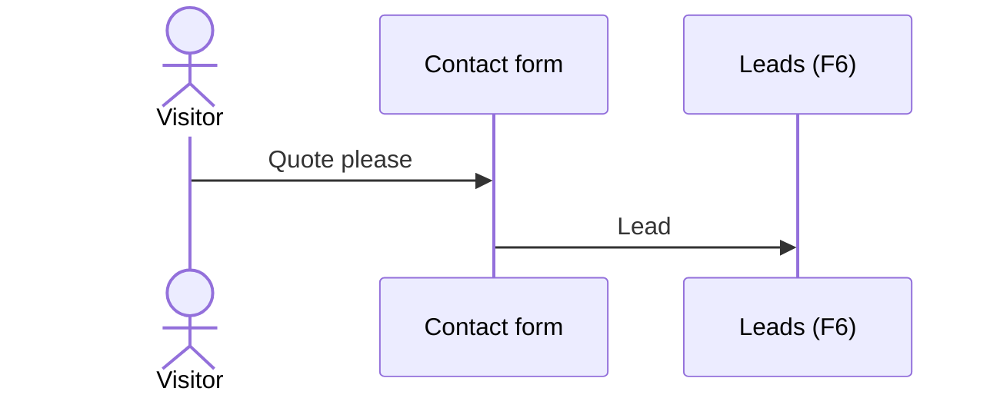

🏠 [Specs](../../../../README.md) › 🧩 [Functional capabilities](../../../README.md) ›
🌐 [F18 Hosted websites and domains (hosted edition)](../../README.md) › 📝 [Use cases](../README.md) ›
📝 [Use cases: FL-F18-01 Build the site](README.md) › 📝 UC-F18-04 Add a contact page that feeds leads

# 📝 UC-F18-04 Add a contact page that feeds leads

**Status:** ✅ specified

## Summary

Marketing adds a contact page whose form creates F6 leads, with consent and spam protection; a customer sends a message.

## Personas

- [U12 Marketing](../../../../01-users/personas/u12-marketing.md)
- [U09 Customer](../../../../01-users/personas/u09-customer.md)

## Goal

Contacts become leads.

## Trigger

The builder.

## Frequency

Once; messages daily.

## Preconditions

- F6 is on.

## Postconditions

- Success: messages become leads.
- Failure: held as spam.

## Main flow

1. Marketing adds the Contact page (S-F18-04).
2. They choose fields and consent.
3. A visitor sends a message; spam checks run (UC-F18-24).
4. A lead is created in F6.

## Alternative flows

- 3a. Held as spam: marketing releases it.

## Error flows

- 3e. Consent not ticked for marketing: lead without marketing consent.
- Any step: a service does not answer; the call is retried first (BR-F3-32), then the message follows the error pattern
  (D122) and what was typed stays on the screen.

## Business rules

- [BR-F18-02 Built from the ERP's data](../../business-rules/br-f18-02-built-from-erp-data.md)
- [BR-F18-04 Automatic checks gate publication](../../business-rules/br-f18-04-checks-gate-publication.md)
- [BR-F18-18 Forms protected without tracking](../../business-rules/br-f18-18-forms-protected-without-tracking.md)

## Entities

- [E-F18-02 Page](../../data/e-f18-02-page.md)
- [E-F18-04 Contact message](../../data/e-f18-04-contact-message.md)
- [E-F18-16 Spam hold](../../data/e-f18-16-spam-hold.md)

## Permissions

Marketing.

## Notifications

- Sales on a new lead.

## Audit events

Messages and leads.

## AI involvement

None.

## API, MCP and A2A exposure

Through T5 and T6 with the caller's rights (BR-F3-34).

## Screens

- [S-F18-04 Contact page](../../screens/01-build-the-site/s-f18-04-contact-page.md)

## Flowchart

See [FL-F18-01 Build the site](../../flows/fl-f18-01-build-the-site.md#flowchart).

## Sequence diagram

## Acceptance criteria

1. **Given** a message **when** sent **then** a lead is created.
2. **Given** spam **when** sent **then** it is held.
3. **Given** no marketing consent **when** sent **then** the lead has none.

## Non-functional notes

D408's targets ([Performance](../../../../05-non-functional/performance.md)): 95 % of screens within 1 second; lists
paged on the server, the first page within 1 second; reports within 5 seconds or in the background.

## Regulatory references

Website rules of the France country pack:
[CR-FR-069 Website legal notices](../../../../10-country-packs/france/consumer/cr-fr-069-website-legal-notices.md),
[CR-FR-070 Consent before cookies and trackers](../../../../10-country-packs/france/data-protection/cr-fr-070-cookie-consent.md),
[CR-FR-072 Accessible online shops](../../../../10-country-packs/france/consumer/cr-fr-072-web-accessibility-eaa.md),
[CR-FR-194 Rules for job offers](../../../../10-country-packs/france/labour/cr-fr-194-job-offer-rules.md),
[CR-FR-195 Candidates' personal data](../../../../10-country-packs/france/data-protection/cr-fr-195-candidate-data.md),
[CR-FR-197 Who may hold a .fr domain](../../../../10-country-packs/france/digital/cr-fr-197-fr-domain-eligibility.md),
[CR-FR-058 AI in recruitment and work is high-risk](../../../../10-country-packs/france/ai-and-recording/cr-fr-058-high-risk-ai-in-employment.md),
[CR-FR-063 Consent for email and SMS marketing](../../../../10-country-packs/france/consumer/cr-fr-063-electronic-marketing-consent.md).

## Related use cases

- [UC-F18-24 Protect forms against spam](uc-f18-24-protect-forms-against-spam.md)

## Open questions

None.

---

⬅️ [UC-F18-03 Generate pages from the ERP's data](uc-f18-03-generate-pages-from-the-erp-s-data.md) ·
⬆️ [Up](README.md) ·
➡️ [UC-F18-05 Publish a careers page from openings](../02-careers/uc-f18-05-publish-a-careers-page-from-openings.md)
