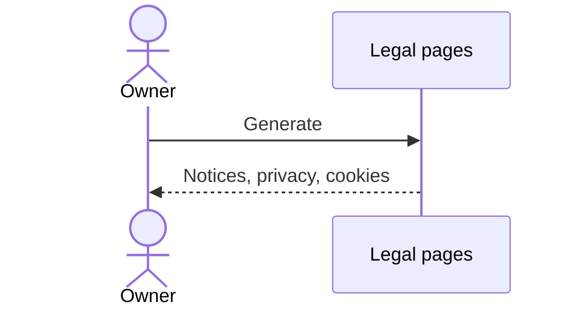

🏠 [Specs](../../../../README.md) › 🧩 [Functional capabilities](../../../README.md) ›
🌐 [F18 Hosted websites and domains (hosted edition)](../../README.md) › 📝 [Use cases](../README.md) ›
📝 [Use cases: FL-F18-01 Build the site](README.md) › 📝 UC-F18-08 Generate legal notices, privacy and cookies

# 📝 UC-F18-08 Generate legal notices, privacy and cookies

**Status:** ✅ specified

## Summary

The owner generates legal notices, privacy and cookie pages and the consent banner from the company's data and the
country pack.

## Personas

- [U13 Owner](../../../../01-users/personas/u13-owner.md)

## Goal

A lawful site.

## Trigger

The builder; a law change.

## Frequency

Rare.

## Preconditions

- Company identity.

## Postconditions

- Success: pages live.
- Failure: missing data.

## Main flow

1. The owner opens Legal pages (S-F18-08).
2. SimpleERP generates them (BR-F18-01).
3. The owner reviews.
4. They are published with the site.

## Alternative flows

- 2a. A law change: pages regenerated.

## Error flows

- 2e. Missing identifier: asked.
- Any step: a service does not answer; the call is retried first (BR-F3-32), then the message follows the error pattern
  (D122) and what was typed stays on the screen.

## Business rules

- [BR-F18-01 Sites follow the country pack](../../business-rules/br-f18-01-sites-follow-the-country-pack.md)

## Entities

- [E-F18-02 Page](../../data/e-f18-02-page.md)

## Permissions

Owner.

## Notifications

- The owner on a law change.

## Audit events

Generations.

## AI involvement

None.

## API, MCP and A2A exposure

Through T5 and T6 with the caller's rights (BR-F3-34).

## Screens

- [S-F18-08 Legal pages](../../screens/01-build-the-site/s-f18-08-legal-pages.md)

## Flowchart

See [FL-F18-01 Build the site](../../flows/fl-f18-01-build-the-site.md#flowchart).

## Sequence diagram

## Acceptance criteria

1. **Given** the company's SIREN **when** generated **then** legal notices show it.
2. **Given** no SIREN **when** generated **then** it is asked.
3. **Given** a law change **when** flagged **then** pages are regenerated.

## Non-functional notes

D408's targets ([Performance](../../../../05-non-functional/performance.md)): 95 % of screens within 1 second; lists
paged on the server, the first page within 1 second; reports within 5 seconds or in the background.

## Regulatory references

Website rules of the France country pack:
[CR-FR-069 Website legal notices](../../../../10-country-packs/france/consumer/cr-fr-069-website-legal-notices.md),
[CR-FR-070 Consent before cookies and trackers](../../../../10-country-packs/france/data-protection/cr-fr-070-cookie-consent.md),
[CR-FR-072 Accessible online shops](../../../../10-country-packs/france/consumer/cr-fr-072-web-accessibility-eaa.md),
[CR-FR-194 Rules for job offers](../../../../10-country-packs/france/labour/cr-fr-194-job-offer-rules.md),
[CR-FR-195 Candidates' personal data](../../../../10-country-packs/france/data-protection/cr-fr-195-candidate-data.md),
[CR-FR-197 Who may hold a .fr domain](../../../../10-country-packs/france/digital/cr-fr-197-fr-domain-eligibility.md),
[CR-FR-058 AI in recruitment and work is high-risk](../../../../10-country-packs/france/ai-and-recording/cr-fr-058-high-risk-ai-in-employment.md),
[CR-FR-063 Consent for email and SMS marketing](../../../../10-country-packs/france/consumer/cr-fr-063-electronic-marketing-consent.md).

## Related use cases

- [UC-F18-24 Protect forms against spam](uc-f18-24-protect-forms-against-spam.md)

## Open questions

None.

---

⬅️ [UC-F18-07 Handle one pipeline of applications](../02-careers/uc-f18-07-handle-one-pipeline-of-applications.md) ·
⬆️ [Up](README.md) ·
➡️ [UC-F18-09 Buy or transfer a domain](../03-domain-and-dns/uc-f18-09-buy-or-transfer-a-domain.md)
