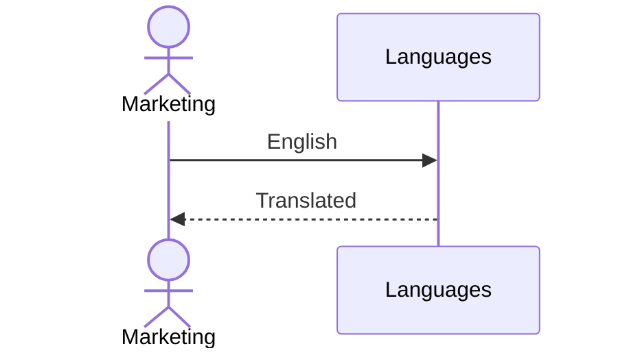

🏠 [Specs](../../../../README.md) › 🧩 [Functional capabilities](../../../README.md) ›
🌐 [F18 Hosted websites and domains (hosted edition)](../../README.md) › 📝 [Use cases](../README.md) ›
📝 [Use cases: FL-F18-01 Build the site](README.md) › 📝 UC-F18-17 Offer the site in several languages

# 📝 UC-F18-17 Offer the site in several languages

**Status:** ✅ specified

## Summary

Marketing offers the site in several languages through T10, reviews translations and publishes.

## Personas

- [U12 Marketing](../../../../01-users/personas/u12-marketing.md)

## Goal

Visitors in their language.

## Trigger

A language added.

## Frequency

Rare.

## Preconditions

- Site exists.

## Postconditions

- Success: languages live.
- Failure: draft.

## Main flow

1. Marketing opens Languages (S-F18-17).
2. They choose languages.
3. Pages are translated.
4. They review and publish.

## Alternative flows

- 3a. Machine translation marked.

## Error flows

- 3e. Missing translation: original shown.
- Any step: a service does not answer; the call is retried first (BR-F3-32), then the message follows the error pattern
  (D122) and what was typed stays on the screen.

## Business rules

- [BR-F18-01 Sites follow the country pack](../../business-rules/br-f18-01-sites-follow-the-country-pack.md)

## Entities

- [E-F18-02 Page](../../data/e-f18-02-page.md)

## Permissions

Marketing.

## Notifications

- None.

## Audit events

Languages.

## AI involvement

Translation.

## API, MCP and A2A exposure

Through T5 and T6 with the caller's rights (BR-F3-34).

## Screens

- [S-F18-17 Languages](../../screens/01-build-the-site/s-f18-17-languages.md)

## Flowchart

See [FL-F18-01 Build the site](../../flows/fl-f18-01-build-the-site.md#flowchart).

## Sequence diagram

## Acceptance criteria

1. **Given** English added **when** translated **then** pages exist.
2. **Given** a missing text **when** shown **then** original.
3. **Given** published **when** live **then** switcher shows.

## Non-functional notes

D408's targets ([Performance](../../../../05-non-functional/performance.md)): 95 % of screens within 1 second; lists
paged on the server, the first page within 1 second; reports within 5 seconds or in the background.

## Regulatory references

Website rules of the France country pack:
[CR-FR-069 Website legal notices](../../../../10-country-packs/france/consumer/cr-fr-069-website-legal-notices.md),
[CR-FR-070 Consent before cookies and trackers](../../../../10-country-packs/france/data-protection/cr-fr-070-cookie-consent.md),
[CR-FR-072 Accessible online shops](../../../../10-country-packs/france/consumer/cr-fr-072-web-accessibility-eaa.md),
[CR-FR-194 Rules for job offers](../../../../10-country-packs/france/labour/cr-fr-194-job-offer-rules.md),
[CR-FR-195 Candidates' personal data](../../../../10-country-packs/france/data-protection/cr-fr-195-candidate-data.md),
[CR-FR-197 Who may hold a .fr domain](../../../../10-country-packs/france/digital/cr-fr-197-fr-domain-eligibility.md),
[CR-FR-058 AI in recruitment and work is high-risk](../../../../10-country-packs/france/ai-and-recording/cr-fr-058-high-risk-ai-in-employment.md),
[CR-FR-063 Consent for email and SMS marketing](../../../../10-country-packs/france/consumer/cr-fr-063-electronic-marketing-consent.md).

## Related use cases

- [UC-F18-03 Generate pages from the ERP's data](uc-f18-03-generate-pages-from-the-erp-s-data.md)

## Open questions

None.

---

⬅️ [UC-F18-16 Edit the site after publication](../04-test-and-publish/uc-f18-16-edit-the-site-after-publication.md) ·
⬆️ [Up](README.md) · ➡️ [UC-F18-18](../05-run-the-site/uc-f18-18-measure-audience-and-search-ranking.md)
