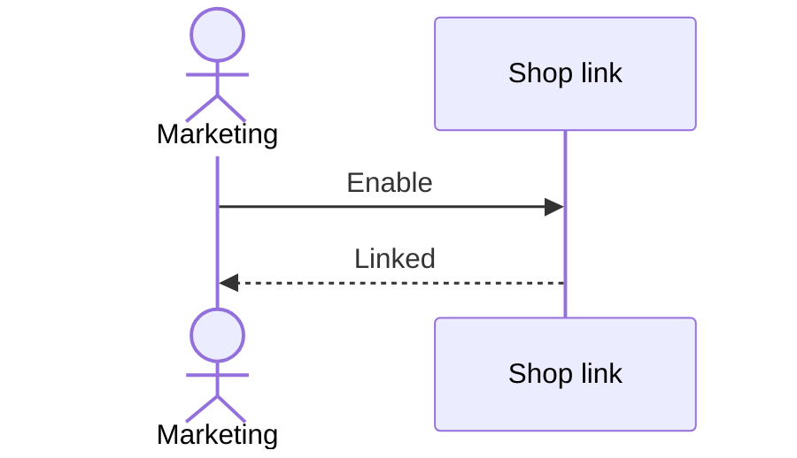

🏠 [Specs](../../../../README.md) › 🧩 [Functional capabilities](../../../README.md) ›
🌐 [F18 Hosted websites and domains (hosted edition)](../../README.md) › 📝 [Use cases](../README.md) ›
📝 [Use cases: FL-F18-01 Build the site](README.md) › 📝 UC-F18-19 Connect the online shop

# 📝 UC-F18-19 Connect the online shop

**Status:** ✅ specified

## Summary

Marketing connects F11's shop to the site's menu.

## Personas

- [U12 Marketing](../../../../01-users/personas/u12-marketing.md)

## Goal

Shop reachable from the site.

## Trigger

F11 on.

## Frequency

Once.

## Preconditions

- F11 on.

## Postconditions

- Success: linked.
- Failure: none.

## Main flow

1. Marketing opens Shop link (S-F18-19).
2. They enable it.
3. They choose the menu place.
4. They publish.

## Alternative flows

- 3a. A product block on the home page.

## Error flows

- 2e. F11 off: not offered.
- Any step: a service does not answer; the call is retried first (BR-F3-32), then the message follows the error pattern
  (D122) and what was typed stays on the screen.

## Business rules

- [BR-F18-02 Built from the ERP's data](../../business-rules/br-f18-02-built-from-erp-data.md)

## Entities

- [E-F18-02 Page](../../data/e-f18-02-page.md)

## Permissions

Marketing.

## Notifications

- None.

## Audit events

Link changes.

## AI involvement

None.

## API, MCP and A2A exposure

Through T5 and T6 with the caller's rights (BR-F3-34).

## Screens

- [S-F18-19 Shop link](../../screens/01-build-the-site/s-f18-19-shop-link.md)

## Flowchart

See [FL-F18-01 Build the site](../../flows/fl-f18-01-build-the-site.md#flowchart).

## Sequence diagram

## Acceptance criteria

1. **Given** F11 on **when** enabled **then** the menu shows Shop.
2. **Given** F11 off **when** opened **then** not offered.
3. **Given** published **when** live **then** the link works.

## Non-functional notes

D408's targets ([Performance](../../../../05-non-functional/performance.md)): 95 % of screens within 1 second; lists
paged on the server, the first page within 1 second; reports within 5 seconds or in the background.

## Regulatory references

Website rules of the France country pack:
[CR-FR-069 Website legal notices](../../../../10-country-packs/france/consumer/cr-fr-069-website-legal-notices.md),
[CR-FR-070 Consent before cookies and trackers](../../../../10-country-packs/france/data-protection/cr-fr-070-cookie-consent.md),
[CR-FR-072 Accessible online shops](../../../../10-country-packs/france/consumer/cr-fr-072-web-accessibility-eaa.md),
[CR-FR-194 Rules for job offers](../../../../10-country-packs/france/labour/cr-fr-194-job-offer-rules.md),
[CR-FR-195 Candidates' personal data](../../../../10-country-packs/france/data-protection/cr-fr-195-candidate-data.md),
[CR-FR-197 Who may hold a .fr domain](../../../../10-country-packs/france/digital/cr-fr-197-fr-domain-eligibility.md),
[CR-FR-058 AI in recruitment and work is high-risk](../../../../10-country-packs/france/ai-and-recording/cr-fr-058-high-risk-ai-in-employment.md),
[CR-FR-063 Consent for email and SMS marketing](../../../../10-country-packs/france/consumer/cr-fr-063-electronic-marketing-consent.md).

## Related use cases

- [UC-F18-01 Build the site with the guide](uc-f18-01-build-the-site-with-the-guide.md)

## Open questions

None.

---

⬅️ [UC-F18-18](../05-run-the-site/uc-f18-18-measure-audience-and-search-ranking.md) · ⬆️ [Up](README.md) ·
➡️ [UC-F18-20 Watch uptime, renewals and expiry](../05-run-the-site/uc-f18-20-watch-uptime-renewals-and-expiry.md)
