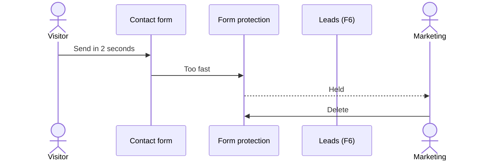

🏠 [Specs](../../../../README.md) › 🧩 [Functional capabilities](../../../README.md) ›
🌐 [F18 Hosted websites and domains (hosted edition)](../../README.md) › 📝 [Use cases](../README.md) ›
📝 [Use cases: FL-F18-01 Build the site](README.md) › 📝 UC-F18-24 Protect forms against spam

# 📝 UC-F18-24 Protect forms against spam

**Status:** ✅ specified

## Summary

Every form of the site (contact, application, booking) is protected against spam without tracking visitors; suspected
messages are kept aside for marketing to release or delete.

## Personas

- [U12 Marketing and communication](../../../../01-users/personas/u12-marketing.md)
- [U09 Customer](../../../../01-users/personas/u09-customer.md), who fills the form

## Goal

Leads without spam, and no genuine message lost.

## Trigger

A form message sent.

## Frequency

Each message; spam daily on busy sites.

## Preconditions

- The form is on the site.

## Postconditions

- Success: genuine messages become leads; spam kept aside.
- Failure: none lost: a doubtful message is kept aside.

## Main flow

1. A visitor sends the contact form.
2. SimpleERP checks it: hidden field, time to fill, rate per address, content (BR-F18-18).
3. A genuine message becomes an F6 lead (UC-F18-04).
4. A suspected one is kept on Form protection (S-F18-24) with the reason.
5. Marketing releases or deletes held messages.

## Alternative flows

- 4a. Under a repeated attack, a stronger challenge appears for that form.

## Error flows

- 5e. A released message's lead already exists: merged with it.
- Any step: a service does not answer; the call is retried first (BR-F3-32), then the message follows the error pattern
  (D122) and what was typed stays on the screen.

## Business rules

- [BR-F18-18 Forms protected without tracking](../../business-rules/br-f18-18-forms-protected-without-tracking.md)

## Entities

- [E-F18-16 Spam hold](../../data/e-f18-16-spam-hold.md)
- [E-F18-04 Contact message](../../data/e-f18-04-contact-message.md)

## Permissions

Marketing reviews held messages.

## Notifications

- Marketing daily of held messages.

## Audit events

Holds, releases, deletions.

## AI involvement

The AI assistant may score the content; it never deletes.

## API, MCP and A2A exposure

Through the API (T5) and as AI assistant tools (T6), with the caller's rights (BR-F3-34).

## Screens

- [S-F18-24 Form protection](../../screens/01-build-the-site/s-f18-24-form-protection.md)

## Flowchart

See [FL-F18-01 Build the site](../../flows/fl-f18-01-build-the-site.md#flowchart).

## Sequence diagram

## Acceptance criteria

1. **Given** a form filled in 2 seconds with the hidden field set **when** sent **then** it is held as spam.
2. **Given** 6 messages from one address in an hour and a limit of 5 **when** the 6th arrives **then** it is held.
3. **Given** a held genuine message **when** marketing releases it **then** a lead is created.
4. **Given** any visitor **when** the form loads **then** no tracking cookie is set.

## Non-functional notes

D408's targets ([Performance](../../../../05-non-functional/performance.md)): 95 % of screens within 1 second; lists
paged on the server, the first page within 1 second; reports within 5 seconds or in the background.

## Regulatory references

[CR-FR-070 Cookie consent](../../../../10-country-packs/france/data-protection/cr-fr-070-cookie-consent.md).

## Related use cases

- [UC-F18-04 Add a contact page that feeds leads](uc-f18-04-add-a-contact-page-that-feeds-leads.md)

## Open questions

None.

---

⬅️ [UC-F18-23 Create mailboxes on the domain](../03-domain-and-dns/uc-f18-23-create-mailboxes-on-the-domain.md) ·
⬆️ [Up](README.md) ·
➡️ [UC-F18-25 Use a sector page template](../06-content-and-search/uc-f18-25-use-a-sector-page-template.md)
