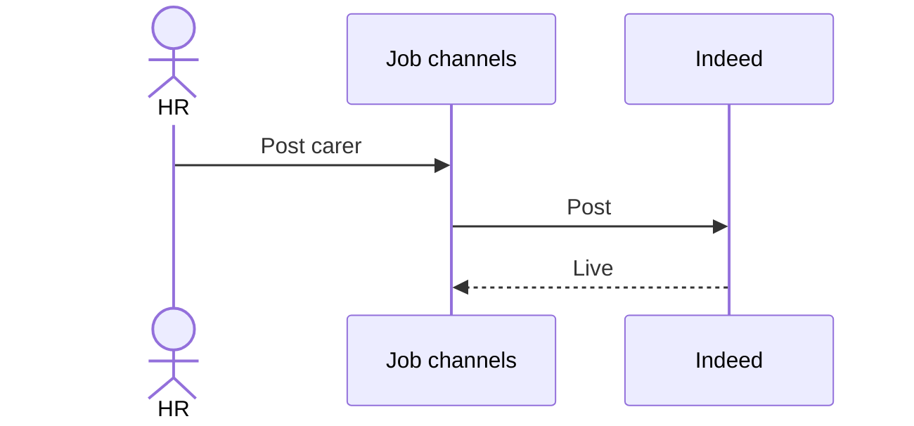

🏠 [Specs](../../../../README.md) › 🧩 [Functional capabilities](../../../README.md) ›
🌐 [F18 Hosted websites and domains (hosted edition)](../../README.md) › 📝 [Use cases](../README.md) ›
📝 [Use cases: FL-F18-02 Careers](README.md) › 📝 UC-F18-06 Post openings to LinkedIn and Indeed

# 📝 UC-F18-06 Post openings to LinkedIn and Indeed

**Status:** ✅ specified

## Summary

HR posts openings to LinkedIn and Indeed and syncs their status both ways.

## Personas

- [U06 HR](../../../../01-users/personas/u06-hr.md)

## Goal

Reach candidates where they are.

## Trigger

An opening published.

## Frequency

Monthly.

## Preconditions

- Accounts connected.

## Postconditions

- Success: postings live.
- Failure: refused.

## Main flow

1. HR opens Job channels (S-F18-06).
2. They connect the accounts.
3. They post openings.
4. Status syncs both ways.

## Alternative flows

- 3a. One channel only.

## Error flows

- 2e. Connection refused.
- Any step: a service does not answer; the call is retried first (BR-F3-32), then the message follows the error pattern
  (D122) and what was typed stays on the screen.

## Business rules

- [BR-F18-07 Job offers checked before posting](../../business-rules/br-f18-07-job-offers-checked.md)

## Entities

- [E-F18-05 Job posting](../../data/e-f18-05-job-posting.md)
- [E-F18-06 Application](../../data/e-f18-06-application.md)

## Permissions

HR.

## Notifications

- HR on errors.

## Audit events

Postings.

## AI involvement

None.

## API, MCP and A2A exposure

Through T5 and T6 with the caller's rights (BR-F3-34).

## Screens

- [S-F18-06 Job channels](../../screens/02-careers/s-f18-06-job-channels.md)

## Flowchart

See [FL-F18-02 Careers](../../flows/fl-f18-02-careers.md#flowchart).

## Sequence diagram

## Acceptance criteria

1. **Given** a carer opening **when** posted **then** it is live on Indeed.
2. **Given** closed in F9 **when** synced **then** closed on Indeed.
3. **Given** a refused connection **when** tested **then** an error shows.

## Non-functional notes

D408's targets ([Performance](../../../../05-non-functional/performance.md)): 95 % of screens within 1 second; lists
paged on the server, the first page within 1 second; reports within 5 seconds or in the background.

## Regulatory references

Website rules of the France country pack:
[CR-FR-069 Website legal notices](../../../../10-country-packs/france/consumer/cr-fr-069-website-legal-notices.md),
[CR-FR-070 Consent before cookies and trackers](../../../../10-country-packs/france/data-protection/cr-fr-070-cookie-consent.md),
[CR-FR-072 Accessible online shops](../../../../10-country-packs/france/consumer/cr-fr-072-web-accessibility-eaa.md),
[CR-FR-194 Rules for job offers](../../../../10-country-packs/france/labour/cr-fr-194-job-offer-rules.md),
[CR-FR-195 Candidates' personal data](../../../../10-country-packs/france/data-protection/cr-fr-195-candidate-data.md),
[CR-FR-197 Who may hold a .fr domain](../../../../10-country-packs/france/digital/cr-fr-197-fr-domain-eligibility.md),
[CR-FR-058 AI in recruitment and work is high-risk](../../../../10-country-packs/france/ai-and-recording/cr-fr-058-high-risk-ai-in-employment.md),
[CR-FR-063 Consent for email and SMS marketing](../../../../10-country-packs/france/consumer/cr-fr-063-electronic-marketing-consent.md).

## Related use cases

- [UC-F18-07 Handle one pipeline of applications](uc-f18-07-handle-one-pipeline-of-applications.md)

## Open questions

None.

---

⬅️ [UC-F18-05 Publish a careers page from openings](uc-f18-05-publish-a-careers-page-from-openings.md) ·
⬆️ [Up](README.md) ·
➡️ [UC-F18-07 Handle one pipeline of applications](uc-f18-07-handle-one-pipeline-of-applications.md)
