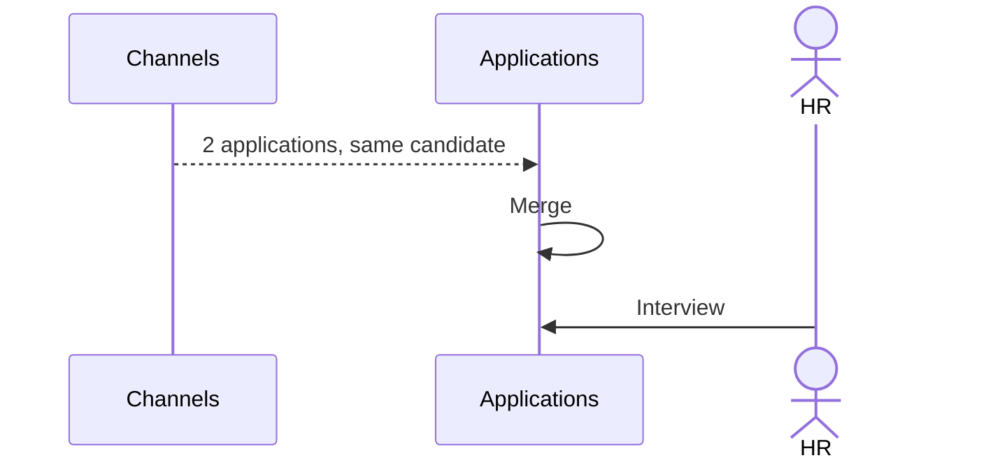

🏠 [Specs](../../../../README.md) › 🧩 [Functional capabilities](../../../README.md) ›
🌐 [F18 Hosted websites and domains (hosted edition)](../../README.md) › 📝 [Use cases](../README.md) ›
📝 [Use cases: FL-F18-02 Careers](README.md) › 📝 UC-F18-07 Handle one pipeline of applications

# 📝 UC-F18-07 Handle one pipeline of applications

**Status:** ✅ specified

## Summary

HR handles one pipeline of applications from every channel, deduplicated per candidate.

## Personas

- [U06 HR](../../../../01-users/personas/u06-hr.md)

## Goal

One view of candidates.

## Trigger

An application.

## Frequency

Daily.

## Preconditions

- Postings live.

## Postconditions

- Success: applications in F9.
- Failure: none.

## Main flow

1. Applications arrive from the site, LinkedIn and Indeed.
2. simple-ERP deduplicates per candidate and opening (BR-F18-08).
3. HR opens Applications (S-F18-07).
4. They move candidates through stages.

## Alternative flows

- 4a. Unsuccessful: erased after the period (BR-F18-09).

## Error flows

- 2e. A doubtful duplicate: HR confirms.
- Any step: a service does not answer; the call is retried first (BR-F3-32), then the message follows the error pattern
  (D122) and what was typed stays on the screen.

## Business rules

- [BR-F18-08 Applications aggregated once](../../business-rules/br-f18-08-applications-aggregated-once.md)
- [BR-F18-09 Candidates informed, data limited](../../business-rules/br-f18-09-candidates-informed-and-data-limited.md)

## Entities

- [E-F18-06 Application](../../data/e-f18-06-application.md)

## Permissions

HR and hiring managers.

## Notifications

- HR on new applications.

## Audit events

Stages.

## AI involvement

None.

## API, MCP and A2A exposure

Through T5 and T6 with the caller's rights (BR-F3-34).

## Screens

- [S-F18-07 Applications](../../screens/02-careers/s-f18-07-applications.md)

## Flowchart

See [FL-F18-02 Careers](../../flows/fl-f18-02-careers.md#flowchart).

## Sequence diagram

## Acceptance criteria

1. **Given** the same candidate on site and Indeed **when** received **then** one application shows both channels.
2. **Given** unsuccessful **when** the period ends **then** data is erased.
3. **Given** a hiring manager **when** opening **then** only their openings show.

## Non-functional notes

D408's targets ([Performance](../../../../05-non-functional/performance.md)): 95 % of screens within 1 second; lists
paged on the server, the first page within 1 second; reports within 5 seconds or in the background.

## Regulatory references

Website rules of the France country pack:
[CR-FR-069 Website legal notices](../../../../10-country-packs/france/consumer/cr-fr-069-website-legal-notices.md),
[CR-FR-070 Consent before cookies and trackers](../../../../10-country-packs/france/data-protection/cr-fr-070-cookie-consent.md),
[CR-FR-072 Accessible online shops](../../../../10-country-packs/france/consumer/cr-fr-072-web-accessibility-eaa.md),
[CR-FR-194 Rules for job offers](../../../../10-country-packs/france/labour/cr-fr-194-job-offer-rules.md),
[CR-FR-195 Candidates' personal data](../../../../10-country-packs/france/data-protection/cr-fr-195-candidate-data.md),
[CR-FR-197 Who may hold a .fr domain](../../../../10-country-packs/france/digital/cr-fr-197-fr-domain-eligibility.md),
[CR-FR-058 AI in recruitment and work is high-risk](../../../../10-country-packs/france/ai-and-recording/cr-fr-058-high-risk-ai-in-employment.md),
[CR-FR-063 Consent for email and SMS marketing](../../../../10-country-packs/france/consumer/cr-fr-063-electronic-marketing-consent.md).

## Related use cases

- [UC-F18-05 Publish a careers page from openings](uc-f18-05-publish-a-careers-page-from-openings.md)

## Open questions

None.

---

⬅️ [UC-F18-06 Post openings to LinkedIn and Indeed](uc-f18-06-post-openings-to-linkedin-and-indeed.md) ·
⬆️ [Up](README.md) · ➡️ [UC-F18-08](../01-build-the-site/uc-f18-08-generate-legal-notices-privacy-and-cookies.md)
