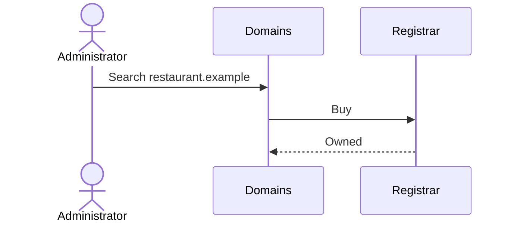

🏠 [Specs](../../../../README.md) › 🧩 [Functional capabilities](../../../README.md) ›
🌐 [F18 Hosted websites and domains (hosted edition)](../../README.md) › 📝 [Use cases](../README.md) ›
📝 [Use cases: FL-F18-03 Domain and DNS](README.md) › 📝 UC-F18-09 Buy or transfer a domain

# 📝 UC-F18-09 Buy or transfer a domain

**Status:** ✅ specified

## Summary

The owner or the administrator searches, buys or transfers a domain through a registrar's API in the company's name.

## Personas

- [U13 Owner](../../../../01-users/personas/u13-owner.md)
- [U07 Administrator](../../../../01-users/personas/u07-administrator.md)

## Goal

The company owns its domain.

## Trigger

A new site.

## Frequency

Rare.

## Preconditions

- Eligible contact.

## Postconditions

- Success: domain owned.
- Failure: refused.

## Main flow

1. The administrator opens Domains (S-F18-09) and searches.
2. They buy or transfer through the registrar (BR-F18-10).
3. The owner approves the cost.
4. Ownership is confirmed.

## Alternative flows

- 2a. Transfer with an authorisation code.

## Error flows

- 2e. Not eligible (.fr rules): refused.
- Any step: a service does not answer; the call is retried first (BR-F3-32), then the message follows the error pattern
  (D122) and what was typed stays on the screen.

## Business rules

- [BR-F18-10 Domains through registrar APIs](../../business-rules/br-f18-10-domains-through-registrar-apis.md)

## Entities

- [E-F18-07 Domain](../../data/e-f18-07-domain.md)

## Permissions

Administrator; owner approves.

## Notifications

- The owner on renewals.

## Audit events

Purchases.

## AI involvement

None.

## API, MCP and A2A exposure

Through T5 and T6 with the caller's rights (BR-F3-34).

## Screens

- [S-F18-09 Domains](../../screens/03-domain-and-dns/s-f18-09-domains.md)

## Flowchart

See [FL-F18-03 Domain and DNS](../../flows/fl-f18-03-domain-and-dns.md#flowchart).

## Sequence diagram

## Acceptance criteria

1. **Given** a free name **when** bought **then** it is in the company's name.
2. **Given** not eligible **when** bought **then** refused.
3. **Given** a transfer code **when** transferred **then** it moves.

## Non-functional notes

D408's targets ([Performance](../../../../05-non-functional/performance.md)): 95 % of screens within 1 second; lists
paged on the server, the first page within 1 second; reports within 5 seconds or in the background.

## Regulatory references

Website rules of the France country pack:
[CR-FR-069 Website legal notices](../../../../10-country-packs/france/consumer/cr-fr-069-website-legal-notices.md),
[CR-FR-070 Consent before cookies and trackers](../../../../10-country-packs/france/data-protection/cr-fr-070-cookie-consent.md),
[CR-FR-072 Accessible online shops](../../../../10-country-packs/france/consumer/cr-fr-072-web-accessibility-eaa.md),
[CR-FR-194 Rules for job offers](../../../../10-country-packs/france/labour/cr-fr-194-job-offer-rules.md),
[CR-FR-195 Candidates' personal data](../../../../10-country-packs/france/data-protection/cr-fr-195-candidate-data.md),
[CR-FR-197 Who may hold a .fr domain](../../../../10-country-packs/france/digital/cr-fr-197-fr-domain-eligibility.md),
[CR-FR-058 AI in recruitment and work is high-risk](../../../../10-country-packs/france/ai-and-recording/cr-fr-058-high-risk-ai-in-employment.md),
[CR-FR-063 Consent for email and SMS marketing](../../../../10-country-packs/france/consumer/cr-fr-063-electronic-marketing-consent.md).

## Related use cases

- [UC-F18-10 Connect an existing domain](uc-f18-10-connect-an-existing-domain.md)

## Open questions

None.

---

⬅️ [UC-F18-08](../01-build-the-site/uc-f18-08-generate-legal-notices-privacy-and-cookies.md) · ⬆️ [Up](README.md) ·
➡️ [UC-F18-10 Connect an existing domain](uc-f18-10-connect-an-existing-domain.md)
