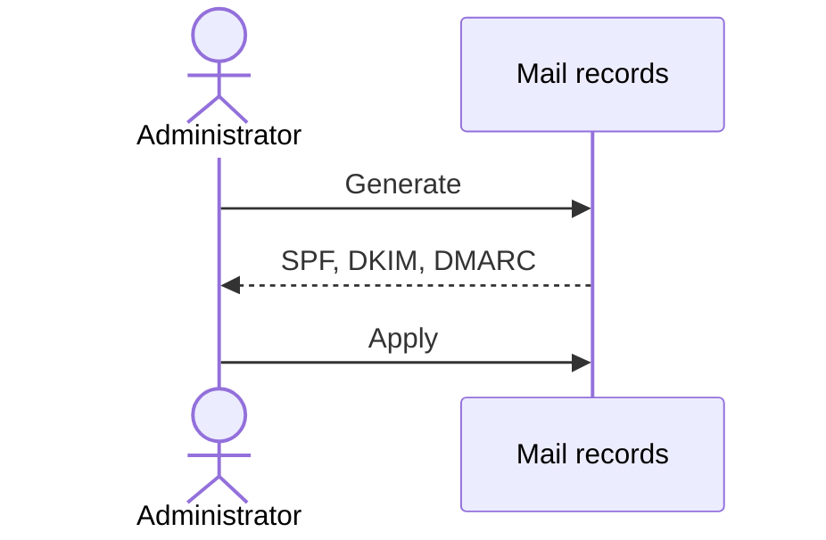

🏠 [Specs](../../../../README.md) › 🧩 [Functional capabilities](../../../README.md) ›
🌐 [F18 Hosted websites and domains (hosted edition)](../../README.md) › 📝 [Use cases](../README.md) ›
📝 [Use cases: FL-F18-03 Domain and DNS](README.md) › 📝 UC-F18-12 Set mail records SPF, DKIM and DMARC

# 📝 UC-F18-12 Set mail records SPF, DKIM and DMARC

**Status:** ✅ specified

## Summary

The administrator sets SPF, DKIM and DMARC so that the ERP's and the mailboxes' emails are delivered, checked weekly.

## Personas

- [U07 Administrator](../../../../01-users/personas/u07-administrator.md)

## Goal

Mail delivered.

## Trigger

Domain connected.

## Frequency

Once, weekly checks.

## Preconditions

- Domain connected.

## Postconditions

- Success: records valid.
- Failure: broken records alert.

## Main flow

1. The administrator opens Mail records (S-F18-12).
2. SimpleERP generates the records (BR-F18-12).
3. They apply.
4. Weekly checks run.

## Alternative flows

- 2a. Mailboxes on the domain (UC-F18-23).

## Error flows

- 4e. Broken: alert.
- Any step: a service does not answer; the call is retried first (BR-F3-32), then the message follows the error pattern
  (D122) and what was typed stays on the screen.

## Business rules

- [BR-F18-12 Mail records for delivery](../../business-rules/br-f18-12-mail-records-for-delivery.md)

## Entities

- [E-F18-08 DNS record](../../data/e-f18-08-dns-record.md)

## Permissions

Administrator.

## Notifications

- On broken records.

## Audit events

Changes.

## AI involvement

None.

## API, MCP and A2A exposure

Through T5 and T6 with the caller's rights (BR-F3-34).

## Screens

- [S-F18-12 Mail records](../../screens/03-domain-and-dns/s-f18-12-mail-records.md)

## Flowchart

See [FL-F18-03 Domain and DNS](../../flows/fl-f18-03-domain-and-dns.md#flowchart).

## Sequence diagram

## Acceptance criteria

1. **Given** records applied **when** checked **then** valid.
2. **Given** broken **when** checked **then** alert.
3. **Given** mailboxes **when** created **then** delivered.

## Non-functional notes

D408's targets ([Performance](../../../../05-non-functional/performance.md)): 95 % of screens within 1 second; lists
paged on the server, the first page within 1 second; reports within 5 seconds or in the background.

## Regulatory references

Website rules of the France country pack:
[CR-FR-069 Website legal notices](../../../../10-country-packs/france/consumer/cr-fr-069-website-legal-notices.md),
[CR-FR-070 Consent before cookies and trackers](../../../../10-country-packs/france/data-protection/cr-fr-070-cookie-consent.md),
[CR-FR-072 Accessible online shops](../../../../10-country-packs/france/consumer/cr-fr-072-web-accessibility-eaa.md),
[CR-FR-194 Rules for job offers](../../../../10-country-packs/france/labour/cr-fr-194-job-offer-rules.md),
[CR-FR-195 Candidates' personal data](../../../../10-country-packs/france/data-protection/cr-fr-195-candidate-data.md),
[CR-FR-197 Who may hold a .fr domain](../../../../10-country-packs/france/digital/cr-fr-197-fr-domain-eligibility.md),
[CR-FR-058 AI in recruitment and work is high-risk](../../../../10-country-packs/france/ai-and-recording/cr-fr-058-high-risk-ai-in-employment.md),
[CR-FR-063 Consent for email and SMS marketing](../../../../10-country-packs/france/consumer/cr-fr-063-electronic-marketing-consent.md).

## Related use cases

- [UC-F18-23 Create mailboxes on the domain](uc-f18-23-create-mailboxes-on-the-domain.md)

## Open questions

None.

---

⬅️ [UC-F18-11 Manage the DNS zone and certificates](uc-f18-11-manage-the-dns-zone-and-certificates.md) ·
⬆️ [Up](README.md) ·
➡️ [UC-F18-13 Review the private preview](../04-test-and-publish/uc-f18-13-review-the-private-preview.md)
