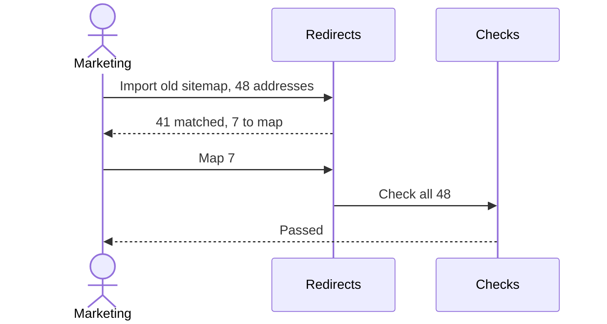

🏠 [Specs](../../../../README.md) › 🧩 [Functional capabilities](../../../README.md) ›
🌐 [F18 Hosted websites and domains (hosted edition)](../../README.md) › 📝 [Use cases](../README.md) ›
📝 [Use cases: FL-F18-03 Domain and DNS](README.md) › 📝 UC-F18-22 Redirect the old site's addresses

# 📝 UC-F18-22 Redirect the old site's addresses

**Status:** 🔄 waiting for the owner

## Summary

When the new site replaces an old one on the same domain, marketing imports the old addresses, maps each to its new page
and checks that none answers "not found" after publication.

## Personas

- [U12 Marketing and communication](../../../../01-users/personas/u12-marketing.md)
- [U07 Administrator](../../../../01-users/personas/u07-administrator.md), who connects the domain

## Goal

Search ranking and old links kept when the site is replaced.

## Trigger

An existing domain connected with an old site (UC-F18-10); a page moved.

## Frequency

Once at the move; a few later.

## Preconditions

- The old addresses are known (sitemap or list).

## Postconditions

- Success: every old address redirected.
- Failure: publication waits until the missing ones are mapped.

## Main flow

1. Marketing opens Redirects (S-F18-22) and imports the old site's sitemap or a list.
2. simple-ERP proposes a new page for each old address by its words.
3. Marketing confirms or changes each target (BR-F18-16).
4. The checks verify every old address redirects, with no loop.
5. At publication, the redirects go live with the site.

## Alternative flows

- 3a. An address with no equivalent: the home page, flagged; or "gone" on purpose.

## Error flows

- 4e. An old address without a target: publication waits.
- 3e. A loop: refused.
- Any step: a service does not answer; the call is retried first (BR-F3-32), then the message follows the error pattern
  (D122) and what was typed stays on the screen.

## Business rules

- [BR-F18-16 Every old address redirects](../../business-rules/br-f18-16-every-old-address-redirects.md)

## Entities

- [E-F18-14 Redirect](../../data/e-f18-14-redirect.md)

## Permissions

Marketing maps; the owner publishes.

## Notifications

- Marketing (Proposed) weekly of old addresses still receiving visits after 6 months.

## Audit events

Redirects added, changed, removed.

## AI involvement

The AI assistant proposes targets by meaning; marketing confirms.

## API, MCP and A2A exposure

Through the API (T5) and as AI assistant tools (T6), with the caller's rights (BR-F3-34).

## Screens

- [S-F18-22 Redirects](../../screens/03-domain-and-dns/s-f18-22-redirects.md)

## Flowchart

See [FL-F18-03 Domain and DNS](../../flows/fl-f18-03-domain-and-dns.md#flowchart).

## Sequence diagram

## Acceptance criteria

1. **Given** 48 old addresses **when** imported **then** 41 targets are proposed and 7 listed to map.
2. **Given** /nos-services mapped to /services **when** published **then** the old address redirects permanently.
3. **Given** one old address left without target **when** checked **then** publication waits.
4. **Given** a redirect from /a to /b and /b to /a **when** saved **then** it is refused.

## Non-functional notes

D408's targets ([Performance](../../../../05-non-functional/performance.md)): 95 % of screens within 1 second; lists
paged on the server, the first page within 1 second; reports within 5 seconds or in the background.

## Regulatory references

None.

## Related use cases

- [UC-F18-10 Connect an existing domain](uc-f18-10-connect-an-existing-domain.md)
- [UC-F18-26 Set the search-engine basics](../06-content-and-search/uc-f18-26-set-the-search-engine-basics.md)

## Open questions

None.

---

⬅️ [UC-F18-21 Publish a blog fed by F5 posts](../06-content-and-search/uc-f18-21-publish-a-blog-fed-by-f5-posts.md) ·
⬆️ [Up](README.md) · ➡️ [UC-F18-23 Create mailboxes on the domain](uc-f18-23-create-mailboxes-on-the-domain.md)
