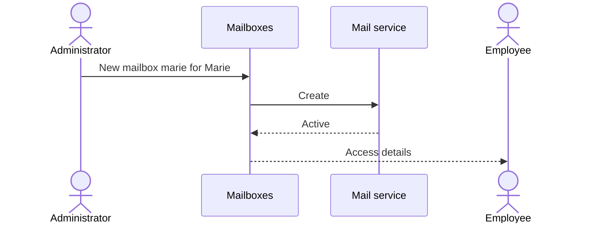

🏠 [Specs](../../../../README.md) › 🧩 [Functional capabilities](../../../README.md) ›
🌐 [F18 Hosted websites and domains (hosted edition)](../../README.md) › 📝 [Use cases](../README.md) ›
📝 [Use cases: FL-F18-03 Domain and DNS](README.md) › 📝 UC-F18-23 Create mailboxes on the domain

# 📝 UC-F18-23 Create mailboxes on the domain

**Status:** ✅ specified

## Summary

The administrator creates mailboxes and shared addresses on the company's domain for named users, which follow their
lifecycle in F1 and close with an export at offboarding.

## Personas

- [U07 Administrator](../../../../01-users/personas/u07-administrator.md)
- [U01 Employee](../../../../01-users/personas/u01-employee.md), who uses the mailbox

## Goal

Professional addresses on the company's domain for the team.

## Trigger

A user invited (UC-F1-03) or a shared address needed.

## Frequency

At each hire; a few shared addresses.

## Preconditions

- The domain is connected with its mail records (UC-F18-12).

## Postconditions

- Success: mailboxes active; mail delivered.
- Failure: not created.

## Main flow

1. The administrator opens Mailboxes (S-F18-23) and chooses "New mailbox".
2. They pick the user (or role members for a shared address) and the address.
3. SimpleERP creates the mailbox and checks the mail records.
4. The user receives the access details and reads mail in their usual mail app.
5. When the user is offboarded in F1, the mailbox is closed and its mail exported (BR-F18-17).

## Alternative flows

- 2a. A forward only: mail to the address goes to another mailbox.
- 5a. The owner keeps the address as a forward for a time.

## Error flows

- 2e. The address exists: refused.
- 3e. Mail records broken: the mailbox waits until fixed (UC-F18-12).
- Any step: a service does not answer; the call is retried first (BR-F3-32), then the message follows the error pattern
  (D122) and what was typed stays on the screen.

## Business rules

- [BR-F18-17 Mailboxes for named users, closed at offboarding](../../business-rules/br-f18-17-mailboxes-for-named-users-closed-at-offboarding.md)
- [BR-F18-12 Mail records for delivery](../../business-rules/br-f18-12-mail-records-for-delivery.md)

## Entities

- [E-F18-15 Mailbox](../../data/e-f18-15-mailbox.md)

## Permissions

Administrator; the owner approves shared addresses.

## Notifications

- The user with the access details; the administrator when a mailbox nears its size.

## Audit events

Mailboxes created, changed, closed, exported.

## AI involvement

None.

## API, MCP and A2A exposure

Through the API (T5) and as AI assistant tools (T6), with the caller's rights (BR-F3-34).

## Screens

- [S-F18-23 Mailboxes](../../screens/03-domain-and-dns/s-f18-23-mailboxes.md)

## Flowchart

See [FL-F18-03 Domain and DNS](../../flows/fl-f18-03-domain-and-dns.md#flowchart).

## Sequence diagram

## Acceptance criteria

1. **Given** Marie invited in F1 **when** the administrator creates marie@ on the domain **then** mail to it is
   delivered to her.
2. **Given** contact@ shared by 3 users **when** created **then** the 3 receive its mail.
3. **Given** Marie offboarded **when** F1 offboards her **then** the mailbox closes and its mail is exported.
4. **Given** marie@ already exists **when** created **then** it is refused.

## Non-functional notes

D408's targets ([Performance](../../../../05-non-functional/performance.md)): 95 % of screens within 1 second; lists
paged on the server, the first page within 1 second; reports within 5 seconds or in the background.

## Regulatory references

[CR-FR-052 Storage limitation](../../../../10-country-packs/france/data-protection/cr-fr-052-storage-limitation.md).

## Related use cases

- [UC-F18-12 Set mail records SPF, DKIM and DMARC](uc-f18-12-set-mail-records-spf-dkim-and-dmarc.md)
- [UC-F18-10 Connect an existing domain](uc-f18-10-connect-an-existing-domain.md)

## Open questions

None.

---

⬅️ [UC-F18-22 Redirect the old site's addresses](uc-f18-22-redirect-the-old-sites-addresses.md) · ⬆️ [Up](README.md) ·
➡️ [UC-F18-24 Protect forms against spam](../01-build-the-site/uc-f18-24-protect-forms-against-spam.md)
