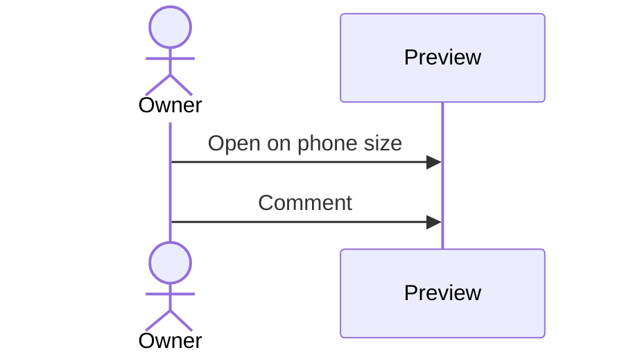

🏠 [Specs](../../../../README.md) › 🧩 [Functional capabilities](../../../README.md) ›
🌐 [F18 Hosted websites and domains (hosted edition)](../../README.md) › 📝 [Use cases](../README.md) ›
📝 [Use cases: FL-F18-04 Test and publish](README.md) › 📝 UC-F18-13 Review the private preview

# 📝 UC-F18-13 Review the private preview

**Status:** ✅ specified

## Summary

The owner and marketing review the private preview on phone and desktop sizes and comment.

## Personas

- [U13 Owner](../../../../01-users/personas/u13-owner.md)
- [U12 Marketing](../../../../01-users/personas/u12-marketing.md)

## Goal

See the site before it is live.

## Trigger

Changes ready.

## Frequency

Each change.

## Preconditions

- Changes on the preview.

## Postconditions

- Success: comments addressed.
- Failure: none.

## Main flow

1. They open Preview (S-F18-13).
2. They check phone and desktop sizes.
3. They comment on elements.
4. Marketing addresses comments.

## Alternative flows

- 3a. Share a private link.

## Error flows

- 1e. Nothing changed: said.
- Any step: a service does not answer; the call is retried first (BR-F3-32), then the message follows the error pattern
  (D122) and what was typed stays on the screen.

## Business rules

- [BR-F18-03 Private preview first](../../business-rules/br-f18-03-preview-before-publication.md)

## Entities

- [E-F18-01 Hosted website](../../data/e-f18-01-hosted-website.md)

## Permissions

Owner and marketing.

## Notifications

- Marketing on comments.

## Audit events

Comments.

## AI involvement

None.

## API, MCP and A2A exposure

Through T5 and T6 with the caller's rights (BR-F3-34).

## Screens

- [S-F18-13 Preview](../../screens/04-test-and-publish/s-f18-13-preview.md)

## Flowchart

See [FL-F18-04 Test and publish](../../flows/fl-f18-04-test-and-publish.md#flowchart).

## Sequence diagram

## Acceptance criteria

1. **Given** a preview **when** opened **then** both sizes show.
2. **Given** a comment **when** saved **then** marketing is told.
3. **Given** no change **when** opened **then** it says so.

## Non-functional notes

D408's targets ([Performance](../../../../05-non-functional/performance.md)): 95 % of screens within 1 second; lists
paged on the server, the first page within 1 second; reports within 5 seconds or in the background.

## Regulatory references

Website rules of the France country pack:
[CR-FR-069 Website legal notices](../../../../10-country-packs/france/consumer/cr-fr-069-website-legal-notices.md),
[CR-FR-070 Consent before cookies and trackers](../../../../10-country-packs/france/data-protection/cr-fr-070-cookie-consent.md),
[CR-FR-072 Accessible online shops](../../../../10-country-packs/france/consumer/cr-fr-072-web-accessibility-eaa.md),
[CR-FR-194 Rules for job offers](../../../../10-country-packs/france/labour/cr-fr-194-job-offer-rules.md),
[CR-FR-195 Candidates' personal data](../../../../10-country-packs/france/data-protection/cr-fr-195-candidate-data.md),
[CR-FR-197 Who may hold a .fr domain](../../../../10-country-packs/france/digital/cr-fr-197-fr-domain-eligibility.md),
[CR-FR-058 AI in recruitment and work is high-risk](../../../../10-country-packs/france/ai-and-recording/cr-fr-058-high-risk-ai-in-employment.md),
[CR-FR-063 Consent for email and SMS marketing](../../../../10-country-packs/france/consumer/cr-fr-063-electronic-marketing-consent.md).

## Related use cases

- [UC-F18-14 Run the automatic checks](uc-f18-14-run-the-automatic-checks.md)

## Open questions

None.

---

⬅️ [UC-F18-12](../03-domain-and-dns/uc-f18-12-set-mail-records-spf-dkim-and-dmarc.md) · ⬆️ [Up](README.md) ·
➡️ [UC-F18-14 Run the automatic checks](uc-f18-14-run-the-automatic-checks.md)
