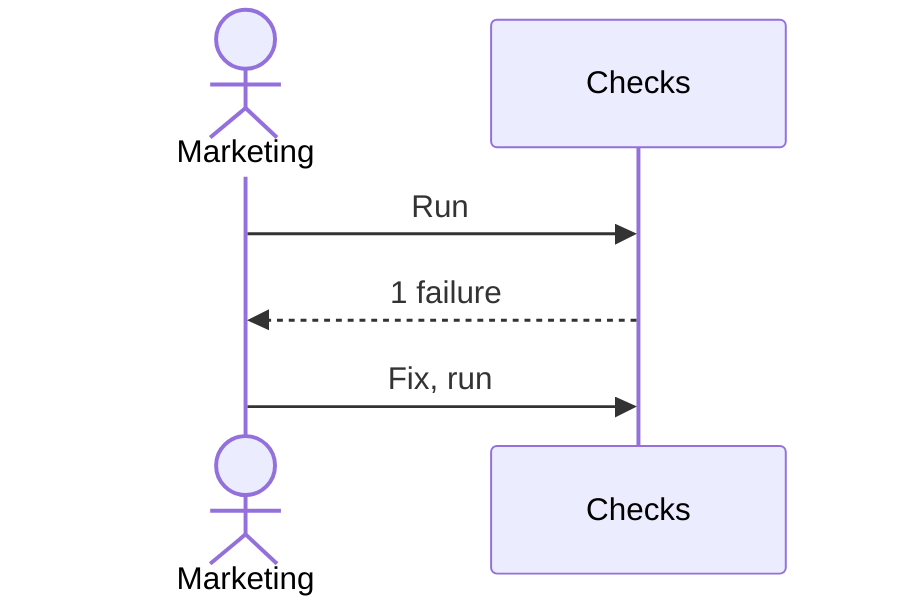

🏠 [Specs](../../../../README.md) › 🧩 [Functional capabilities](../../../README.md) ›
🌐 [F18 Hosted websites and domains (hosted edition)](../../README.md) › 📝 [Use cases](../README.md) ›
📝 [Use cases: FL-F18-04 Test and publish](README.md) › 📝 UC-F18-14 Run the automatic checks

# 📝 UC-F18-14 Run the automatic checks

**Status:** ✅ specified

## Summary

Marketing and the hosting engineer run the automatic checks, read the report and fix failures, including redirects and
search basics.

## Personas

- [U12 Marketing](../../../../01-users/personas/u12-marketing.md)
- [U48 Hosting engineer](../../../../01-users/personas/u48-hosting-engineer.md)

## Goal

Nothing broken goes live.

## Trigger

Before publishing.

## Frequency

Each publication.

## Preconditions

- Preview ready.

## Postconditions

- Success: passed.
- Failure: publication waits.

## Main flow

1. Marketing opens Checks (S-F18-14) and runs them.
2. simple-ERP checks links, forms, accessibility, speed, legal, DNS, redirects and structured data (BR-F18-04).
3. They read the report.
4. They fix failures.

## Alternative flows

- 2a. Warnings only: pass.

## Error flows

- 2e. A failure: publication waits.
- Any step: a service does not answer; the call is retried first (BR-F3-32), then the message follows the error pattern
  (D122) and what was typed stays on the screen.

## Business rules

- [BR-F18-04 Automatic checks gate publication](../../business-rules/br-f18-04-checks-gate-publication.md)
- [BR-F18-16 Every old address redirects](../../business-rules/br-f18-16-every-old-address-redirects.md)
- [BR-F18-20 Search basics from public data only](../../business-rules/br-f18-20-search-basics-from-public-data-only.md)

## Entities

- [E-F18-10 Publication check report](../../data/e-f18-10-publication-check-report.md)

## Permissions

Marketing; hosting engineer supports.

## Notifications

- The publisher on failures.

## Audit events

Runs.

## AI involvement

None.

## API, MCP and A2A exposure

Through T5 and T6 with the caller's rights (BR-F3-34).

## Screens

- [S-F18-14 Checks](../../screens/04-test-and-publish/s-f18-14-checks.md)

## Flowchart

See [FL-F18-04 Test and publish](../../flows/fl-f18-04-test-and-publish.md#flowchart).

## Sequence diagram

## Acceptance criteria

1. **Given** a broken link **when** checked **then** failure.
2. **Given** an old address without redirect **when** checked **then** failure.
3. **Given** all fixed **when** run **then** passed.

## Non-functional notes

D408's targets ([Performance](../../../../05-non-functional/performance.md)): 95 % of screens within 1 second; lists
paged on the server, the first page within 1 second; reports within 5 seconds or in the background.

## Regulatory references

Website rules of the France country pack:
[CR-FR-069 Website legal notices](../../../../10-country-packs/france/consumer/cr-fr-069-website-legal-notices.md),
[CR-FR-070 Consent before cookies and trackers](../../../../10-country-packs/france/data-protection/cr-fr-070-cookie-consent.md),
[CR-FR-072 Accessible online shops](../../../../10-country-packs/france/consumer/cr-fr-072-web-accessibility-eaa.md),
[CR-FR-194 Rules for job offers](../../../../10-country-packs/france/labour/cr-fr-194-job-offer-rules.md),
[CR-FR-195 Candidates' personal data](../../../../10-country-packs/france/data-protection/cr-fr-195-candidate-data.md),
[CR-FR-197 Who may hold a .fr domain](../../../../10-country-packs/france/digital/cr-fr-197-fr-domain-eligibility.md),
[CR-FR-058 AI in recruitment and work is high-risk](../../../../10-country-packs/france/ai-and-recording/cr-fr-058-high-risk-ai-in-employment.md),
[CR-FR-063 Consent for email and SMS marketing](../../../../10-country-packs/france/consumer/cr-fr-063-electronic-marketing-consent.md).

## Related use cases

- [UC-F18-15 Approve, publish and roll back](uc-f18-15-approve-publish-and-roll-back.md)

## Open questions

None.

---

⬅️ [UC-F18-13 Review the private preview](uc-f18-13-review-the-private-preview.md) · ⬆️ [Up](README.md) ·
➡️ [UC-F18-15 Approve, publish and roll back](uc-f18-15-approve-publish-and-roll-back.md)
