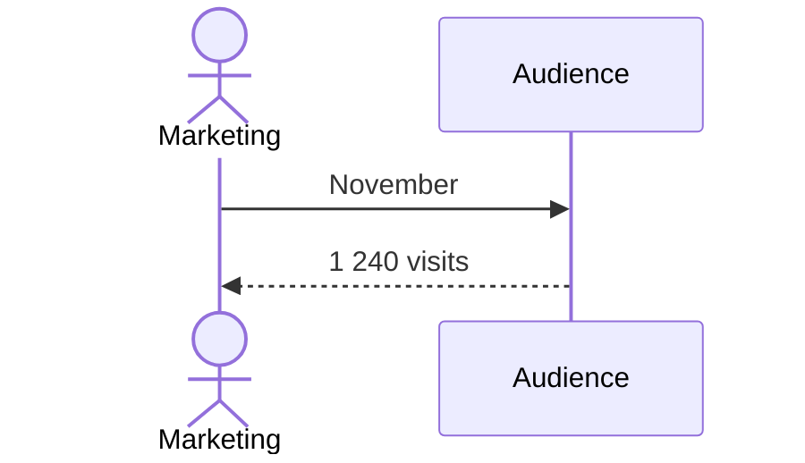

🏠 [Specs](../../../../README.md) › 🧩 [Functional capabilities](../../../README.md) ›
🌐 [F18 Hosted websites and domains (hosted edition)](../../README.md) › 📝 [Use cases](../README.md) ›
📝 [Use cases: FL-F18-05 Run the site](README.md) › 📝 UC-F18-18 Measure audience and search ranking

# 📝 UC-F18-18 Measure audience and search ranking

**Status:** ✅ specified

## Summary

Marketing measures audience with consent and search ranking, reads advice and acts.

## Personas

- [U12 Marketing](../../../../01-users/personas/u12-marketing.md)

## Goal

Know if the site works.

## Trigger

Monthly.

## Frequency

Monthly.

## Preconditions

- Site live.

## Postconditions

- Success: figures read.
- Failure: none.

## Main flow

1. Marketing opens Audience (S-F18-18).
2. They see visits within consent (BR-F18-14).
3. They read search ranking and advice.
4. They act (UC-F18-26).

## Alternative flows

- 2a. No consent: counts only.

## Error flows

- 2e. No data: said.
- Any step: a service does not answer; the call is retried first (BR-F3-32), then the message follows the error pattern
  (D122) and what was typed stays on the screen.

## Business rules

- [BR-F18-14 Analytics only with consent](../../business-rules/br-f18-14-analytics-only-with-consent.md)

## Entities

- [E-F18-11 Audience figure](../../data/e-f18-11-audience-figure.md)

## Permissions

Marketing.

## Notifications

- None.

## Audit events

None.

## AI involvement

Advice.

## API, MCP and A2A exposure

Through T5 and T6 with the caller's rights (BR-F3-34).

## Screens

- [S-F18-18 Audience](../../screens/05-run-the-site/s-f18-18-audience.md)

## Flowchart

See [FL-F18-05 Run the site](../../flows/fl-f18-05-run-the-site.md#flowchart).

## Sequence diagram

## Acceptance criteria

1. **Given** 1 240 visits **when** opened **then** shown.
2. **Given** no consent **when** measured **then** nothing tracked.
3. **Given** advice **when** read **then** linked to search basics.

## Non-functional notes

D408's targets ([Performance](../../../../05-non-functional/performance.md)): 95 % of screens within 1 second; lists
paged on the server, the first page within 1 second; reports within 5 seconds or in the background.

## Regulatory references

Website rules of the France country pack:
[CR-FR-069 Website legal notices](../../../../10-country-packs/france/consumer/cr-fr-069-website-legal-notices.md),
[CR-FR-070 Consent before cookies and trackers](../../../../10-country-packs/france/data-protection/cr-fr-070-cookie-consent.md),
[CR-FR-072 Accessible online shops](../../../../10-country-packs/france/consumer/cr-fr-072-web-accessibility-eaa.md),
[CR-FR-194 Rules for job offers](../../../../10-country-packs/france/labour/cr-fr-194-job-offer-rules.md),
[CR-FR-195 Candidates' personal data](../../../../10-country-packs/france/data-protection/cr-fr-195-candidate-data.md),
[CR-FR-197 Who may hold a .fr domain](../../../../10-country-packs/france/digital/cr-fr-197-fr-domain-eligibility.md),
[CR-FR-058 AI in recruitment and work is high-risk](../../../../10-country-packs/france/ai-and-recording/cr-fr-058-high-risk-ai-in-employment.md),
[CR-FR-063 Consent for email and SMS marketing](../../../../10-country-packs/france/consumer/cr-fr-063-electronic-marketing-consent.md).

## Related use cases

- [UC-F18-26 Set the search-engine basics](../06-content-and-search/uc-f18-26-set-the-search-engine-basics.md)

## Open questions

None.

---

⬅️ [UC-F18-17](../01-build-the-site/uc-f18-17-offer-the-site-in-several-languages.md) · ⬆️ [Up](README.md) ·
➡️ [UC-F18-19 Connect the online shop](../01-build-the-site/uc-f18-19-connect-the-online-shop.md)
