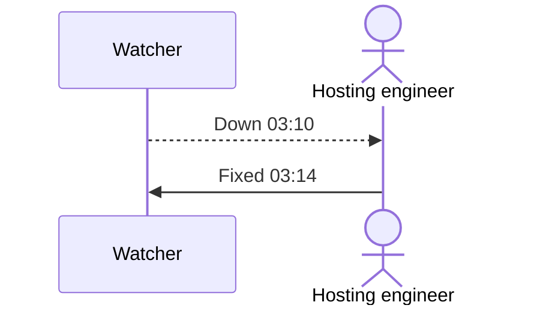

🏠 [Specs](../../../../README.md) › 🧩 [Functional capabilities](../../../README.md) ›
🌐 [F18 Hosted websites and domains (hosted edition)](../../README.md) › 📝 [Use cases](../README.md) ›
📝 [Use cases: FL-F18-05 Run the site](README.md) › 📝 UC-F18-20 Watch uptime, renewals and expiry

# 📝 UC-F18-20 Watch uptime, renewals and expiry

**Status:** ✅ specified

## Summary

The hosting engineer and the administrator watch uptime, domain renewals and certificate expiry, are alerted and fix.

## Personas

- [U48 Hosting engineer](../../../../01-users/personas/u48-hosting-engineer.md)
- [U07 Administrator](../../../../01-users/personas/u07-administrator.md)

## Goal

The site always up.

## Trigger

Continuous.

## Frequency

Continuous.

## Preconditions

- Site live.

## Postconditions

- Success: issues fixed.
- Failure: alerts.

## Main flow

1. simple-ERP watches uptime, renewals, certificates.
2. An issue alerts (BR-F18-13).
3. The engineer opens Site health (S-F18-20).
4. They fix or restore (UC-F18-27).

## Alternative flows

- 4a. Renewal paid automatically.

## Error flows

- 2e. Down: alert at once.
- Any step: a service does not answer; the call is retried first (BR-F3-32), then the message follows the error pattern
  (D122) and what was typed stays on the screen.

## Business rules

- [BR-F18-13 Certificates renewed early](../../business-rules/br-f18-13-certificates-renewed-early.md)
- [BR-F18-10 Domains through registrar APIs](../../business-rules/br-f18-10-domains-through-registrar-apis.md)

## Entities

- [E-F18-07 Domain](../../data/e-f18-07-domain.md)
- [E-F18-09 TLS certificate](../../data/e-f18-09-tls-certificate.md)
- [E-F18-12 Uptime event](../../data/e-f18-12-uptime-event.md)

## Permissions

Hosting engineer and administrator.

## Notifications

- On issues.

## Audit events

Events.

## AI involvement

None.

## API, MCP and A2A exposure

Through T5 and T6 with the caller's rights (BR-F3-34).

## Screens

- [S-F18-20 Site health](../../screens/05-run-the-site/s-f18-20-site-health.md)

## Flowchart

See [FL-F18-05 Run the site](../../flows/fl-f18-05-run-the-site.md#flowchart).

## Sequence diagram

## Acceptance criteria

1. **Given** down at 03:10 **when** detected **then** alert.
2. **Given** a certificate 30 days from expiry **when** checked **then** renewed.
3. **Given** a domain renewal **when** due **then** paid.

## Non-functional notes

D408's targets ([Performance](../../../../05-non-functional/performance.md)): 95 % of screens within 1 second; lists
paged on the server, the first page within 1 second; reports within 5 seconds or in the background.

## Regulatory references

Website rules of the France country pack:
[CR-FR-069 Website legal notices](../../../../10-country-packs/france/consumer/cr-fr-069-website-legal-notices.md),
[CR-FR-070 Consent before cookies and trackers](../../../../10-country-packs/france/data-protection/cr-fr-070-cookie-consent.md),
[CR-FR-072 Accessible online shops](../../../../10-country-packs/france/consumer/cr-fr-072-web-accessibility-eaa.md),
[CR-FR-194 Rules for job offers](../../../../10-country-packs/france/labour/cr-fr-194-job-offer-rules.md),
[CR-FR-195 Candidates' personal data](../../../../10-country-packs/france/data-protection/cr-fr-195-candidate-data.md),
[CR-FR-197 Who may hold a .fr domain](../../../../10-country-packs/france/digital/cr-fr-197-fr-domain-eligibility.md),
[CR-FR-058 AI in recruitment and work is high-risk](../../../../10-country-packs/france/ai-and-recording/cr-fr-058-high-risk-ai-in-employment.md),
[CR-FR-063 Consent for email and SMS marketing](../../../../10-country-packs/france/consumer/cr-fr-063-electronic-marketing-consent.md).

## Related use cases

- [UC-F18-27 Back up and restore the site](uc-f18-27-back-up-and-restore-the-site.md)

## Open questions

None.

---

⬅️ [UC-F18-19 Connect the online shop](../01-build-the-site/uc-f18-19-connect-the-online-shop.md) · ⬆️ [Up](README.md) ·
➡️ [UC-F18-21 Publish a blog fed by F5 posts](../06-content-and-search/uc-f18-21-publish-a-blog-fed-by-f5-posts.md)
