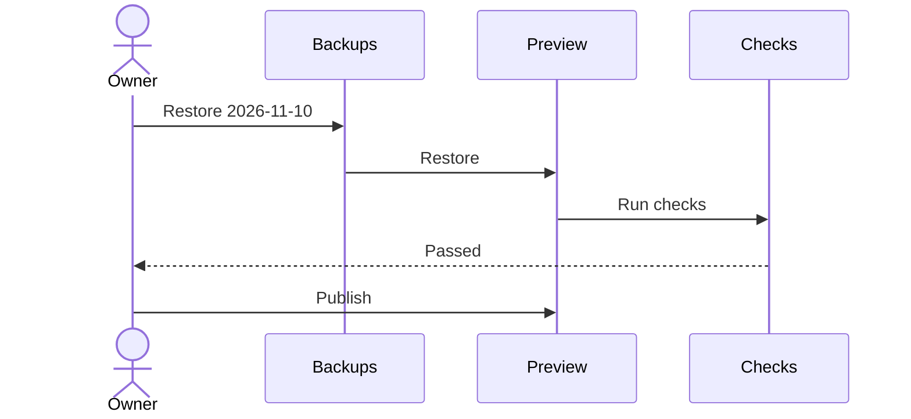

🏠 [Specs](../../../../README.md) › 🧩 [Functional capabilities](../../../README.md) ›
🌐 [F18 Hosted websites and domains (hosted edition)](../../README.md) › 📝 [Use cases](../README.md) ›
📝 [Use cases: FL-F18-05 Run the site](README.md) › 📝 UC-F18-27 Back up and restore the site

# 📝 UC-F18-27 Back up and restore the site

**Status:** ✅ specified

## Summary

The site is backed up daily; the owner or the hosting engineer restores a backup to the private preview, then publishes
it after the checks.

## Personas

- [U13 Owner](../../../../01-users/personas/u13-owner.md)
- [U48 Hosting engineer](../../../../01-users/personas/u48-hosting-engineer.md), who helps restore

## Goal

A broken or lost site back within minutes.

## Trigger

A bad publication noticed late; a request to go back.

## Frequency

Daily backups; restores rare.

## Preconditions

- Backups exist.

## Postconditions

- Success: the backup's version live after the checks.
- Failure: the live site unchanged.

## Main flow

1. SimpleERP backs up the site daily (BR-F18-21).
2. The owner opens Backups (S-F18-27) and chooses a date.
3. SimpleERP restores it to the private preview.
4. The checks run on the restored version.
5. The owner publishes it.

## Alternative flows

- 2a. Roll back to the previous publication (UC-F18-15) when it is recent.

## Error flows

- 3e. The backup has expired: not offered.
- 2e. A restore straight to the live site: refused.
- Any step: a service does not answer; the call is retried first (BR-F3-32), then the message follows the error pattern
  (D122) and what was typed stays on the screen.

## Business rules

- [BR-F18-21 Sites backed up daily, restored to the preview](../../business-rules/br-f18-21-sites-backed-up-daily-restored-to-the-preview.md)
- [BR-F18-03 Private preview first](../../business-rules/br-f18-03-preview-before-publication.md)

## Entities

- [E-F18-19 Site backup](../../data/e-f18-19-site-backup.md)

## Permissions

Owner restores; the hosting engineer helps on request.

## Notifications

- The owner and marketing when a restore is published.

## Audit events

Backups, restores, publications.

## AI involvement

None.

## API, MCP and A2A exposure

Through the API (T5) and as AI assistant tools (T6), with the caller's rights (BR-F3-34).

## Screens

- [S-F18-27 Backups](../../screens/05-run-the-site/s-f18-27-backups.md)

## Flowchart

See [FL-F18-05 Run the site](../../flows/fl-f18-05-run-the-site.md#flowchart).

## Sequence diagram

## Acceptance criteria

1. **Given** a backup of 2026-11-10 **when** restored **then** the preview shows it and the live site is unchanged.
2. **Given** the checks pass **when** the owner publishes **then** the live site is the restored version.
3. **Given** a backup of 45 days **when** restoring **then** it is not offered.

## Non-functional notes

D408's targets ([Performance](../../../../05-non-functional/performance.md)): 95 % of screens within 1 second; lists
paged on the server, the first page within 1 second; reports within 5 seconds or in the background.

## Regulatory references

None.

## Related use cases

- [UC-F18-15 Approve, publish and roll back](../04-test-and-publish/uc-f18-15-approve-publish-and-roll-back.md)
- [UC-F18-20 Watch uptime, renewals and expiry](uc-f18-20-watch-uptime-renewals-and-expiry.md)

## Open questions

None.

---

⬅️ [UC-F18-26 Set the search-engine basics](../06-content-and-search/uc-f18-26-set-the-search-engine-basics.md) ·
⬆️ [Up](README.md) ·
➡️ [UC-F18-28 A/B test a page](../07-tests-visitors-and-accessibility/uc-f18-28-a-b-test-a-page.md)
