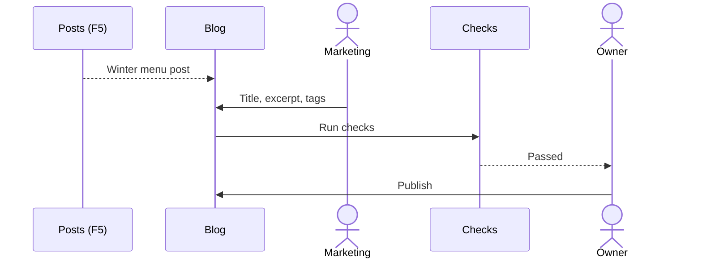

🏠 [Specs](../../../../README.md) › 🧩 [Functional capabilities](../../../README.md) ›
🌐 [F18 Hosted websites and domains (hosted edition)](../../README.md) › 📝 [Use cases](../README.md) ›
📝 [Use cases: FL-F18-06 Content and search](README.md) › 📝 UC-F18-21 Publish a blog fed by F5 posts

# 📝 UC-F18-21 Publish a blog fed by F5 posts

**Status:** ✅ specified

## Summary

Marketing turns the posts published in F5 into blog articles on the site's preview, keeps their AI label, and publishes
them with the next publication.

## Personas

- [U12 Marketing and communication](../../../../01-users/personas/u12-marketing.md)

## Goal

Fresh content on the site without writing twice.

## Trigger

A post published in F5 on a channel that feeds the blog.

## Frequency

A few posts a month.

## Preconditions

- The site exists; the blog page is on.

## Postconditions

- Success: articles live after publication.
- Failure: articles stay in the preview.

## Main flow

1. Marketing publishes a post in F5; it appears as a blog article on the preview (S-F18-21) (BR-F18-15).
2. Marketing adjusts the title, the excerpt and the tags.
3. The sitemap and structured data are regenerated (BR-F18-20).
4. The checks run (UC-F18-14).
5. The owner or a granted role publishes; the article is live.

## Alternative flows

- 1a. Marketing writes an article directly in the blog.

## Error flows

- 4e. An image without alternative text: the accessibility check fails.
- 1e. The post is deleted in F5: the article is removed at the next publication.
- Any step: a service does not answer; the call is retried first (BR-F3-32), then the message follows the error pattern
  (D122) and what was typed stays on the screen.

## Business rules

- [BR-F18-15 Blog articles come from F5 posts](../../business-rules/br-f18-15-blog-articles-come-from-f5-posts.md)
- [BR-F18-20 Search basics from public data only](../../business-rules/br-f18-20-search-basics-from-public-data-only.md)

## Entities

- [E-F18-13 Blog article](../../data/e-f18-13-blog-article.md)

## Permissions

Marketing edits; the owner or a granted role publishes.

## Notifications

- Marketing when a post becomes a draft article.

## Audit events

Articles created, changed, published, removed.

## AI involvement

The AI assistant may suggest titles and excerpts; AI-written text keeps its label.

## API, MCP and A2A exposure

Through the API (T5) and as AI assistant tools (T6), with the caller's rights (BR-F3-34).

## Screens

- [S-F18-21 Blog](../../screens/06-content-and-search/s-f18-21-blog.md)

## Flowchart

See [FL-F18-06 Content and search](../../flows/fl-f18-06-content-and-search.md#flowchart).

## Sequence diagram

## Acceptance criteria

1. **Given** the post "Winter menu" published in F5 on 2026-11-12 **when** it arrives **then** a blog article is on the
   preview with its date.
2. **Given** a post written with AI help **when** shown **then** the article says so.
3. **Given** an image without alternative text **when** checked **then** publication waits.
4. **Given** the post deleted in F5 **when** the site is next published **then** the article is gone.

## Non-functional notes

D408's targets ([Performance](../../../../05-non-functional/performance.md)): 95 % of screens within 1 second; lists
paged on the server, the first page within 1 second; reports within 5 seconds or in the background.

## Regulatory references

[CR-FR-056 People know they deal with an AI](../../../../10-country-packs/france/ai-and-recording/cr-fr-056-people-know-they-deal-with-an-ai.md).

## Related use cases

- [UC-F18-26 Set the search-engine basics](uc-f18-26-set-the-search-engine-basics.md)
- [UC-F18-15 Approve, publish and roll back](../04-test-and-publish/uc-f18-15-approve-publish-and-roll-back.md)

## Open questions

None.

---

⬅️ [UC-F18-20 Watch uptime, renewals and expiry](../05-run-the-site/uc-f18-20-watch-uptime-renewals-and-expiry.md) ·
⬆️ [Up](README.md) ·
➡️ [UC-F18-22 Redirect the old site's addresses](../03-domain-and-dns/uc-f18-22-redirect-the-old-sites-addresses.md)
