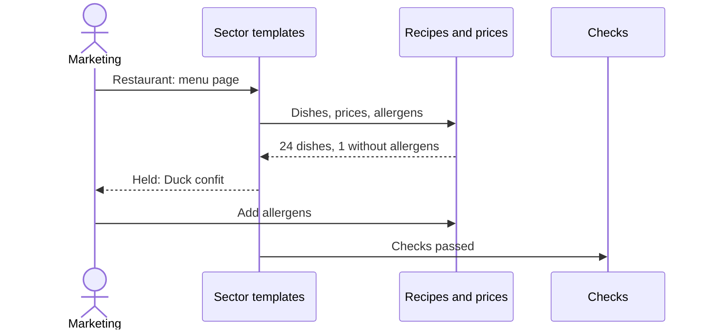

🏠 [Specs](../../../../README.md) › 🧩 [Functional capabilities](../../../README.md) ›
🌐 [F18 Hosted websites and domains (hosted edition)](../../README.md) › 📝 [Use cases](../README.md) ›
📝 [Use cases: FL-F18-06 Content and search](README.md) › 📝 UC-F18-25 Use a sector page template

# 📝 UC-F18-25 Use a sector page template

**Status:** ✅ specified

## Summary

The owner or marketing adds the pages of the sector's template (a menu with allergens for a restaurant, fees for a
health practice, property listings for an agency), filled from the ERP with the information the law requires.

## Personas

- [U13 Owner](../../../../01-users/personas/u13-owner.md)
- [U12 Marketing and communication](../../../../01-users/personas/u12-marketing.md)

## Goal

Sector pages ready and lawful without designing them.

## Trigger

A sector pack installed; a page to add.

## Frequency

Once, then updated with the data.

## Preconditions

- The sector pack is installed and its data exists in the ERP.

## Postconditions

- Success: sector pages on the preview, complete.
- Failure: pages held with the missing items.

## Main flow

1. Marketing opens Sector templates (S-F18-25); the templates of the company's sector show.
2. They choose pages: menu, opening hours, booking for a restaurant.
3. SimpleERP fills them from the ERP: dishes with prices and allergens.
4. SimpleERP checks the mandatory information (BR-F18-19).
5. The pages go through the checks and the owner publishes.

## Alternative flows

- 2a. A health practice: fee display from the practice's settings (CR-FR-130).
- 2b. A real-estate agency: listings with energy class and diagnostics (CR-FR-144).

## Error flows

- 4e. A dish without allergens: the menu page is held and the dish listed.
- Any step: a service does not answer; the call is retried first (BR-F3-32), then the message follows the error pattern
  (D122) and what was typed stays on the screen.

## Business rules

- [BR-F18-19 Sector templates carry the sector's mandatory information](../../business-rules/br-f18-19-sector-templates-carry-the-sectors-mandatory-information.md)
- [BR-F18-02 Built from the ERP's data](../../business-rules/br-f18-02-built-from-erp-data.md)

## Entities

- [E-F18-17 Sector template](../../data/e-f18-17-sector-template.md)
- [E-F18-02 Page](../../data/e-f18-02-page.md)

## Permissions

Owner and marketing.

## Notifications

- Marketing when a page is held for missing information.

## Audit events

Template pages added, held, published.

## AI involvement

The AI assistant may write the page's introduction text.

## API, MCP and A2A exposure

Through the API (T5) and as AI assistant tools (T6), with the caller's rights (BR-F3-34).

## Screens

- [S-F18-25 Sector templates](../../screens/06-content-and-search/s-f18-25-sector-templates.md)

## Flowchart

See [FL-F18-06 Content and search](../../flows/fl-f18-06-content-and-search.md#flowchart).

## Sequence diagram

## Acceptance criteria

1. **Given** the restaurant example company with 24 dishes **when** the menu page is added **then** each dish shows its
   price and allergens.
2. **Given** one dish without allergens **when** checked **then** the page is held and the dish listed.
3. **Given** the health-practice template **when** added **then** fees show as the country pack requires.
4. **Given** a listing without energy class **when** checked **then** it is held.

## Non-functional notes

D408's targets ([Performance](../../../../05-non-functional/performance.md)): 95 % of screens within 1 second; lists
paged on the server, the first page within 1 second; reports within 5 seconds or in the background.

## Regulatory references

[CR-FR-107](../../../../10-country-packs/france/consumer/cr-fr-107-allergen-information.md),
[CR-FR-130](../../../../10-country-packs/france/health-practice/cr-fr-130-fee-display.md),
[CR-FR-144](../../../../10-country-packs/france/real-estate/cr-fr-144-property-diagnostics.md),
[CR-FR-143](../../../../10-country-packs/france/real-estate/cr-fr-143-rent-caps-and-energy-rules.md).

## Related use cases

- [UC-F18-03 Generate pages from the ERP's data](../01-build-the-site/uc-f18-03-generate-pages-from-the-erp-s-data.md)
- [UC-F18-26 Set the search-engine basics](uc-f18-26-set-the-search-engine-basics.md)

## Open questions

None.

---

⬅️ [UC-F18-24 Protect forms against spam](../01-build-the-site/uc-f18-24-protect-forms-against-spam.md) ·
⬆️ [Up](README.md) · ➡️ [UC-F18-26 Set the search-engine basics](uc-f18-26-set-the-search-engine-basics.md)
