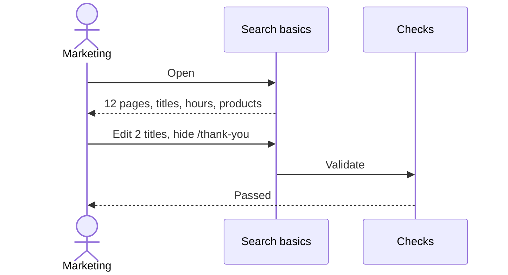

🏠 [Specs](../../../../README.md) › 🧩 [Functional capabilities](../../../README.md) ›
🌐 [F18 Hosted websites and domains (hosted edition)](../../README.md) › 📝 [Use cases](../README.md) ›
📝 [Use cases: FL-F18-06 Content and search](README.md) › 📝 UC-F18-26 Set the search-engine basics

# 📝 UC-F18-26 Set the search-engine basics

**Status:** ✅ specified

## Summary

Marketing reviews the sitemap, page titles and descriptions and the structured data SimpleERP generates from the ERP's
public data, and they are regenerated at each publication.

## Personas

- [U12 Marketing and communication](../../../../01-users/personas/u12-marketing.md)

## Goal

The site found by search engines with correct, current information.

## Trigger

Each publication; a page added.

## Frequency

At each publication; a review a quarter.

## Preconditions

- The site has pages.

## Postconditions

- Success: sitemap and structured data valid and live.
- Failure: the check fails and publication waits.

## Main flow

1. Marketing opens Search basics (S-F18-26).
2. SimpleERP shows the generated titles, descriptions and structured data per page (BR-F18-20).
3. Marketing edits titles and descriptions, and marks pages "not indexed".
4. The checks validate the sitemap and structured data.
5. At publication they are regenerated and submitted.

## Alternative flows

- 3a. The AI assistant proposes titles from the page content.

## Error flows

- 4e. Structured data invalid: the check fails with the field.
- 3e. A title above the length: warned.
- Any step: a service does not answer; the call is retried first (BR-F3-32), then the message follows the error pattern
  (D122) and what was typed stays on the screen.

## Business rules

- [BR-F18-20 Search basics from public data only](../../business-rules/br-f18-20-search-basics-from-public-data-only.md)

## Entities

- [E-F18-18 Search settings](../../data/e-f18-18-search-settings.md)

## Permissions

Marketing.

## Notifications

- None.

## Audit events

Edits.

## AI involvement

The AI assistant proposes titles and descriptions.

## API, MCP and A2A exposure

Through the API (T5) and as AI assistant tools (T6), with the caller's rights (BR-F3-34).

## Screens

- [S-F18-26 Search basics](../../screens/06-content-and-search/s-f18-26-search-basics.md)

## Flowchart

See [FL-F18-06 Content and search](../../flows/fl-f18-06-content-and-search.md#flowchart).

## Sequence diagram

## Acceptance criteria

1. **Given** the restaurant's opening hours in F1 **when** generated **then** they are in the structured data.
2. **Given** /thank-you marked "not indexed" **when** the sitemap is built **then** it is left out.
3. **Given** invalid structured data **when** checked **then** publication waits.
4. **Given** a cost price in the ERP **when** generated **then** it never appears.

## Non-functional notes

D408's targets ([Performance](../../../../05-non-functional/performance.md)): 95 % of screens within 1 second; lists
paged on the server, the first page within 1 second; reports within 5 seconds or in the background.

## Regulatory references

None.

## Related use cases

- [UC-F18-18 Measure audience and search ranking](../05-run-the-site/uc-f18-18-measure-audience-and-search-ranking.md)
- [UC-F18-21 Publish a blog fed by F5 posts](uc-f18-21-publish-a-blog-fed-by-f5-posts.md)

## Open questions

None.

---

⬅️ [UC-F18-25 Use a sector page template](uc-f18-25-use-a-sector-page-template.md) · ⬆️ [Up](README.md) ·
➡️ [UC-F18-27 Back up and restore the site](../05-run-the-site/uc-f18-27-back-up-and-restore-the-site.md)
