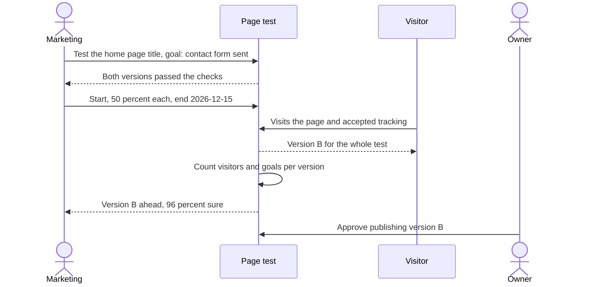

🏠 [Specs](../../../../README.md) › 🧩 [Functional capabilities](../../../README.md) ›
🌐 [F18 Hosted websites and domains (hosted edition)](../../README.md) › 📝 [Use cases](../README.md) ›
📝 [Use cases: FL-F18-07 A/B tests, visitors, accessibility and members](README.md) › 📝 UC-F18-28 A/B test a page

# 📝 UC-F18-28 A/B test a page

**Status:** ✅ specified

## Summary

The marketing person tests two versions of a page of the hosted site (a title, a picture, a button, a price block)
against each other. Visitors who accepted tracking are split between the versions, the page counts the goal each one
reaches (a contact form sent, a click on a button), and the test ends by itself when one version is clearly better or at
its end date.

## Personas

- [U12 Marketing and communication](../../../../01-users/personas/u12-marketing.md)

## Goal

The company changes a page because the figures show a better version, not because of an opinion, and never publishes the
winner without the customer's yes.

## Trigger

The marketing person wants to improve a page's results and creates a test from the page.

## Frequency

A few tests a quarter; one test runs for two to four weeks.

## Preconditions

- The site is published and its page exists ([E-F18-01 Hosted website](../../data/e-f18-01-hosted-website.md),
  [E-F18-02 Page](../../data/e-f18-02-page.md)).
- Visitor measurement is on and the consent banner is live
  ([UC-F18-18](../05-run-the-site/uc-f18-18-measure-audience-and-search-ranking.md),
  [BR-F18-14](../../business-rules/br-f18-14-analytics-only-with-consent.md)).
- The page gets enough visitors for the goal to be measured (simple-ERP shows the days needed).

## Postconditions

- **Succeeded:** the test is saved ([E-F18-20 Page test](../../data/e-f18-20-page-test.md)) with its two versions, its
  goal, its split and its dates; at the end the winner or the absence of a winner is recorded and, if the owner
  approves, the winner is published.
- **Failed:** the test is not started: the screen lists what is missing (a second version, a goal, a preview that passed
  the checks).

## Main flow

1. The marketing person opens the page test screen
   ([S-F18-28](../../screens/07-tests-visitors-and-accessibility/s-f18-28-page-ab-test.md)) and picks a page, then edits
   a second version of it in the builder.
2. The marketing person chooses the goal (a form sent, a click, a visit to a next page), the share of visitors who see
   the new version, and the end date.
3. simple-ERP shows the private preview of both versions and runs the automatic checks on each
   ([UC-F18-13](../04-test-and-publish/uc-f18-13-review-the-private-preview.md),
   [UC-F18-14](../04-test-and-publish/uc-f18-14-run-the-automatic-checks.md)).
4. The marketing person starts the test; simple-ERP shows each consenting visitor one version for the whole test and
   counts visitors and goals per version.
5. simple-ERP shows each day the visitors, the goals, the rate of each version and how sure the difference is; a visitor
   who refused tracking sees the original and is not counted.
6. The test ends at significance or at its end date
   ([BR-F18-22](../../business-rules/br-f18-22-tests-end-at-significance-or-their-end-date.md)); the owner approves
   publishing the winner ([UC-F18-15](../04-test-and-publish/uc-f18-15-approve-publish-and-roll-back.md)) or keeps the
   original.

## Alternative flows

- 2a. The marketing person sets a minimum number of visitors per version: the test cannot end before it.
- 5a. A version breaks the page (a check fails or the goal stops being reached): the marketing person stops the test and
  every visitor sees the original again.
- 6a. No version is clearly better at the end date: the test ends without a winner and the original stays.

## Error flows

- 3e. A version fails the automatic checks: the test cannot start until it passes.
- 4e. Another test already runs on the same page: the second test is refused.
- 5e. Measurement is switched off during the test: the test is paused and says why.
- Any step: a service does not answer; the call is retried first
  ([BR-F3-32](../../../f03-assistant/business-rules/br-f03-32-retry-before-an-error.md)), then the message follows the
  error pattern ([D122](../../../../06-decisions/ux/d122-error-message-standard.md)) and what the user typed stays on
  the screen.

## Business rules

- [BR-F18-22](../../business-rules/br-f18-22-tests-end-at-significance-or-their-end-date.md)
- [BR-F18-03 Private preview first](../../business-rules/br-f18-03-preview-before-publication.md)
- [BR-F18-04](../../business-rules/br-f18-04-checks-gate-publication.md)
- [BR-F18-05](../../business-rules/br-f18-05-customer-approves-rollback-kept.md)
- [BR-F18-14](../../business-rules/br-f18-14-analytics-only-with-consent.md)

## Entities

- [E-F18-20 Page test](../../data/e-f18-20-page-test.md): created, changed, ended
- [E-F18-02 Page](../../data/e-f18-02-page.md): read, the page tested
- [E-F18-10 Publication check report](../../data/e-f18-10-publication-check-report.md): read, the checks of each version
- [E-F18-11 Audience figure](../../data/e-f18-11-audience-figure.md): read, the visitors of the page
- [E-F5-16 A/B test](../../../f05-social-media/data/e-f05-16-a-b-test.md): read, the post, email and SMS tests kept
  apart

## Permissions

Marketing creates, starts and stops tests. The owner or an administrator approves publishing the winner.
Sales reads the results.

## Notifications

The marketing person, in the app: a test ended, or was paused. The owner, on a phone: a winner waiting for approval.

## Audit events

Each test created, started, paused, stopped or ended; each version edited; the figures at the end; the approval or
refusal of the winner, with who and when.

## AI involvement

No AI step of its own. The AI assistant may open the screen and prefill it from the user's words; the user checks and
confirms ([BR-F3-07](../../../f03-assistant/business-rules/br-f03-07-no-deletes-no-irreversible-acts.md)).

## API, MCP and A2A exposure

T5 operations of the capability for the personas above: create, read, update and list. The MCP tool of the
capability may read and propose, never confirm alone. No A2A skill.

## Screens

- [S-F18-28](../../screens/07-tests-visitors-and-accessibility/s-f18-28-page-ab-test.md)

## Flowchart

See
[FL-F18-07 A/B tests, visitors, accessibility and members](../../flows/fl-f18-07-tests-visitors-and-accessibility.md#flowchart).

## Sequence diagram

## Acceptance criteria

1. **Given** a page with a second version that passed the checks **when** the marketing person starts the test **then**
   the consenting visitors are split by the chosen share and see the same version all along.
2. **Given** a visitor who refused tracking **when** the page is shown **then** the original is shown and the visit is
   not counted.
3. **Given** a test whose end date is reached with no clear winner **when** the date comes **then** the test ends with
   no winner and the original stays.
4. **Given** a winner at significance **when** the test ends **then** nothing is published until the owner approves.

## Non-functional notes

The screen answers within 2 seconds for 10,000 records; every change is audited.

## Regulatory references

A test that remembers which version a visitor saw needs the visitor's consent to the storing of that choice
on their device ([CR-FR-070](../../../../10-country-packs/france/data-protection/cr-fr-070-cookie-consent.md)); visitors
who refuse see the original and are not counted. The test measures pages, never individual people.

## Related use cases

- [UC-F18-29 Track known visitors for sales](uc-f18-29-track-known-visitors-for-sales.md)
- [UC-F18-14](../04-test-and-publish/uc-f18-14-run-the-automatic-checks.md)
- [UC-F18-15](../04-test-and-publish/uc-f18-15-approve-publish-and-roll-back.md)
- [UC-F18-18](../05-run-the-site/uc-f18-18-measure-audience-and-search-ranking.md)
- [UC-F18-29 Track known visitors for sales](uc-f18-29-track-known-visitors-for-sales.md)
- [UC-F5-22](../../../f05-social-media/use-cases/09-brand-tests-and-return-on-investment/uc-f05-22-a-b-test-posts-emails-and-sms.md)

## Open questions

None.

---

⬅️ [UC-F18-27 Back up and restore the site](../05-run-the-site/uc-f18-27-back-up-and-restore-the-site.md) ·
⬆️ [Up](README.md) · ➡️ [UC-F18-29 Track known visitors for sales](uc-f18-29-track-known-visitors-for-sales.md)
