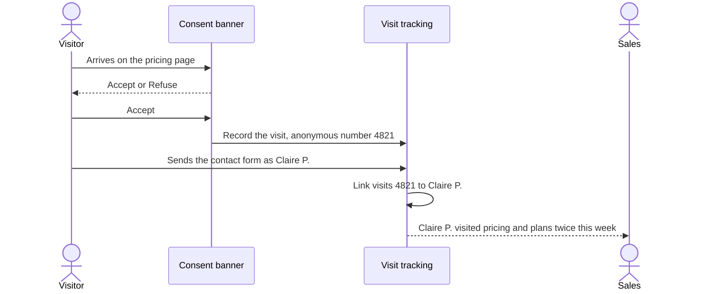

🏠 [Specs](../../../../README.md) › 🧩 [Functional capabilities](../../../README.md) ›
🌐 [F18 Hosted websites and domains (hosted edition)](../../README.md) › 📝 [Use cases](../README.md) ›
📝 [Use cases: FL-F18-07 A/B tests, visitors, accessibility and members](README.md) ›
📝 UC-F18-29 Track known visitors for sales

# 📝 UC-F18-29 Track known visitors for sales

**Status:** ✅ specified

## Summary

Sales sees which known contacts visit the company's site: a visitor who accepted tracking and then sent a form or
followed a personalised link is linked to their contact record, and sales reads the pages they looked at and when, to
time a call. A visitor who refused tracking leaves no trace.

## Personas

- [U03 Sales](../../../../01-users/personas/u03-sales.md)
- [U12 Marketing and communication](../../../../01-users/personas/u12-marketing.md)

## Goal

Sales calls a known contact when they show interest, using only the visits the visitor agreed to be recorded, and
marketing can see which pages bring contacts.

## Trigger

A known contact visits the site, sends a form or follows a link of a campaign, or sales opens the visits of a contact or
an account.

## Frequency

Dozens of visits a day on an active site; a look a few times a week.

## Preconditions

- The consent banner is live and records the visitor's choice
  ([UC-F18-08](../01-build-the-site/uc-f18-08-generate-legal-notices-privacy-and-cookies.md),
  [BR-F18-14](../../business-rules/br-f18-14-analytics-only-with-consent.md)).
- Contacts exist in the CRM
  ([E-F6-01 Customer record](../../../f06-customers-and-sales/data/e-f06-01-customer-record.md),
  [E-F5-18 Contact](../../../f05-social-media/data/e-f05-18-contact.md)) and forms feed leads
  ([UC-F18-04](../01-build-the-site/uc-f18-04-add-a-contact-page-that-feeds-leads.md)).

## Postconditions

- **Succeeded:** each consented visit is saved ([E-F18-21 Visit](../../data/e-f18-21-visit.md)) with its pages, source
  and time; a visit is linked to a contact only after the visitor identified themselves; sales sees it in the contact's
  timeline.
- **Failed:** a visit without consent is not saved at all; a visit that cannot be linked stays anonymous.

## Main flow

1. A visitor arrives; the consent banner offers Accept and Refuse with the same weight, and records the choice
   ([BR-F18-23](../../business-rules/br-f18-23-visits-are-tracked-only-with-consent.md)).
2. If the visitor accepts, simple-ERP records the pages seen, the source and the time under an anonymous visitor number;
   if the visitor refuses, nothing is recorded.
3. The visitor sends a contact form or follows a personalised link from an email; simple-ERP links the anonymous visits
   of the device to the contact, with the date of the link.
4. The sales person opens the visitor tracking screen
   ([S-F18-29](../../screens/07-tests-visitors-and-accessibility/s-f18-29-visitor-tracking.md)) and sees the known
   visitors of the last days, with the pages and the number of visits.
5. The sales person opens a contact's timeline
   ([E-F6-11 Timeline entry](../../../f06-customers-and-sales/data/e-f06-11-timeline-entry.md)) where the visits appear
   as entries and decides to call, with the pages seen as a hint.
6. The marketing person reads which pages and sources bring identified visitors, without names.

## Alternative flows

- 2a. The visitor accepts later: visits start from that moment, never before.
- 3a. The visitor withdraws consent from the banner's link: the visits of the device are erased and the link to the
  contact is cut.
- 5a. A contact asks what the company holds about them: their visits are part of the answer
  ([CR-FR-051](../../../../10-country-packs/france/data-protection/cr-fr-051-access-and-erasure.md)).

## Error flows

- 2e. The banner failed to load: nothing is recorded and the page works.
- 3e. A device is shared and the link would attach visits to the wrong person: the link is made only from the form's own
  answer, never from a guess.
- 4e. Sales opens a contact who refused marketing contact: the visits show, but the screen says the contact is not to be
  called for marketing.
- Any step: a service does not answer; the call is retried first
  ([BR-F3-32](../../../f03-assistant/business-rules/br-f03-32-retry-before-an-error.md)), then the message follows the
  error pattern ([D122](../../../../06-decisions/ux/d122-error-message-standard.md)) and what the user typed stays on
  the screen.

## Business rules

- [BR-F18-23](../../business-rules/br-f18-23-visits-are-tracked-only-with-consent.md)
- [BR-F18-14](../../business-rules/br-f18-14-analytics-only-with-consent.md)
- [BR-F18-18](../../business-rules/br-f18-18-forms-protected-without-tracking.md)

## Entities

- [E-F18-21 Visit](../../data/e-f18-21-visit.md): created, linked, erased
- [E-F18-11 Audience figure](../../data/e-f18-11-audience-figure.md): read, the aggregate figures that never hold a
  person
- [E-F11-15 Tracker consent](../../../f11-online-shop/data/e-f11-15-tracker-consent.md): read, the visitor's choice of
  trackers
- [E-F5-10](../../../f05-social-media/data/e-f05-10-consent-and-suppression-record.md): read, the contact's marketing
  consent
- [E-F5-18 Contact](../../../f05-social-media/data/e-f05-18-contact.md): read, the contact the visit is linked to
- [E-F6-11 Timeline entry](../../../f06-customers-and-sales/data/e-f06-11-timeline-entry.md): created, a timeline entry
  per day of visits

## Permissions

Sales reads the visits of its contacts and accounts. Marketing reads the visits as totals and by page, never the names
of unconsented visitors. The owner reads everything and sets the retention.

## Notifications

The sales person, in the app: a known contact visited the pricing page, with a daily limit set by the owner.

## Audit events

Each consent choice, each visit saved, each link to a contact, each erasure after a withdrawal or the end of the
retention, and each time a person read a contact's visits.

## AI involvement

No AI step of its own. The AI assistant may open the screen and prefill it from the user's words; the user checks and
confirms ([BR-F3-07](../../../f03-assistant/business-rules/br-f03-07-no-deletes-no-irreversible-acts.md)).

## API, MCP and A2A exposure

T5 operations of the capability for the personas above: create, read, update and list. The MCP tool of the
capability may read and propose, never confirm alone. No A2A skill.

## Screens

- [S-F18-29](../../screens/07-tests-visitors-and-accessibility/s-f18-29-visitor-tracking.md)

## Flowchart

See
[FL-F18-07 A/B tests, visitors, accessibility and members](../../flows/fl-f18-07-tests-visitors-and-accessibility.md#flowchart).

## Sequence diagram

## Acceptance criteria

1. **Given** a visitor who refuses on the banner **when** they browse the site **then** nothing about the visits is
   saved.
2. **Given** an anonymous visitor who accepted then sends a form **when** the form arrives **then** their visits are
   linked to the contact created or found, with the date of the link.
3. **Given** a visitor who withdraws consent **when** they use the banner's link **then** their visits are erased and
   the link to the contact is cut.
4. **Given** a visit older than the retention period **when** the nightly clean-up runs **then** it is erased.

## Non-functional notes

The screen answers within 2 seconds for 10,000 records; every change is audited.

## Regulatory references

Visits may be recorded only after the visitor's free, informed choice, with refusing as easy as accepting,
and no visit is recorded before it
([CR-FR-070](../../../../10-country-packs/france/data-protection/cr-fr-070-cookie-consent.md)). Linking visits to a
named contact is a further use of personal data that the privacy notice names
([CR-FR-051](../../../../10-country-packs/france/data-protection/cr-fr-051-access-and-erasure.md),
[CR-FR-052](../../../../10-country-packs/france/data-protection/cr-fr-052-storage-limitation.md)); marketing contact
follows the contact's own consent
([CR-FR-063](../../../../10-country-packs/france/consumer/cr-fr-063-electronic-marketing-consent.md)).

## Related use cases

- [UC-F18-28 A/B test a page](uc-f18-28-a-b-test-a-page.md)
- [UC-F18-30 Check and declare accessibility](uc-f18-30-check-and-declare-accessibility.md)
- [UC-F18-18](../05-run-the-site/uc-f18-18-measure-audience-and-search-ranking.md)
- [UC-F18-28 A/B test a page](uc-f18-28-a-b-test-a-page.md)
- [UC-F18-04](../01-build-the-site/uc-f18-04-add-a-contact-page-that-feeds-leads.md)
- [UC-F5-15](../../../f05-social-media/use-cases/06-audiences-consent-and-journeys/uc-f05-15-record-and-prove-consent.md)
- [UC-F6-17](../../../f06-customers-and-sales/use-cases/06-accounts-and-credit/uc-f06-17-organise-accounts-with-their-timeline-and-emails.md)
- [UC-F11-15](../../../f11-online-shop/use-cases/05-grow-the-shop/uc-f11-15-collect-and-moderate-reviews.md)

## Open questions

None.

---

⬅️ [UC-F18-28 A/B test a page](uc-f18-28-a-b-test-a-page.md) · ⬆️ [Up](README.md) ·
➡️ [UC-F18-30 Check and declare accessibility](uc-f18-30-check-and-declare-accessibility.md)
