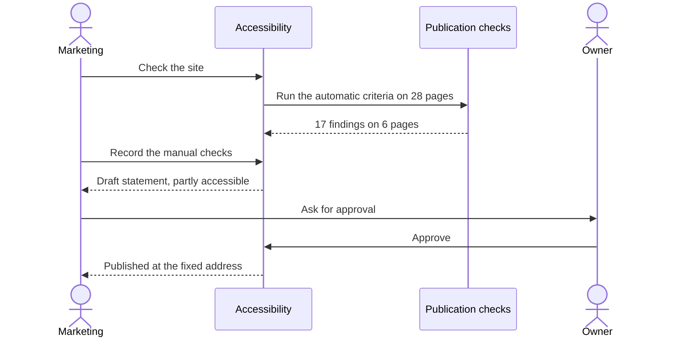

🏠 [Specs](../../../../README.md) › 🧩 [Functional capabilities](../../../README.md) ›
🌐 [F18 Hosted websites and domains (hosted edition)](../../README.md) › 📝 [Use cases](../README.md) ›
📝 [Use cases: FL-F18-07 A/B tests, visitors, accessibility and members](README.md) ›
📝 UC-F18-30 Check and declare accessibility

# 📝 UC-F18-30 Check and declare accessibility

**Status:** ✅ specified

## Summary

The marketing person and the administrator check the hosted site against the web accessibility criteria, fix what the
checks find, and publish the site's accessibility information: how the service meets the accessibility requirements, as
the law asks, plus what is not accessible and how to ask for help, which SimpleERP adds. A site with an online shop
cannot be published without it.

## Personas

- [U12 Marketing and communication](../../../../01-users/personas/u12-marketing.md)
- [U07 Administrator](../../../../01-users/personas/u07-administrator.md)

## Goal

The site is as accessible as it can be, its gaps are told honestly, and a visitor who meets a barrier knows who to write
to.

## Trigger

The site is built or changed, the shop is connected
([UC-F18-19](../01-build-the-site/uc-f18-19-connect-the-online-shop.md)), or the yearly review of the statement comes
due.

## Frequency

A check at every publication; a statement review each year.

## Preconditions

- The site has a preview ([UC-F18-13](../04-test-and-publish/uc-f18-13-review-the-private-preview.md)) and the automatic
  checks run ([UC-F18-14](../04-test-and-publish/uc-f18-14-run-the-automatic-checks.md)).
- The company profile says whether the company is a very small service company the law may exempt
  ([E-F21-02 Company profile](../../../f21-onboarding-and-modules/data/e-f21-02-company-profile.md)).

## Postconditions

- **Succeeded:** the statement is saved
  ([E-F18-22 Accessibility statement](../../data/e-f18-22-accessibility-statement.md)) with the level reached, the known
  gaps, the date of the last check and a contact; once approved it is published at a fixed address linked from every
  page.
- **Failed:** the statement stays a draft; a shop site cannot be published and the missing parts are listed.

## Main flow

1. The marketing person opens the accessibility screen
   ([S-F18-30](../../screens/07-tests-visitors-and-accessibility/s-f18-30-accessibility.md)) and starts a check of the
   site.
2. SimpleERP runs the automatic criteria (text alternatives, contrast, titles, labels, keyboard use) on every page and
   lists each finding with the page and the way to fix it.
3. The administrator or marketing person works through the manual checks that a program cannot do (reading order,
   meaning of links, captions) and records the result of each.
4. SimpleERP fills a draft statement: the requirements that apply and how the site meets them (the content the law
   asks), then the standard used, the level reached, what is not accessible and why, the date, and a contact and a way
   to complain, which SimpleERP adds.
5. The marketing person edits the text and asks the owner to approve it
   ([UC-F18-15](../04-test-and-publish/uc-f18-15-approve-publish-and-roll-back.md)).
6. The statement is published at a fixed address, linked from the footer of every page and from the general terms, in
   written form readable aloud by screen readers; it stays published as long as the shop is offered and is reviewed
   each year or after a big change.

## Alternative flows

- 2a. The site is not an online shop and the company is exempt as a very small service company: the statement is
  optional, and SimpleERP still offers it.
- 3a. A gap cannot be fixed now: it is listed in the statement with its reason and a date.
- 6a. A visitor reports a barrier through the contact: it becomes a task with a date to answer.

## Error flows

- 2e. A page cannot be read by the check (it needs a sign-in): it is listed as not checked.
- 5e. The owner refuses the statement: it returns to draft with the comment.
- 6e. The statement is older than a year: the site shows a warning and the next publication of a shop site is held.
- Any step: a service does not answer; the call is retried first
  ([BR-F3-32](../../../f03-assistant/business-rules/br-f03-32-retry-before-an-error.md)), then the message follows the
  error pattern ([D122](../../../../06-decisions/ux/d122-error-message-standard.md)) and what the user typed stays on
  the screen.

## Business rules

- [BR-F18-24](../../business-rules/br-f18-24-an-e-shop-publishes-its-accessibility-statement.md)
- [BR-F18-04](../../business-rules/br-f18-04-checks-gate-publication.md)
- [BR-F18-05](../../business-rules/br-f18-05-customer-approves-rollback-kept.md)

## Entities

- [E-F18-22 Accessibility statement](../../data/e-f18-22-accessibility-statement.md): created, changed, published
- [E-F18-10 Publication check report](../../data/e-f18-10-publication-check-report.md): read and created, the check
  report
- [E-F18-01 Hosted website](../../data/e-f18-01-hosted-website.md): read, the site
- [E-F11-14 Legal page](../../../f11-online-shop/data/e-f11-14-legal-page.md): read, the legal pages the statement is
  linked from
- [E-F21-02 Company profile](../../../f21-onboarding-and-modules/data/e-f21-02-company-profile.md): read, the company's
  size and activity

## Permissions

Marketing and administrators run checks and edit the statement. The owner approves it. The hosting engineer
reads the findings.

## Notifications

The marketing person, in the app: the statement is a year old, or a barrier was reported. The owner: a statement waiting
for approval.

## Audit events

Each check run with its findings, each manual result, each statement edited, approved, published and replaced, with who
and when; each reported barrier and its answer.

## AI involvement

No AI step of its own. The AI assistant may open the screen and prefill it from the user's words; the user checks and
confirms ([BR-F3-07](../../../f03-assistant/business-rules/br-f03-07-no-deletes-no-irreversible-acts.md)).

## API, MCP and A2A exposure

T5 operations of the capability for the personas above: create, read, update and list. The MCP tool of the
capability may read and propose, never confirm alone. No A2A skill.

## Screens

- [S-F18-30](../../screens/07-tests-visitors-and-accessibility/s-f18-30-accessibility.md)

## Flowchart

See
[FL-F18-07 A/B tests, visitors, accessibility and members](../../flows/fl-f18-07-tests-visitors-and-accessibility.md#flowchart).

## Sequence diagram

## Acceptance criteria

1. **Given** a site with an online shop and no published statement **when** someone asks to publish **then** the
   publication is held and the missing statement is named.
2. **Given** an automatic check that finds a missing text alternative **when** the check ends **then** the finding names
   the page and the way to fix it.
3. **Given** a gap that cannot be fixed now **when** the draft is written **then** the statement lists it with its
   reason.
4. **Given** a statement a year old **when** the next publication is asked **then** the site shows a warning and a shop
   site is held.

## Non-functional notes

The screen answers within 2 seconds for 10,000 records; every change is audited.

## Regulatory references

The European Accessibility Act, in force for services provided after 2025-06-28, makes online shops and certain other
consumer services accessible ([CR-FR-072](../../../../10-country-packs/france/consumer/cr-fr-072-web-accessibility-eaa.md)). In France the
provider gives, in its general terms or an equivalent document, the information on how its service meets the
requirements, in written and oral form, kept as long as the service is offered (Code de la consommation D412-57 2° and
its annex); the law names no "accessibility statement" and does not ask for the gaps or a way to ask for help.
Providers with fewer than 10 persons and 2 MEUR or less of turnover or balance sheet are exempt (D412-60).

- France-pack rule:
  [CR-FR-222 Accessibility statement (EAA)](../../../../10-country-packs/france/digital/cr-fr-222-accessibility-statement.md)

## Related use cases

- [UC-F18-29 Track known visitors for sales](uc-f18-29-track-known-visitors-for-sales.md)
- [UC-F18-31 Publish members-only pages](uc-f18-31-publish-members-only-pages.md)
- [UC-F18-14](../04-test-and-publish/uc-f18-14-run-the-automatic-checks.md)
- [UC-F18-15](../04-test-and-publish/uc-f18-15-approve-publish-and-roll-back.md)
- [UC-F18-19 Connect the online shop](../01-build-the-site/uc-f18-19-connect-the-online-shop.md)
- [UC-F18-08](../01-build-the-site/uc-f18-08-generate-legal-notices-privacy-and-cookies.md)
- [UC-F11-19](../../../f11-online-shop/use-cases/06-channels-and-legal/uc-f11-19-publish-the-legal-pages.md)
- [UC-F21-16](../../../f21-onboarding-and-modules/use-cases/01-first-run/uc-f21-16-check-the-legal-set-up.md)

## Open questions

None.

---

⬅️ [UC-F18-29 Track known visitors for sales](uc-f18-29-track-known-visitors-for-sales.md) · ⬆️ [Up](README.md) ·
➡️ [UC-F18-31 Publish members-only pages](uc-f18-31-publish-members-only-pages.md)
