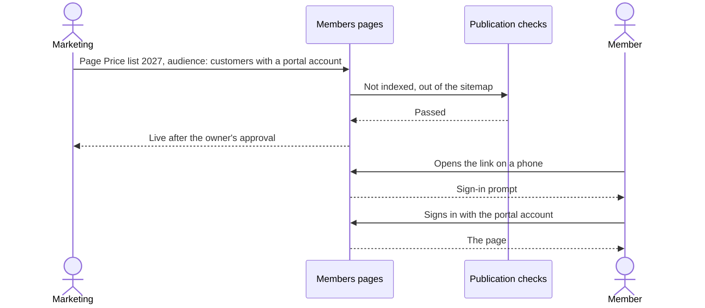

🏠 [Specs](../../../../README.md) › 🧩 [Functional capabilities](../../../README.md) ›
🌐 [F18 Hosted websites and domains (hosted edition)](../../README.md) › 📝 [Use cases](../README.md) ›
📝 [Use cases: FL-F18-07 A/B tests, visitors, accessibility and members](README.md) ›
📝 UC-F18-31 Publish members-only pages

# 📝 UC-F18-31 Publish members-only pages

**Status:** ✅ specified

## Summary

The marketing person publishes pages that only the company's customers or members can read: price lists, documents, a
newsletter archive, a members' offer. Readers sign in with their portal account on a phone or a computer, and the pages
are never shown to search engines or visitors who are not signed in.

## Personas

- [U12 Marketing and communication](../../../../01-users/personas/u12-marketing.md)
- [U09 Customer](../../../../01-users/personas/u09-customer.md)

## Goal

Reserved content reaches the right people, and nobody else, including search engines and the AI crawlers that read the
public web.

## Trigger

The marketing person marks a page as members only, or a customer opens a link to a members page.

## Frequency

A few members pages per site; a visit by each member a few times a month.

## Preconditions

- The site is published ([E-F18-01 Hosted website](../../data/e-f18-01-hosted-website.md)) and the company has portal
  accounts for its customers ([E-F1-17 Portal account](../../../f01-administration/data/e-f01-17-portal-account.md)).
- The page exists as a draft or live page ([E-F18-02 Page](../../data/e-f18-02-page.md)).

## Postconditions

- **Succeeded:** the page audience is saved ([E-F18-23 Page audience](../../data/e-f18-23-page-audience.md)) with the
  people allowed; the page is live behind the sign-in, outside the sitemap and marked not to be indexed.
- **Failed:** the page stays public or draft; the screen says which condition failed and nothing reserved is shown.

## Main flow

1. The marketing person opens the members pages screen
   ([S-F18-31](../../screens/07-tests-visitors-and-accessibility/s-f18-31-members-pages.md)) and picks a page, then
   chooses who may read it: every customer with a portal account, a group, or named people.
2. simple-ERP shows how the page will look to a visitor who is not signed in (a sign-in prompt) and to a member (the
   content), in the private preview ([UC-F18-13](../04-test-and-publish/uc-f18-13-review-the-private-preview.md)).
3. The marketing person asks for the page to go live; the checks confirm it carries the not-indexed mark and is out of
   the sitemap ([BR-F18-25](../../business-rules/br-f18-25-members-only-content-is-never-indexed.md)) and the owner
   approves ([UC-F18-15](../04-test-and-publish/uc-f18-15-approve-publish-and-roll-back.md)).
4. A member opens the link on a phone or a computer, signs in with their portal account and reads the page.
5. simple-ERP records which member read which page and when, for the marketing person's totals.
6. The marketing person changes the audience or withdraws the page; a person who is no longer a member loses access at
   once.

## Alternative flows

- 2a. The audience is a group that changes: members join and leave and their access follows the group.
- 4a. A member forgot their password: they use the reset of their portal account.
- 6a. A page is made public later: it is treated as a new publication and goes through the approval.

## Error flows

- 3e. The checks find the page in the sitemap or without the not-indexed mark: the page is held until fixed.
- 4e. A signed-in person who is not in the audience opens the link: access is refused with a message that does not
  reveal the content.
- 6e. A page is shared by a link outside the site: the link asks for the sign-in all the same.
- Any step: a service does not answer; the call is retried first
  ([BR-F3-32](../../../f03-assistant/business-rules/br-f03-32-retry-before-an-error.md)), then the message follows the
  error pattern ([D122](../../../../06-decisions/ux/d122-error-message-standard.md)) and what the user typed stays on
  the screen.

## Business rules

- [BR-F18-25](../../business-rules/br-f18-25-members-only-content-is-never-indexed.md)
- [BR-F18-04](../../business-rules/br-f18-04-checks-gate-publication.md)
- [BR-F18-05](../../business-rules/br-f18-05-customer-approves-rollback-kept.md)
- [BR-F18-14](../../business-rules/br-f18-14-analytics-only-with-consent.md)

## Entities

- [E-F18-23 Page audience](../../data/e-f18-23-page-audience.md): created, changed, withdrawn
- [E-F18-02 Page](../../data/e-f18-02-page.md): read, the page
- [E-F1-17 Portal account](../../../f01-administration/data/e-f01-17-portal-account.md): read, the portal accounts
  allowed
- [E-F18-10 Publication check report](../../data/e-f18-10-publication-check-report.md): read, the checks
- [E-F18-18 Search settings](../../data/e-f18-18-search-settings.md): read, the sitemap and indexing settings

## Permissions

Marketing sets audiences. The owner approves going live. Members read the pages they are allowed. The
administrator manages the portal accounts.

## Notifications

The member, by email: a new page is available to them (optional, by their choice). The marketing person: a page held by
the checks.

## Audit events

Each audience created, changed or withdrawn; each page held or released by the checks; each read by a member and each
refused access, with the time.

## AI involvement

No AI step of its own. The AI assistant may open the screen and prefill it from the user's words; the user checks and
confirms ([BR-F3-07](../../../f03-assistant/business-rules/br-f03-07-no-deletes-no-irreversible-acts.md)).

## API, MCP and A2A exposure

T5 operations of the capability for the personas above: create, read, update and list. The MCP tool of the
capability may read and propose, never confirm alone. No A2A skill.

## Screens

- [S-F18-31](../../screens/07-tests-visitors-and-accessibility/s-f18-31-members-pages.md)

## Flowchart

See
[FL-F18-07 A/B tests, visitors, accessibility and members](../../flows/fl-f18-07-tests-visitors-and-accessibility.md#flowchart).

## Sequence diagram

## Acceptance criteria

1. **Given** a members-only page **when** the checks run **then** the page carries the not-indexed mark and is absent
   from the sitemap, or it is held.
2. **Given** a visitor who is not signed in **when** they open the page's address **then** they see only a sign-in
   prompt.
3. **Given** a person who leaves the audience **when** they open the link again **then** access is refused at once.
4. **Given** a members-only page **when** a search engine or crawler asks for it **then** it receives the sign-in
   prompt, never the content.

## Non-functional notes

The screen answers within 2 seconds for 10,000 records; every change is audited.

## Regulatory references

Reserved content is protected by the sign-in, not by hiding the link; a customer's portal account is personal
data and the pages read are not shared with others
([CR-FR-052](../../../../10-country-packs/france/data-protection/cr-fr-052-storage-limitation.md)). The members' pages
follow the site's legal notices
([CR-FR-069](../../../../10-country-packs/france/consumer/cr-fr-069-website-legal-notices.md)).

## Related use cases

- [UC-F18-30 Check and declare accessibility](uc-f18-30-check-and-declare-accessibility.md)
- [UC-F18-13](../04-test-and-publish/uc-f18-13-review-the-private-preview.md)
- [UC-F18-15](../04-test-and-publish/uc-f18-15-approve-publish-and-roll-back.md)
- [UC-F18-26](../06-content-and-search/uc-f18-26-set-the-search-engine-basics.md)
- [UC-F1-19](../../../f01-administration/use-cases/12-portal-accounts-and-integrations/uc-f01-19-manage-portal-accounts.md)
- [UC-F6-11](../../../f06-customers-and-sales/use-cases/02-quote-to-order/uc-f06-11-use-the-customer-portal.md)

## Open questions

None.

---

⬅️ [UC-F18-30 Check and declare accessibility](uc-f18-30-check-and-declare-accessibility.md) · ⬆️ [Up](README.md)
