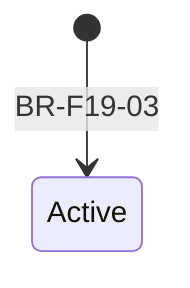

🏠 [Specs](../../../README.md) › 🧩 [Functional capabilities](../../README.md) ›
🏭 [F19 Feature factory (hosted edition)](../README.md) › 🗃️ [Data](README.md) › 🗃️ E-F19-01 Feature request

# 🗃️ E-F19-01 Feature request

**Status:** ✅ specified

## Purpose

A need described to the chatbot.

## Fields

| Name | Type | Required | Validation | Default | Example | Personal data | Custom fields |
|---|---|---|---|---|---|---|---|
| company, author, description | records | yes | BR-F19-03 | - | Acme, owner, gate booking | no | no |

## Relations

As its use cases.

## Lifecycle

## Indexes and search

By number, date, partner.

## Retention

Kept for the period of its kind of record in the country pack (D293), or else its kind's default in the
[retention schedule](../../../05-non-functional/data-retention.md).

## Audit

Every change.

## Import and export

CSV, FEC where relevant.

## Used by

- [UC-F19-01](../use-cases/01-describe-and-order/uc-f19-01-describe-a-feature-in-plain-words.md)
- [UC-F19-02](../use-cases/01-describe-and-order/uc-f19-02-refine-the-feature-with-the-chatbot.md)
- [UC-F19-09](../use-cases/03-try-install-and-maintain/uc-f19-09-ask-for-changes.md)

## Open questions

None.

---

⬆️ [Up](README.md) · ➡️ [E-F19-02 Feature specification](e-f19-02-feature-specification.md)
