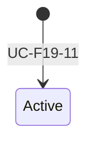

🏠 [Specs](../../../README.md) › 🧩 [Functional capabilities](../../README.md) ›
🏭 [F19 Feature factory (hosted edition)](../README.md) › 🗃️ [Data](README.md) › 🗃️ E-F19-03 Feature subscription

# 🗃️ E-F19-03 Feature subscription

**Status:** ✅ specified

## Purpose

A feature billed monthly.

## Fields

| Name | Type | Required | Validation | Default | Example | Personal data | Custom fields |
|---|---|---|---|---|---|---|---|
| company, feature, price, started, ended | records | yes | BR-F19-09 | - | Acme, gate booking, 300, 2026-12-01 | no | no |

## Relations

As its use cases.

## Lifecycle

## Indexes and search

By number, date, partner.

## Retention

As an accounting record:
[CR-FR-002 Accounting records kept 10 years](../../../10-country-packs/france/accounting/cr-fr-002-accounting-records-kept-ten-years.md).

## Audit

Every change.

## Import and export

CSV, FEC where relevant.

## Used by

- [UC-F19-03](../use-cases/01-describe-and-order/uc-f19-03-accept-the-quote.md)
- [UC-F19-08](../use-cases/03-try-install-and-maintain/uc-f19-08-accept-and-install-the-feature.md)
- [UC-F19-11](../use-cases/03-try-install-and-maintain/uc-f19-11-cancel-a-feature-and-export-its-data.md)
- [UC-F19-19](../use-cases/05-bill-and-credit/uc-f19-19-follow-features-costs-and-credits.md)

## Open questions

None.

---

⬅️ [E-F19-02 Feature specification](e-f19-02-feature-specification.md) · ⬆️ [Up](README.md) ·
➡️ [E-F19-04 Generated plugin version](e-f19-04-generated-plugin-version.md)
