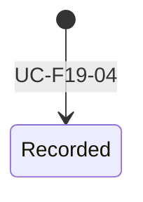

🏠 [Specs](../../../README.md) › 🧩 [Functional capabilities](../../README.md) ›
🏭 [F19 Feature factory (hosted edition)](../README.md) › 🗃️ [Data](README.md) › 🗃️ E-F19-04 Generated plugin version

# 🗃️ E-F19-04 Generated plugin version

**Status:** ✅ specified

## Purpose

The generated code, tests and signature.

## Fields

| Name | Type | Required | Validation | Default | Example | Personal data | Custom fields |
|---|---|---|---|---|---|---|---|
| feature, version, tests, review, signature | records | yes | BR-F19-05 | - | gate booking, 1.2, passed, approved, signed | no | no |

## Relations

As its use cases.

## Lifecycle

## Indexes and search

By number, date, partner.

## Retention

Kept for the period of its kind of record in the country pack (D293), or else its kind's default in the
[retention schedule](../../../05-non-functional/data-retention.md).

## Audit

Every change.

## Import and export

CSV, FEC where relevant.

## Used by

- [UC-F19-04](../use-cases/02-build-and-check/uc-f19-04-generate-the-plugin-in-the-sandbox.md)
- [UC-F19-06](../use-cases/02-build-and-check/uc-f19-06-review-and-sign-the-feature.md)
- [UC-F19-08](../use-cases/03-try-install-and-maintain/uc-f19-08-accept-and-install-the-feature.md)
- [UC-F19-09](../use-cases/03-try-install-and-maintain/uc-f19-09-ask-for-changes.md)
- [UC-F19-10](../use-cases/03-try-install-and-maintain/uc-f19-10-report-a-defect.md)
- [UC-F19-13](../use-cases/04-promote/uc-f19-13-review-a-promotion-for-genericity-and-privacy.md)
- [UC-F19-17](../use-cases/02-build-and-check/uc-f19-17-keep-features-working-across-upgrades.md)

## Open questions

None.

---

⬅️ [E-F19-03 Feature subscription](e-f19-03-feature-subscription.md) · ⬆️ [Up](README.md) ·
➡️ [E-F19-05 Feature check report](e-f19-05-feature-check-report.md)
