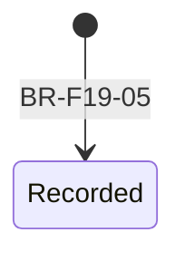

🏠 [Specs](../../../README.md) › 🧩 [Functional capabilities](../../README.md) ›
🏭 [F19 Feature factory (hosted edition)](../README.md) › 🗃️ [Data](README.md) › 🗃️ E-F19-05 Feature check report

# 🗃️ E-F19-05 Feature check report

**Status:** ✅ specified

## Purpose

Automatic check results.

## Fields

| Name | Type | Required | Validation | Default | Example | Personal data | Custom fields |
|---|---|---|---|---|---|---|---|
| version, check, result | records | yes | BR-F19-05 | - | 1.2, boundary, passed | no | no |

## Relations

As its use cases.

## Lifecycle

## Indexes and search

By number, date, partner.

## Retention

Kept for the period of its kind of record in the country pack (D293), or else its kind's default in the
[retention schedule](../../../05-non-functional/data-retention.md).

## Audit

Every change.

## Import and export

CSV, FEC where relevant.

## Used by

- [UC-F19-05](../use-cases/02-build-and-check/uc-f19-05-run-the-automatic-checks.md)
- [UC-F19-06](../use-cases/02-build-and-check/uc-f19-06-review-and-sign-the-feature.md)
- [UC-F19-17](../use-cases/02-build-and-check/uc-f19-17-keep-features-working-across-upgrades.md)

## Open questions

None.

---

⬅️ [E-F19-04 Generated plugin version](e-f19-04-generated-plugin-version.md) · ⬆️ [Up](README.md) ·
➡️ [E-F19-06 Try-out copy](e-f19-06-try-out-copy.md)
