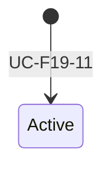

🏠 [Specs](../../../README.md) › 🧩 [Functional capabilities](../../README.md) ›
🏭 [F19 Feature factory (hosted edition)](../README.md) › 🗃️ [Data](README.md) › 🗃️ E-F19-06 Try-out copy

# 🗃️ E-F19-06 Try-out copy

**Status:** ✅ specified

## Purpose

A copy of the company for trying.

## Fields

| Name | Type | Required | Validation | Default | Example | Personal data | Custom fields |
|---|---|---|---|---|---|---|---|
| company, feature, created, expires | records | yes | BR-F19-06 | - | Acme, gate booking, 2026-11-20, 2026-12-04 | yes | no |

## Relations

As its use cases.

## Lifecycle

## Indexes and search

By number, date, partner.

## Retention

Kept for the period of its kind of record in the country pack (D293), or else its kind's default in the
[retention schedule](../../../05-non-functional/data-retention.md).

## Audit

Every change.

## Import and export

CSV, FEC where relevant.

## Used by

- [UC-F19-07](../use-cases/03-try-install-and-maintain/uc-f19-07-try-the-feature-on-a-copy-of-the-data.md)
- [UC-F19-11](../use-cases/03-try-install-and-maintain/uc-f19-11-cancel-a-feature-and-export-its-data.md)

## Open questions

None.

---

⬅️ [E-F19-05 Feature check report](e-f19-05-feature-check-report.md) · ⬆️ [Up](README.md) ·
➡️ [E-F19-07 Feature promotion](e-f19-07-feature-promotion.md)
