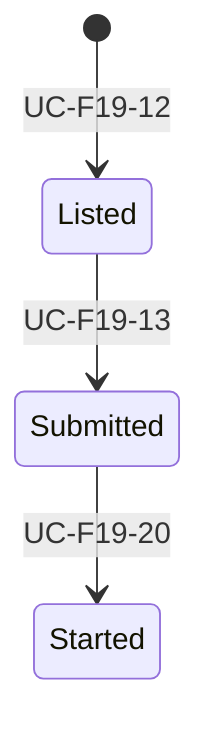

🏠 [Specs](../../../README.md) › 🧩 [Functional capabilities](../../README.md) ›
🏭 [F19 Feature factory (hosted edition)](../README.md) › 🗃️ [Data](README.md) › 🗃️ E-F19-07 Feature promotion

# 🗃️ E-F19-07 Feature promotion

**Status:** ✅ specified

## Purpose

A feature offered to every hosted customer.

## Fields

| Name | Type | Required | Validation | Default | Example | Personal data | Custom fields |
|---|---|---|---|---|---|---|---|
| feature, promoter, terms accepted, status | records | yes | BR-F19-10 | - | gate booking, Acme, 2026-12-10, listed | no | no |

## Relations

As its use cases.

## Lifecycle

## Indexes and search

By number, date, partner.

## Retention

Kept for the period of its kind of record in the country pack (D293), or else its kind's default in the
[retention schedule](../../../05-non-functional/data-retention.md).

## Audit

Every change.

## Import and export

CSV, FEC where relevant.

## Used by

- [UC-F19-12](../use-cases/04-promote/uc-f19-12-promote-the-feature-to-every-hosted-customer.md)
- [UC-F19-13](../use-cases/04-promote/uc-f19-13-review-a-promotion-for-genericity-and-privacy.md)
- [UC-F19-14](../use-cases/04-promote/uc-f19-14-publish-it-in-the-hosted-store.md)
- [UC-F19-20](../use-cases/04-promote/uc-f19-20-accept-the-licence-terms-of-a-promotion.md)

## Open questions

None.

---

⬅️ [E-F19-06 Try-out copy](e-f19-06-try-out-copy.md) · ⬆️ [Up](README.md) ·
➡️ [E-F19-08 Promotion credit](e-f19-08-promotion-credit.md)
