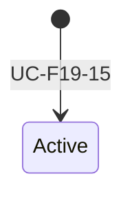

🏠 [Specs](../../../README.md) › 🧩 [Functional capabilities](../../README.md) ›
🏭 [F19 Feature factory (hosted edition)](../README.md) › 🗃️ [Data](README.md) › 🗃️ E-F19-08 Promotion credit

# 🗃️ E-F19-08 Promotion credit

**Status:** ✅ specified

## Purpose

The monthly 50 % credit.

## Fields

| Name | Type | Required | Validation | Default | Example | Personal data | Custom fields |
|---|---|---|---|---|---|---|---|
| promoter, period, revenue, credit, carried | records | yes | BR-F19-11 | - | Acme, Jan, 1 200, 600, 0 | no | no |

## Relations

As its use cases.

## Lifecycle

## Indexes and search

By number, date, partner.

## Retention

As an accounting record:
[CR-FR-002 Accounting records kept 10 years](../../../10-country-packs/france/accounting/cr-fr-002-accounting-records-kept-ten-years.md).

## Audit

Every change.

## Import and export

CSV, FEC where relevant.

## Used by

- [UC-F19-15](../use-cases/05-bill-and-credit/uc-f19-15-receive-the-promotion-credit.md)
- [UC-F19-19](../use-cases/05-bill-and-credit/uc-f19-19-follow-features-costs-and-credits.md)

## Open questions

None.

---

⬅️ [E-F19-07 Feature promotion](e-f19-07-feature-promotion.md) · ⬆️ [Up](README.md) ·
➡️ [E-F19-09 Hosted invoice](e-f19-09-hosted-invoice.md)
