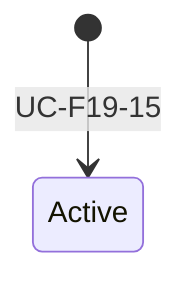

🏠 [Specs](../../../README.md) › 🧩 [Functional capabilities](../../README.md) ›
🏭 [F19 Feature factory (hosted edition)](../README.md) › 🗃️ [Data](README.md) › 🗃️ E-F19-09 Hosted invoice

# 🗃️ E-F19-09 Hosted invoice

**Status:** ✅ specified

## Purpose

An invoice or credit note of the hosting.

## Fields

| Name | Type | Required | Validation | Default | Example | Personal data | Custom fields |
|---|---|---|---|---|---|---|---|
| company, number, lines, VAT, kind | records | yes | BR-F19-12 | - | Acme, AV-2026-0042, ..., 120, credit note | no | no |

## Relations

As its use cases.

## Lifecycle

## Indexes and search

By number, date, partner.

## Retention

As an accounting record:
[CR-FR-002 Accounting records kept 10 years](../../../10-country-packs/france/accounting/cr-fr-002-accounting-records-kept-ten-years.md).

## Audit

Every change.

## Import and export

CSV, FEC where relevant.

## Used by

- [UC-F19-15](../use-cases/05-bill-and-credit/uc-f19-15-receive-the-promotion-credit.md)
- [UC-F19-16](../use-cases/05-bill-and-credit/uc-f19-16-invoice-features-with-the-right-vat.md)
- [UC-F19-22 Refund when acceptance fails](../use-cases/06-delivery-and-refunds/uc-f19-22-refund-when-acceptance-fails.md)
- [UC-F19-25 Post feature invoices, credits and refunds to accounting](../use-cases/05-bill-and-credit/uc-f19-25-post-feature-invoices-credits-and-refunds-to-accounting.md)

## Open questions

None.

---

⬅️ [E-F19-08 Promotion credit](e-f19-08-promotion-credit.md) · ⬆️ [Up](README.md) ·
➡️ [E-F19-10 Feature withdrawal](e-f19-10-feature-withdrawal.md)
