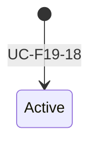

🏠 [Specs](../../../README.md) › 🧩 [Functional capabilities](../../README.md) ›
🏭 [F19 Feature factory (hosted edition)](../README.md) › 🗃️ [Data](README.md) › 🗃️ E-F19-10 Feature withdrawal

# 🗃️ E-F19-10 Feature withdrawal

**Status:** ✅ specified

## Purpose

A feature withdrawn.

## Fields

| Name | Type | Required | Validation | Default | Example | Personal data | Custom fields |
|---|---|---|---|---|---|---|---|
| feature, reason, date | records | yes | BR-F19-13 | - | X sync, leak, 2027-01-04 | no | no |

## Relations

As its use cases.

## Lifecycle

## Indexes and search

By number, date, partner.

## Retention

Kept for the period of its kind of record in the country pack (D293), or else its kind's default in the
[retention schedule](../../../05-non-functional/data-retention.md).

## Audit

Every change.

## Import and export

CSV, FEC where relevant.

## Used by

- [UC-F19-18](../use-cases/04-promote/uc-f19-18-withdraw-a-harmful-feature.md)

## Open questions

None.

---

⬅️ [E-F19-09 Hosted invoice](e-f19-09-hosted-invoice.md) · ⬆️ [Up](README.md) ·
➡️ [E-F19-11 Delivery commitment](e-f19-11-delivery-commitment.md)
