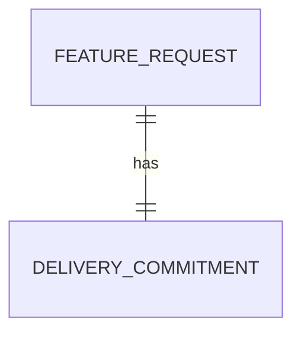
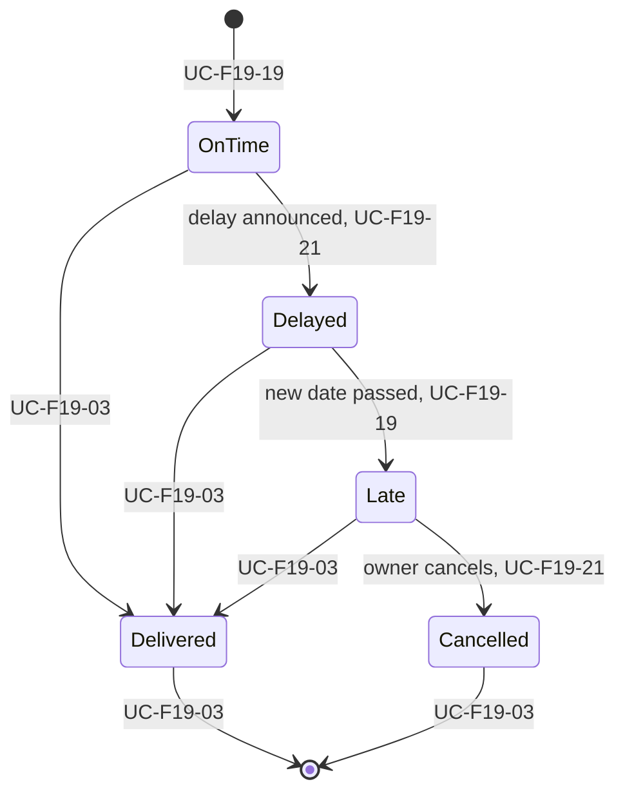

🏠 [Specs](../../../README.md) › 🧩 [Functional capabilities](../../README.md) ›
🏭 [F19 Feature factory (hosted edition)](../README.md) › 🗃️ [Data](README.md) › 🗃️ E-F19-11 Delivery commitment

# 🗃️ E-F19-11 Delivery commitment

**Status:** ✅ specified

## Purpose

The date the factory commits to deliver a feature for try-out, and its delays.

## Fields

| Name | Type | Required | Validation | Default | Example | Personal data | Custom fields |
|---|---|---|---|---|---|---|---|
| feature request | link | yes | an approved specification | - | FR-12 gate booking | no | no |
| committed | date | yes | after the approval | 15 business days | 2026-12-03 | no | no |
| delays | list | no | new date and reason each | - | 2026-12-10, tests failing | no | no |
| delivered | date | when delivered | - | - | 2026-12-09 | no | no |
| state | choice | yes | on time, delayed, late, delivered | on time | delivered | no | no |

## Relations

## Lifecycle

## Indexes and search

By state and date.

## Retention

As the feature request.

## Audit

Every creation and change, with who, when, the old and the new value.

## Import and export

CSV and JSON export through the API (T5); no bulk import.

## Used by

- [UC-F19-21 Commit to a delivery date and handle delays](../use-cases/01-describe-and-order/uc-f19-21-commit-to-a-delivery-date-and-handle-delays.md)
- [UC-F19-03 Accept the quote](../use-cases/01-describe-and-order/uc-f19-03-accept-the-quote.md)
- [UC-F19-19 Follow features, costs and credits](../use-cases/05-bill-and-credit/uc-f19-19-follow-features-costs-and-credits.md)

## Open questions

None.

---

⬅️ [E-F19-10 Feature withdrawal](e-f19-10-feature-withdrawal.md) · ⬆️ [Up](README.md) ·
➡️ [E-F19-12 Feature refund](e-f19-12-feature-refund.md)
