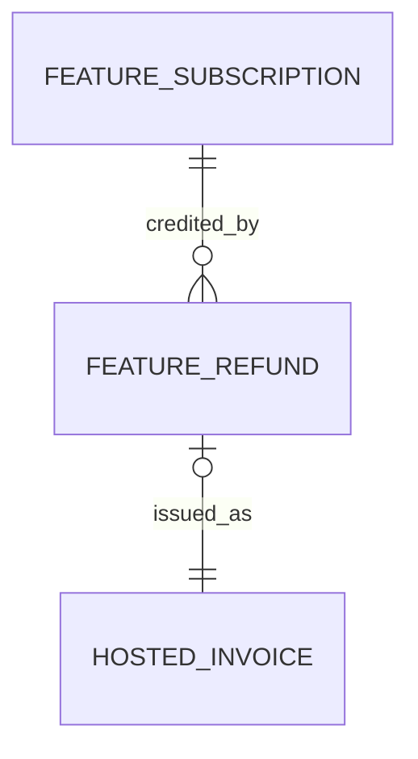
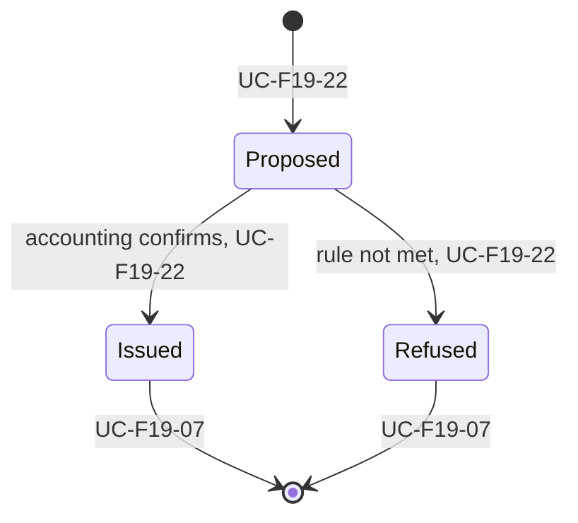

🏠 [Specs](../../../README.md) › 🧩 [Functional capabilities](../../README.md) ›
🏭 [F19 Feature factory (hosted edition)](../README.md) › 🗃️ [Data](README.md) › 🗃️ E-F19-12 Feature refund

# 🗃️ E-F19-12 Feature refund

**Status:** ✅ specified

## Purpose

A credit or a closing without charge for a feature that failed acceptance or was unusable.

## Fields

| Name | Type | Required | Validation | Default | Example | Personal data | Custom fields |
|---|---|---|---|---|---|---|---|
| feature | link | yes | a feature | - | gate booking | no | no |
| kind | choice | yes | closed without charge, month credited | - | month credited | no | no |
| period | month | for credits | - | - | 2027-02 | no | no |
| amount | amount | yes | excluding VAT | 300.00 | 300.00 EUR | no | no |
| credit note | link | for credits | a hosted invoice | - | AV-2027-0007 | no | no |

## Relations

## Lifecycle

## Indexes and search

By company, feature and period.

## Retention

As accounting records: CR-FR-002.

## Audit

Every creation and change, with who, when, the old and the new value.

## Import and export

CSV and JSON export through the API (T5); no bulk import.

## Used by

- [UC-F19-22 Refund when acceptance fails](../use-cases/06-delivery-and-refunds/uc-f19-22-refund-when-acceptance-fails.md)
- [UC-F19-07 Try the feature on a copy of the data](../use-cases/03-try-install-and-maintain/uc-f19-07-try-the-feature-on-a-copy-of-the-data.md)
- [UC-F19-10 Report a defect](../use-cases/03-try-install-and-maintain/uc-f19-10-report-a-defect.md)
- [UC-F19-19 Follow features, costs and credits](../use-cases/05-bill-and-credit/uc-f19-19-follow-features-costs-and-credits.md)

## Open questions

None.

---

⬅️ [E-F19-11 Delivery commitment](e-f19-11-delivery-commitment.md) · ⬆️ [Up](README.md) ·
➡️ [E-F19-13 Code handover](e-f19-13-code-handover.md)
