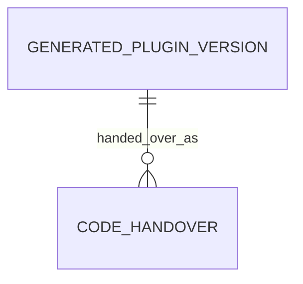
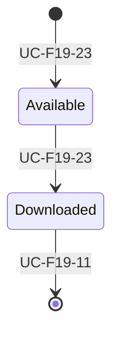

🏠 [Specs](../../../README.md) › 🧩 [Functional capabilities](../../README.md) ›
🏭 [F19 Feature factory (hosted edition)](../README.md) › 🗃️ [Data](README.md) › 🗃️ E-F19-13 Code handover

# 🗃️ E-F19-13 Code handover

**Status:** 🔄 waiting for the owner

## Purpose

The source of a generated feature made available to its customer, with its licence and the export of its data.

## Fields

| Name | Type | Required | Validation | Default | Example | Personal data | Custom fields |
|---|---|---|---|---|---|---|---|
| feature | link | yes | a feature | - | gate booking | no | no |
| version | text | yes | signed version | - | 1.2 | no | no |
| licence | text | yes | AGPL-3.0 (D377) | AGPL-3.0 | AGPL-3.0 | no | no |
| source archive | file | yes | - | - | gate-booking-1.2.tar.gz | no | no |
| data export | file | at cancellation | - | - | export.zip | yes | no |

## Relations

## Lifecycle

## Indexes and search

By feature and version.

## Retention

(Proposed) 1 year after cancellation.

## Audit

Every creation and change, with who, when, the old and the new value.

## Import and export

CSV and JSON export through the API (T5); no bulk import.

## Used by

- [UC-F19-23 Get the source of a feature](../use-cases/03-try-install-and-maintain/uc-f19-23-get-the-source-of-a-feature.md)
- [UC-F19-11 Cancel a feature and export its data](../use-cases/03-try-install-and-maintain/uc-f19-11-cancel-a-feature-and-export-its-data.md)

## Open questions

None.

---

⬅️ [E-F19-12 Feature refund](e-f19-12-feature-refund.md) · ⬆️ [Up](README.md) ·
➡️ [E-F19-14 Security and privacy review](e-f19-14-security-and-privacy-review.md)
