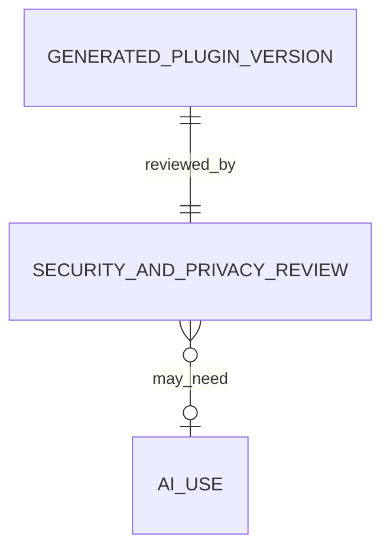
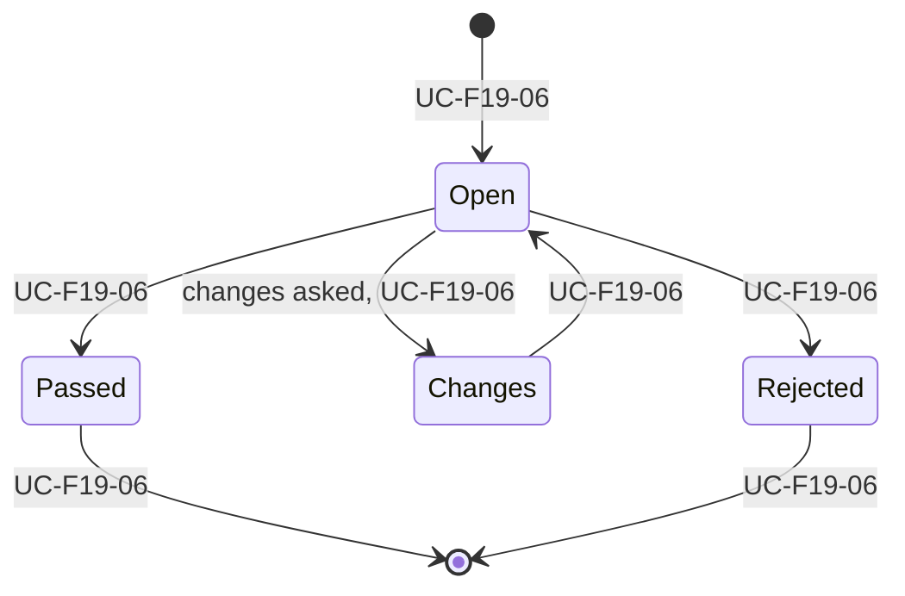

🏠 [Specs](../../../README.md) › 🧩 [Functional capabilities](../../README.md) ›
🏭 [F19 Feature factory (hosted edition)](../README.md) › 🗃️ [Data](README.md) ›
🗃️ E-F19-14 Security and privacy review

# 🗃️ E-F19-14 Security and privacy review

**Status:** ✅ specified

## Purpose

The maintainer's review of a generated feature's security and of the personal data it handles.

## Fields

| Name | Type | Required | Validation | Default | Example | Personal data | Custom fields |
|---|---|---|---|---|---|---|---|
| version | link | yes | a generated version | - | gate booking 1.2 | no | no |
| permissions, outside calls | list | yes | as declared | - | visitors, no outside call | no | no |
| personal data | list | yes | categories | - | names, plates | no | no |
| purpose, retention | text | if personal data | - | - | gate access, 30 days | no | no |
| impact assessment | choice | yes | not needed, needed, approved | not needed | not needed | no | no |
| decision | choice | yes | passed, changes, rejected | - | passed | no | no |

## Relations

## Lifecycle

## Indexes and search

By feature, decision and data category.

## Retention

As long as the version is installable.

## Audit

Every creation and change, with who, when, the old and the new value.

## Import and export

CSV and JSON export through the API (T5); no bulk import.

## Used by

- [UC-F19-24 Review a feature's security and privacy](../use-cases/02-build-and-check/uc-f19-24-review-a-features-security-and-privacy.md)
- [UC-F19-06 Review and sign the feature](../use-cases/02-build-and-check/uc-f19-06-review-and-sign-the-feature.md)

## Open questions

None.

---

⬅️ [E-F19-13 Code handover](e-f19-13-code-handover.md) · ⬆️ [Up](README.md) ·
➡️ [E-F19-15 Factory posting](e-f19-15-factory-posting.md)
