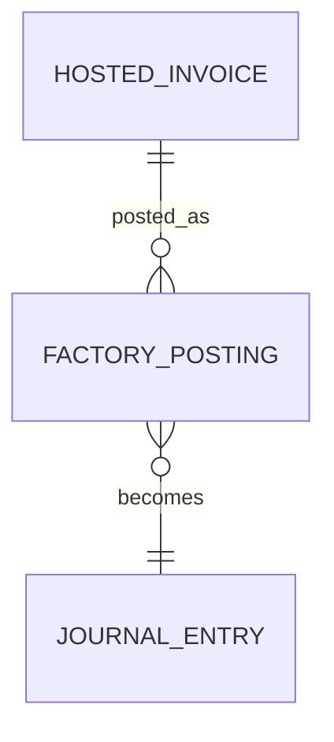
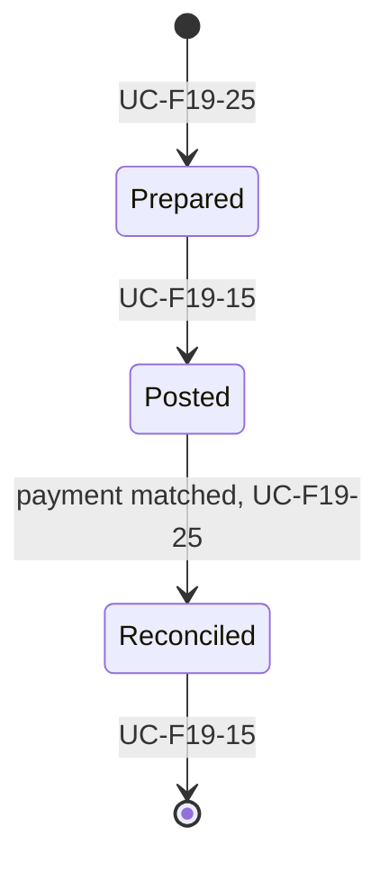

🏠 [Specs](../../../README.md) › 🧩 [Functional capabilities](../../README.md) ›
🏭 [F19 Feature factory (hosted edition)](../README.md) › 🗃️ [Data](README.md) › 🗃️ E-F19-15 Factory posting

# 🗃️ E-F19-15 Factory posting

**Status:** ✅ specified

## Purpose

The accounting entry of a factory invoice, credit note, refund or payment, sent to F8.

## Fields

| Name | Type | Required | Validation | Default | Example | Personal data | Custom fields |
|---|---|---|---|---|---|---|---|
| document | link | yes | a hosted invoice or payment | - | F-2026-0311 | no | no |
| accounts | list | yes | from the F8 mapping | - | 706, 44571, 411 | no | no |
| amounts | list | yes | balanced | - | 300.00, 60.00, 360.00 | no | no |
| posted | date | when posted | an open period | - | 2026-12-01 | no | no |
| reconciled | yes or no | yes | with a bank line | no | yes | no | no |

## Relations

## Lifecycle

## Indexes and search

By document, period and state.

## Retention

[CR-FR-002](../../../10-country-packs/france/accounting/cr-fr-002-accounting-records-kept-ten-years.md).

## Audit

Every creation and change, with who, when, the old and the new value.

## Import and export

FEC export through F8.

## Used by

- [UC-F19-25 Post feature invoices, credits and refunds to accounting](../use-cases/05-bill-and-credit/uc-f19-25-post-feature-invoices-credits-and-refunds-to-accounting.md)
- [UC-F19-26 Reconcile feature payments and follow up unpaid invoices](../use-cases/05-bill-and-credit/uc-f19-26-reconcile-feature-payments-and-follow-up-unpaid-invoices.md)
- [UC-F19-15 Receive the promotion credit](../use-cases/05-bill-and-credit/uc-f19-15-receive-the-promotion-credit.md)
- [UC-F19-16 Invoice features with the right VAT](../use-cases/05-bill-and-credit/uc-f19-16-invoice-features-with-the-right-vat.md)

## Open questions

None.

---

⬅️ [E-F19-14 Security and privacy review](e-f19-14-security-and-privacy-review.md) · ⬆️ [Up](README.md) ·
➡️ [E-F19-16 Feature defect](e-f19-16-feature-defect.md)
