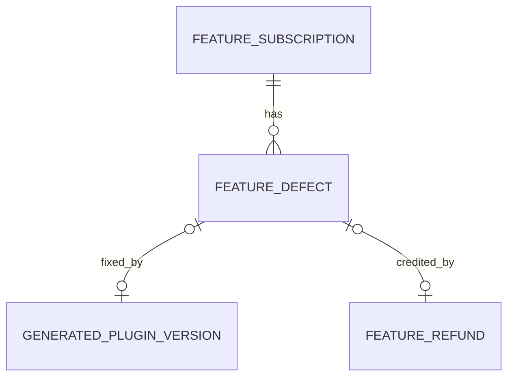
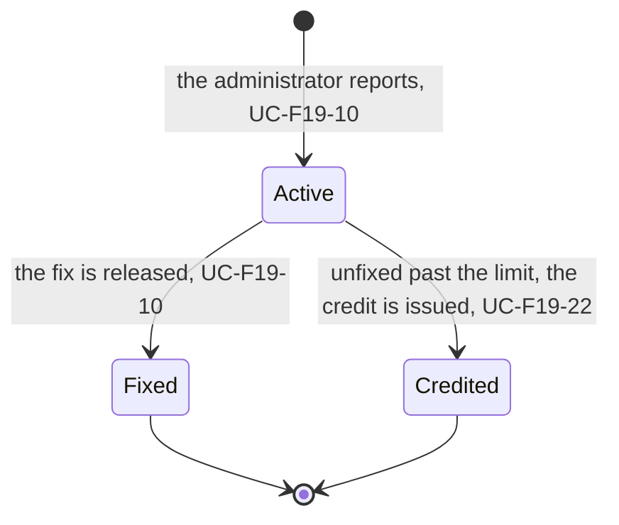

🏠 [Specs](../../../README.md) › 🧩 [Functional capabilities](../../README.md) ›
🏭 [F19 Feature factory (hosted edition)](../README.md) › 🗃️ [Data](README.md) › 🗃️ E-F19-16 Feature defect

# 🗃️ E-F19-16 Feature defect

**Status:** ✅ specified

## Purpose

The feature defect the flow charts name with the words "defect", "defects"
([FL-F19-03](../flows/fl-f19-03-try-install-and-maintain.md), [FL-F19-06](../flows/fl-f19-06-delivery-and-refunds.md)).
A defect is a bug the administrator reports on an installed feature; a fix is generated, checked and released, and a
defect not fixed within 10 business days credits the month (BR-F19-16). The owner decided to create it
([D516](../../../06-decisions/foundations/d516-naming-rules-and-the-seven-classes-of-names.md)); its fields are derived
from the specifications and confirmed by the owner (D572).

## Fields

| Name | Type | Required | Validation | Default | Example | Personal data | Custom fields |
|---|---|---|---|---|---|---|---|
| title | text | yes | not empty | - | Gate slots overlap | no | no |
| feature | link | yes | an installed feature (E-F19-03) | - | gate booking | no | no |
| description | text | yes | not empty | - | Slots show in UTC instead of Paris time. | no | no |
| reported by | user | yes | an administrator of the company | the creator | Claire P. | yes | no |
| reported on | date | yes | set at the report | today | 2027-02-03 | no | no |
| fix limit | date | yes | the report date plus 10 business days (BR-F19-16) | computed | 2027-02-17 | no | no |
| details asked | text | no | set when the defect cannot be reproduced | - | Which site shows the wrong time? | no | no |
| fix version | link | no | a generated plugin version (E-F19-04) that passed BR-F19-05 | - | gate booking 1.0.1 | no | no |
| fixed on | date | when fixed | on or after the report date | - | 2027-02-10 | no | no |
| refund | link | no | a feature refund (E-F19-12) | - | February credit | no | no |
| state | choice | yes | Active, Fixed, Credited | Active | Fixed | no | no |

Derived from [UC-F19-10](../use-cases/03-try-install-and-maintain/uc-f19-10-report-a-defect.md) (the report, the
details asked when it cannot be reproduced, the fix generated, checked and released),
[UC-F19-22](../use-cases/06-delivery-and-refunds/uc-f19-22-refund-when-acceptance-fails.md) and
[BR-F19-16](../business-rules/br-f19-16-nothing-charged-without-an-accepted-feature.md) (the 10 business days limit and
the month's credit), the list view [S-F19-L16](../screens/00-lists/s-f19-l16-feature-defects.md) (title and state) and
the screen [S-F19-10 Defects](../screens/03-try-install-and-maintain/s-f19-10-defects.md) (state and fix dates against
the limit; fixed defects are read-only).

## Relations

- [E-F19-03 Feature subscription](e-f19-03-feature-subscription.md): the installed feature the defect is reported on.
- [E-F19-04 Generated plugin version](e-f19-04-generated-plugin-version.md): the fix, checked, reviewed and signed
  before it is released (BR-F19-05).
- [E-F19-12 Feature refund](e-f19-12-feature-refund.md): the month's credit when the fix limit passes (UC-F19-22).

## Lifecycle

A defect that cannot be reproduced stays Active while more details are asked. Fixed defects are read-only (S-F19-10).

## Indexes and search

By feature, state, reported on and fix limit; searched on the title and the description. The list view sorts on the
title and the state and filters on the state ([S-F19-L16](../screens/00-lists/s-f19-l16-feature-defects.md)).

## Retention

As the other records of its capability.

## Audit

Every change, as the other records of its capability.

## Import and export

CSV and JSON export through the API (T5) of the fields the user may see; no bulk import.

## Used by

- [UC-F19-10 Report a defect](../use-cases/03-try-install-and-maintain/uc-f19-10-report-a-defect.md)
- [UC-F19-22 Refund when acceptance fails](../use-cases/06-delivery-and-refunds/uc-f19-22-refund-when-acceptance-fails.md)

## Open questions

The list view [S-F19-L16](../screens/00-lists/s-f19-l16-feature-defects.md) and the state table of
[S-F19-10](../screens/03-try-install-and-maintain/s-f19-10-defects.md) show only the state Active, while UC-F19-10,
UC-F19-22 and S-F19-10 name fixed and credited defects.

---

⬅️ [E-F19-15 Factory posting](e-f19-15-factory-posting.md) · ⬆️ [Up](README.md) ·
➡️ [E-F19-17 Catalogue change](e-f19-17-catalogue-change.md)
