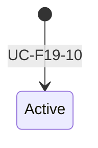

🏠 [Specs](../../../README.md) › 🧩 [Functional capabilities](../../README.md) ›
🏭 [F19 Feature factory (hosted edition)](../README.md) › 🗃️ [Data](README.md) › 🗃️ E-F19-16 Feature defect

# 🗃️ E-F19-16 Feature defect

**Status:** 🔄 waiting for the owner

## Purpose

(Proposed) The feature defect the flow charts name with the words "defect", "defects"
([FL-F19-03](../flows/fl-f19-03-try-install-and-maintain.md), [FL-F19-06](../flows/fl-f19-06-delivery-and-refunds.md)).
The owner decided to create it
([D516](../../../06-decisions/foundations/d516-naming-rules-and-the-seven-classes-of-names.md)); what it holds waits for
the owner's confirmation.

## Fields

(Proposed) To define with the owner: the flow charts name the record, not its fields.

## Relations

(Proposed) To define with the owner, from the use cases below.

## Lifecycle

## Indexes and search

(Proposed) To define with the owner.

## Retention

(Proposed) As the other records of its capability, to confirm with the owner.

## Audit

(Proposed) Every change, as the other records of its capability.

## Import and export

(Proposed) To define with the owner.

## Used by

- [UC-F19-10 Report a defect](../use-cases/03-try-install-and-maintain/uc-f19-10-report-a-defect.md)
- [UC-F19-22 Refund when acceptance fails](../use-cases/06-delivery-and-refunds/uc-f19-22-refund-when-acceptance-fails.md)

## Open questions

(Proposed) Its fields, relations and states wait for the owner (waiting list, step 36e).

---

⬅️ [E-F19-15 Factory posting](e-f19-15-factory-posting.md) · ⬆️ [Up](README.md) ·
➡️ [E-F19-17 Catalogue change](e-f19-17-catalogue-change.md)
