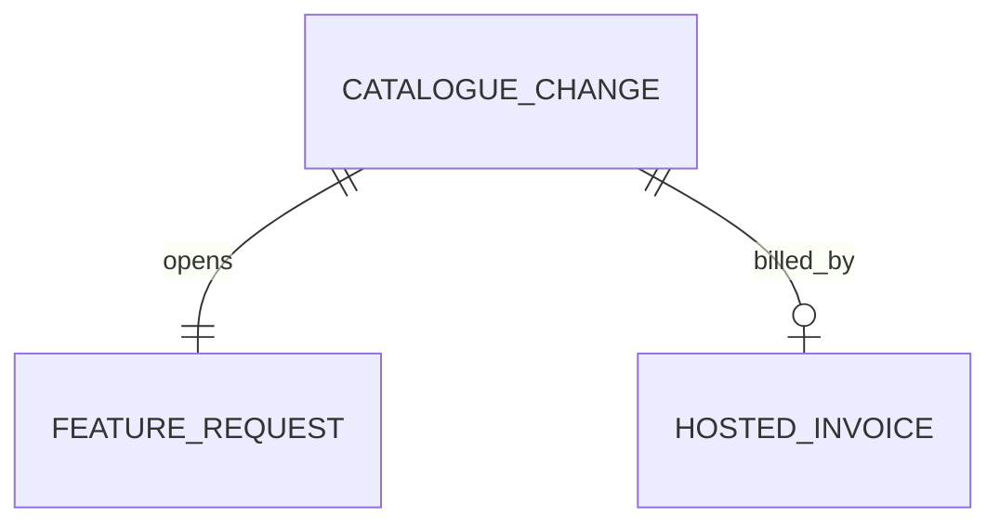
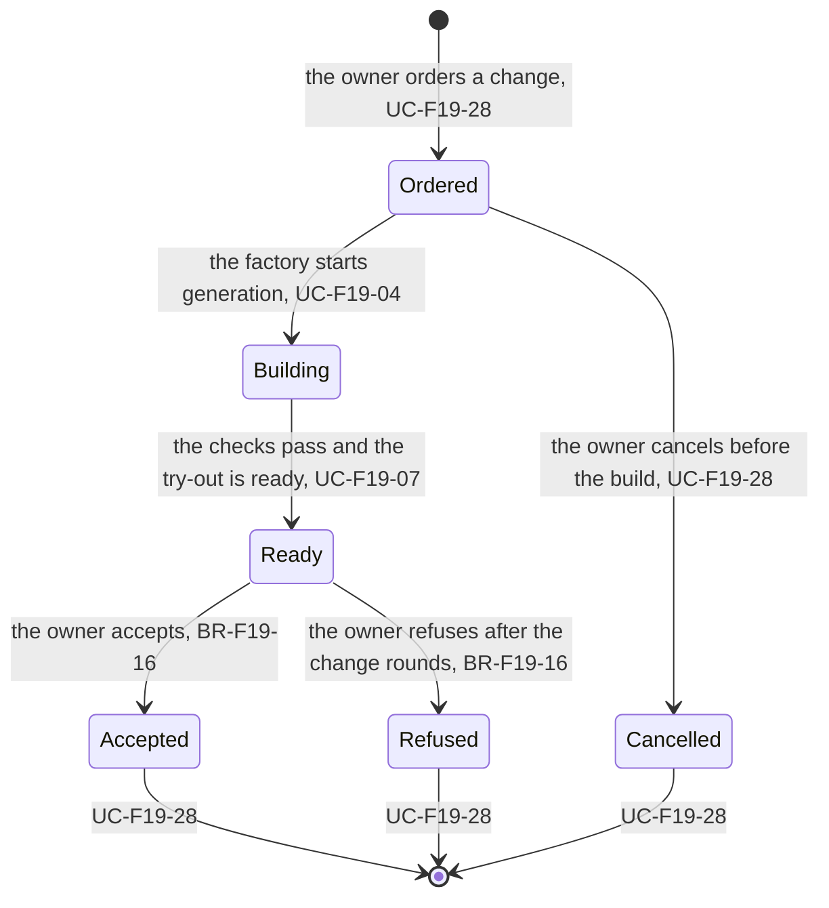

🏠 [Specs](../../../README.md) › 🧩 [Functional capabilities](../../README.md) ›
🏭 [F19 Feature factory (hosted edition)](../README.md) › 🗃️ [Data](README.md) › 🗃️ E-F19-17 Catalogue change

# 🗃️ E-F19-17 Catalogue change

**Status:** ✅ specified

## Purpose

The order of one change from the fixed-price catalogue, with the price and date frozen at the time of the order
([D538](../../../06-decisions/f19-feature-factory/d538-benchmark-gaps-f19-feature-factory.md)). It differs from a
feature request ([E-F19-01 Feature request](e-f19-01-feature-request.md)): the request starts from a description and a
quote, the order from a catalogue entry and a fixed price.

## Fields

| Name | Type | Required | Validation | Default | Example | Personal data | Custom fields |
|---|---|---|---|---|---|---|---|
| catalogue entry | text | yes | an entry of the catalogue | - | Add a field to a form | no | no |
| area | forms, reports, documents, rules | yes | one of the four | - | forms | no | no |
| target | text | yes | a form, report or template of the company | - | Quote form | no | no |
| price at order | amount excluding VAT | yes | the catalogue price at that time | - | 150 EUR | no | no |
| committed date | date | yes | the order date plus the delay | - | 2026-11-17 | no | no |
| ordered by | user | yes | the owner or an administrator | - | Claire P. | yes | no |
| feature request | feature request (E-F19-01) | yes | opened at the order | - | the request | no | no |
| accepted on | date | no | set at acceptance | - | 2026-11-18 | no | no |
| state | Ordered, Building, Ready, Accepted, Refused, Cancelled | yes | the lifecycle below | Ordered | Building | no | no |
| owner | user | yes | a user of the company | the creator | Claire P. | yes | no |

## Relations

- [E-F19-01 Feature request](e-f19-01-feature-request.md)
- [E-F19-09 Hosted invoice](e-f19-09-hosted-invoice.md)
- [E-F19-11 Delivery commitment](e-f19-11-delivery-commitment.md)

## Lifecycle

## Indexes and search

By catalogue entry, area, state, ordered by, committed date and accepted on.

## Retention

Kept with the company's invoices, 10 years, as the order is an accounting document's support
([CR-FR-002](../../../10-country-packs/france/accounting/cr-fr-002-accounting-records-kept-ten-years.md)).

## Audit

Every order, state change, acceptance, refusal and cancellation, with the frozen price and date.

## Import and export

No import. The orders of a year are exported as a CSV for accounting.

## Used by

- [UC-F19-28](../use-cases/07-catalogue-and-co-funding/uc-f19-28-order-a-fixed-price-change.md)

## Open questions

None.

---

⬅️ [E-F19-16 Feature defect](e-f19-16-feature-defect.md) · ⬆️ [Up](README.md) ·
➡️ [E-F19-18 Funding pledge](e-f19-18-funding-pledge.md)
