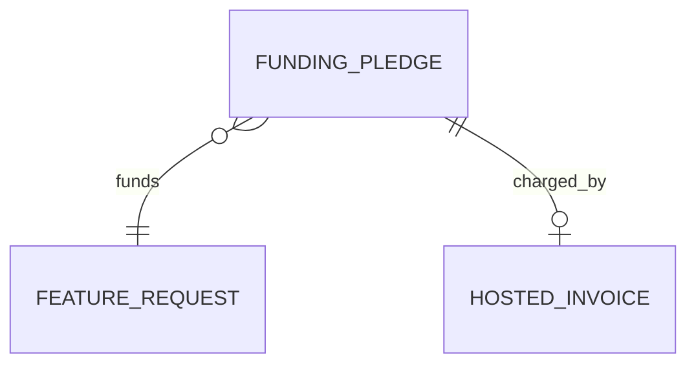
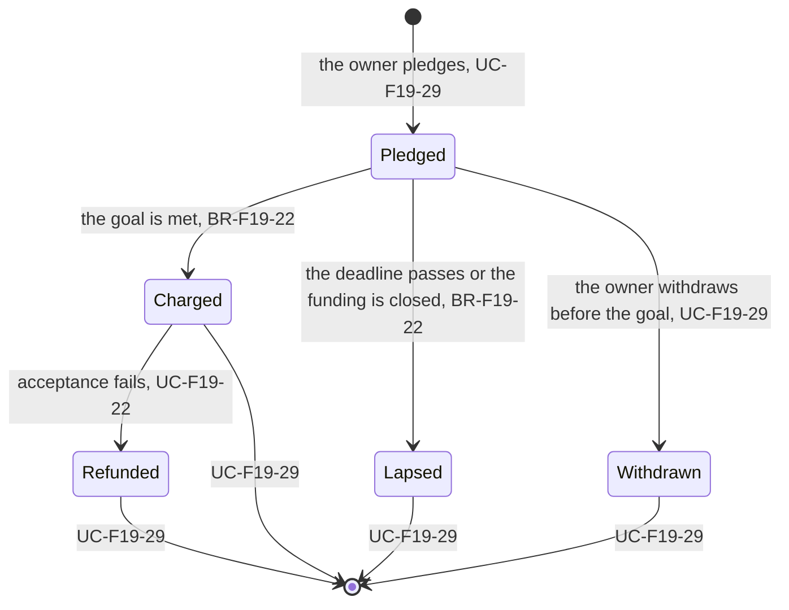

🏠 [Specs](../../../README.md) › 🧩 [Functional capabilities](../../README.md) ›
🏭 [F19 Feature factory (hosted edition)](../README.md) › 🗃️ [Data](README.md) › 🗃️ E-F19-18 Funding pledge

# 🗃️ E-F19-18 Funding pledge

**Status:** ✅ specified

## Purpose

One company's pledge towards a co-funded feature, with its amount and its state
([D538](../../../06-decisions/f19-feature-factory/d538-benchmark-gaps-f19-feature-factory.md)). It differs from the
feature subscription ([E-F19-03 Feature subscription](e-f19-03-feature-subscription.md)): a subscription is a monthly
price after acceptance, a pledge is a one-off promise before the build.

## Fields

| Name | Type | Required | Validation | Default | Example | Personal data | Custom fields |
|---|---|---|---|---|---|---|---|
| feature request | feature request (E-F19-01) | yes | a funding that is open | - | Lease reminders | no | no |
| pledger | company | yes | a hosted customer | - | Atelier Nord | no | no |
| amount | amount excluding VAT | yes | at least the lowest pledge | - | 200 EUR | no | no |
| goal | amount | yes | the feature's quote | - | 1,200 EUR | no | no |
| deadline | date | yes | at most 90 days after the opening | - | 2027-01-12 | no | no |
| pledged on | date | yes | not in the future | - | 2026-12-01 | no | no |
| charged on | date | no | set when the goal is met | - | 2026-12-22 | no | no |
| invoice | hosted invoice (E-F19-09) | no | set at the charge | - | FA-2026-0412 | no | no |
| state | Pledged, Charged, Lapsed, Withdrawn, Refunded | yes | the lifecycle below | Pledged | Charged | no | no |
| owner | user | yes | a user of the company | the creator | Claire P. | yes | no |

## Relations

- [E-F19-01 Feature request](e-f19-01-feature-request.md)
- [E-F19-02 Feature specification](e-f19-02-feature-specification.md)
- [E-F19-09 Hosted invoice](e-f19-09-hosted-invoice.md)
- [E-F19-03 Feature subscription](e-f19-03-feature-subscription.md)

## Lifecycle

## Indexes and search

By feature request, pledger, state, deadline and charged on.

## Retention

Kept with the invoices, 10 years, when charged
([CR-FR-002](../../../10-country-packs/france/accounting/cr-fr-002-accounting-records-kept-ten-years.md)); a lapsed or
withdrawn pledge is erased after 12 months.

## Audit

Every pledge, change, withdrawal, charge, lapse and refund, with the goal check and who.

## Import and export

No import. The pledges of a funding are exported as a CSV for the proposer without the pledgers' names.

## Used by

- [UC-F19-29](../use-cases/07-catalogue-and-co-funding/uc-f19-29-co-fund-a-feature.md)

## Open questions

None.

---

⬅️ [E-F19-17 Catalogue change](e-f19-17-catalogue-change.md) · ⬆️ [Up](README.md) ·
➡️ [E-F19-19 Feature maintenance plan](e-f19-19-feature-maintenance-plan.md)
