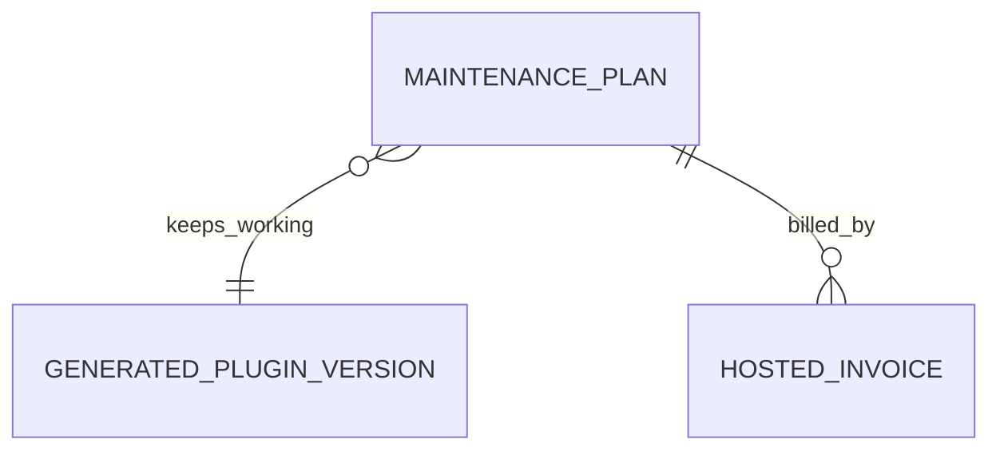
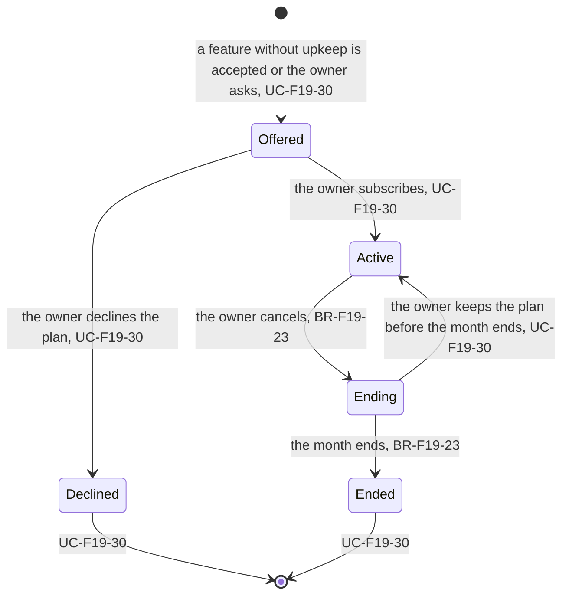

🏠 [Specs](../../../README.md) › 🧩 [Functional capabilities](../../README.md) ›
🏭 [F19 Feature factory (hosted edition)](../README.md) › 🗃️ [Data](README.md) › 🗃️ E-F19-19 Feature maintenance plan

# 🗃️ E-F19-19 Feature maintenance plan

**Status:** ✅ specified

## Purpose

The maintenance plan of one feature, with its monthly price, what it covers and its state
([D538](../../../06-decisions/f19-feature-factory/d538-benchmark-gaps-f19-feature-factory.md)). It differs from the
feature subscription ([E-F19-03 Feature subscription](e-f19-03-feature-subscription.md)): the subscription is the
monthly price of a feature and already includes its upkeep; the plan is for features that were paid once or whose source
was taken.

## Fields

| Name | Type | Required | Validation | Default | Example | Personal data | Custom fields |
|---|---|---|---|---|---|---|---|
| feature | generated plugin version (E-F19-04) | yes | an installed feature of the company | - | Quote form field | no | no |
| origin | fixed price, co-funded, source | yes | one of the three | - | fixed price | no | no |
| price | amount excluding VAT per month | yes | from the price catalogue | - | 20 EUR | no | no |
| covers | upgrades, security fixes | yes | both | both | both | no | no |
| started on | date | no | the day after subscribing | - | 2026-11-15 | no | no |
| ends on | date | no | set when cancelled: the end of the month | - | 2026-12-31 | no | no |
| next upgrade | version and date | no | from the release plan | - | 2.4 on 2026-12-03 | no | no |
| state | Offered, Active, Declined, Ending, Ended | yes | the lifecycle below | Offered | Active | no | no |
| owner | user | yes | a user of the company | the creator | Claire P. | yes | no |

## Relations

- [E-F19-04 Generated plugin version](e-f19-04-generated-plugin-version.md)
- [E-F19-03 Feature subscription](e-f19-03-feature-subscription.md)
- [E-F19-09 Hosted invoice](e-f19-09-hosted-invoice.md)
- [E-F19-13 Code handover](e-f19-13-code-handover.md)

## Lifecycle

## Indexes and search

By feature, origin, state, price and next upgrade.

## Retention

Kept with the invoices, 10 years
([CR-FR-002](../../../10-country-packs/france/accounting/cr-fr-002-accounting-records-kept-ten-years.md)).

## Audit

Every offer, subscription, cancellation, renewal, upgrade test and fix, with who and the result.

## Import and export

No import. The plans of a year are exported as a CSV for accounting.

## Used by

- [UC-F19-30](../use-cases/07-catalogue-and-co-funding/uc-f19-30-subscribe-to-a-feature-maintenance-plan.md)

## Open questions

None.

---

⬅️ [E-F19-18 Funding pledge](e-f19-18-funding-pledge.md) · ⬆️ [Up](README.md)
