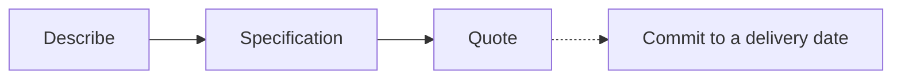
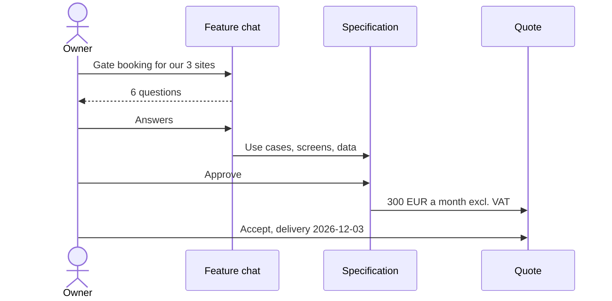

🏠 [Specs](../../../README.md) › 🧩 [Functional capabilities](../../README.md) ›
🏭 [F19 Feature factory (hosted edition)](../README.md) › 🔀 [Flows](README.md) › 🔀 FL-F19-01 Describe and order

# 🔀 FL-F19-01 Describe and order

**Status:** ✅ specified

## Summary

The owner or an administrator describes a need in plain words to the factory's chatbot, which asks questions and writes
a specification (use cases, screens, data, examples) that the customer approves before anything is built (BR-F19-03);
the quote of 300 EUR a month excluding VAT is accepted within the spending limit (BR-F19-08, BR-F19-09), and the factory
commits to a delivery date (UC-F19-21).

## Personas

- [U07 Administrator](../../../01-users/personas/u07-administrator.md)
- [U13 Owner](../../../01-users/personas/u13-owner.md)
- [U48 Hosting engineer](../../../01-users/personas/u48-hosting-engineer.md)

## Flowchart

## Sequence diagram

## Steps

| Step | Persona | Screen | Use case | What happens |
|---|---|---|---|---|
| 1 | U13, U07 | [S-F19-01](../screens/01-describe-and-order/s-f19-01-feature-chat.md) | [UC-F19-01](../use-cases/01-describe-and-order/uc-f19-01-describe-a-feature-in-plain-words.md) | Describe a feature in plain words |
| 2 | U13 | [S-F19-02](../screens/01-describe-and-order/s-f19-02-specification.md) | [UC-F19-02](../use-cases/01-describe-and-order/uc-f19-02-refine-the-feature-with-the-chatbot.md) | Refine the feature with the chatbot |
| 3 | U13 | [S-F19-03](../screens/01-describe-and-order/s-f19-03-quote.md) | [UC-F19-03](../use-cases/01-describe-and-order/uc-f19-03-accept-the-quote.md) | Accept the quote |
| 4 | U13, U48 | [S-F19-21](../screens/01-describe-and-order/s-f19-21-delivery-plan.md) | [UC-F19-21](../use-cases/01-describe-and-order/uc-f19-21-commit-to-a-delivery-date-and-handle-delays.md) | Commit to a delivery date |

### Entities and screens

| Entity | States in this flow | Shown at step and screen | Aggregated view |
|---|---|---|---|
| [E-F19-02 Feature specification](../data/e-f19-02-feature-specification.md) | Active | 2 [S-F19-02](../screens/01-describe-and-order/s-f19-02-specification.md) | Feature specifications |
| [E-F6-03 Quote](../../f06-customers-and-sales/data/e-f06-03-quote.md) | Refused, Sent, Accepted | Shown elsewhere: [S-F6-03 Quote editor](../../f06-customers-and-sales/screens/01-lead-to-quote/s-f06-03-quote-editor.md) | Quotes |
| [E-F19-11 Delivery commitment](../data/e-f19-11-delivery-commitment.md) | On time, Delayed, Delivered, Late, Cancelled | 3 [S-F19-03](../screens/01-describe-and-order/s-f19-03-quote.md); 4 [S-F19-21](../screens/01-describe-and-order/s-f19-21-delivery-plan.md) | Delivery commitments |

## Errors

E1: the need cannot be met by a plugin on the public API (BR-F19-02): the chatbot says so and the request is closed or
sent to the product backlog (step 1). E2: the specification is not approved after the customer's changes: nothing is
built and nothing is charged (step 2). E3: the quote is above the company's spending limit: it is refused for an
administrator and goes to the owner (step 3). E4: the chatbot's provider is down: the conversation is kept and resumes
later (D122).

## Images

Every step and error, for each persona taking part, in light and dark mode (D120). Steps are numbered as in the Steps
table; E rows are the error cases.

| Step | Persona | Device | Light | Dark |
|---|---|---|---|---|
| 1 | U13 | desktop | [light](../images/01-describe-and-order/u13-owner/1-describe-desktop-light.png) | [dark](../images/01-describe-and-order/u13-owner/1-describe-desktop-dark.png) |
| 1 | U13 | phone | [light](../images/01-describe-and-order/u13-owner/1-describe-phone-light.png) | [dark](../images/01-describe-and-order/u13-owner/1-describe-phone-dark.png) |
| 1 | U07 | desktop | [light](../images/01-describe-and-order/u07-administrator/1-describe-desktop-light.png) | [dark](../images/01-describe-and-order/u07-administrator/1-describe-desktop-dark.png) |
| 2 | U13 | desktop | [light](../images/01-describe-and-order/u13-owner/2-specification-desktop-light.png) | [dark](../images/01-describe-and-order/u13-owner/2-specification-desktop-dark.png) |
| 2 | U13 | phone | [light](../images/01-describe-and-order/u13-owner/2-specification-phone-light.png) | [dark](../images/01-describe-and-order/u13-owner/2-specification-phone-dark.png) |
| 3 | U13 | desktop | [light](../images/01-describe-and-order/u13-owner/3-quote-desktop-light.png) | [dark](../images/01-describe-and-order/u13-owner/3-quote-desktop-dark.png) |
| 3 | U13 | phone | [light](../images/01-describe-and-order/u13-owner/3-quote-phone-light.png) | [dark](../images/01-describe-and-order/u13-owner/3-quote-phone-dark.png) |
| E1 | U07 | desktop | [light](../images/01-describe-and-order/u07-administrator/e1-limit-desktop-light.png) | [dark](../images/01-describe-and-order/u07-administrator/e1-limit-desktop-dark.png) |
| 4 | U13 | desktop | [light](../images/01-describe-and-order/u13-owner/4-delivery-plan-desktop-light.png) | [dark](../images/01-describe-and-order/u13-owner/4-delivery-plan-desktop-dark.png) |
| 4 | U13 | phone | [light](../images/01-describe-and-order/u13-owner/4-delivery-plan-phone-light.png) | [dark](../images/01-describe-and-order/u13-owner/4-delivery-plan-phone-dark.png) |
| 4 | U48 | desktop | [light](../images/01-describe-and-order/u48-hosting-engineer/4-delivery-plan-desktop-light.png) | [dark](../images/01-describe-and-order/u48-hosting-engineer/4-delivery-plan-desktop-dark.png) |
| 4 | U48 | phone | [light](../images/01-describe-and-order/u48-hosting-engineer/4-delivery-plan-phone-light.png) | [dark](../images/01-describe-and-order/u48-hosting-engineer/4-delivery-plan-phone-dark.png) |

## Open questions

None.

---

⬆️ [Up](README.md) · ➡️ [FL-F19-02 Build and check](fl-f19-02-build-and-check.md)
