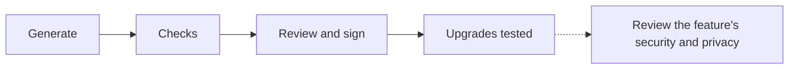

🏠 [Specs](../../../README.md) › 🧩 [Functional capabilities](../../README.md) ›
🏭 [F19 Feature factory (hosted edition)](../README.md) › 🔀 [Flows](README.md) › 🔀 FL-F19-02 Build and check

# 🔀 FL-F19-02 Build and check

**Status:** ✅ specified

## Summary

Covers UC-F19-04, UC-F19-05, UC-F19-06, UC-F19-17.

## Personas

- [U48 Hosting engineer](../../../01-users/personas/u48-hosting-engineer.md)
- [U07 Administrator](../../../01-users/personas/u07-administrator.md)

## Flowchart

## Sequence diagram

See each use case.

## Steps

| Step | Persona | Screen | Use case | What happens |
|---|---|---|---|---|
| 1 | U48 | [S-F19-04](../screens/02-build-and-check/s-f19-04-generation.md) | [UC-F19-04](../use-cases/02-build-and-check/uc-f19-04-generate-the-plugin-in-the-sandbox.md) | Generate the plugin in the sandbox |
| 2 | U48 | [S-F19-05](../screens/02-build-and-check/s-f19-05-checks.md) | [UC-F19-05](../use-cases/02-build-and-check/uc-f19-05-run-the-automatic-checks.md) | Run the automatic checks |
| 3 | U48 | [S-F19-06](../screens/02-build-and-check/s-f19-06-review.md) | [UC-F19-06](../use-cases/02-build-and-check/uc-f19-06-review-and-sign-the-feature.md) | Review and sign the feature |
| 4 | U48 | [S-F19-17](../screens/02-build-and-check/s-f19-17-compatibility.md) | [UC-F19-17](../use-cases/02-build-and-check/uc-f19-17-keep-features-working-across-upgrades.md) | Keep features working across upgrades |
| 5 | U48, U07 | [S-F19-24](../screens/02-build-and-check/s-f19-24-security-and-privacy.md) | [UC-F19-24](../use-cases/02-build-and-check/uc-f19-24-review-a-features-security-and-privacy.md) | Review the feature's security and privacy |

### Entities and screens

| Entity | States in this flow | Shown at step and screen | Aggregated view |
|---|---|---|---|
| [E-F19-05 Feature check report](../data/e-f19-05-feature-check-report.md) | Recorded | 2 [S-F19-05](../screens/02-build-and-check/s-f19-05-checks.md); 3 [S-F19-06](../screens/02-build-and-check/s-f19-06-review.md); 4 [S-F19-17](../screens/02-build-and-check/s-f19-17-compatibility.md) | Feature check reports |
| [E-F19-04 Generated plugin version](../data/e-f19-04-generated-plugin-version.md) | Recorded | 1 [S-F19-04](../screens/02-build-and-check/s-f19-04-generation.md); 3 [S-F19-06](../screens/02-build-and-check/s-f19-06-review.md); 4 [S-F19-17](../screens/02-build-and-check/s-f19-17-compatibility.md) | Generated plugin versions |
| [E-F19-14 Security and privacy review](../data/e-f19-14-security-and-privacy-review.md) | Open, Passed, Changes, Rejected | 3 [S-F19-06](../screens/02-build-and-check/s-f19-06-review.md); 5 [S-F19-24](../screens/02-build-and-check/s-f19-24-security-and-privacy.md) | Security and privacy reviews |

## Errors

As each use case.

## Images

Every step and error, for each persona taking part, in light and dark mode (D120). Steps are numbered as in the Steps
table; E rows are the error cases.

| Step | Persona | Device | Light | Dark |
|---|---|---|---|---|
| 1 | U48 | desktop | [light](../images/02-build-and-check/u48-hosting-engineer/1-generate-desktop-light.png) | [dark](../images/02-build-and-check/u48-hosting-engineer/1-generate-desktop-dark.png) |
| 1 | U48 | phone | [light](../images/02-build-and-check/u48-hosting-engineer/1-generate-phone-light.png) | [dark](../images/02-build-and-check/u48-hosting-engineer/1-generate-phone-dark.png) |
| 2 | U48 | desktop | [light](../images/02-build-and-check/u48-hosting-engineer/2-checks-desktop-light.png) | [dark](../images/02-build-and-check/u48-hosting-engineer/2-checks-desktop-dark.png) |
| 2 | U48 | phone | [light](../images/02-build-and-check/u48-hosting-engineer/2-checks-phone-light.png) | [dark](../images/02-build-and-check/u48-hosting-engineer/2-checks-phone-dark.png) |
| 3 | U48 | desktop | [light](../images/02-build-and-check/u48-hosting-engineer/3-review-desktop-light.png) | [dark](../images/02-build-and-check/u48-hosting-engineer/3-review-desktop-dark.png) |
| 3 | U48 | phone | [light](../images/02-build-and-check/u48-hosting-engineer/3-review-phone-light.png) | [dark](../images/02-build-and-check/u48-hosting-engineer/3-review-phone-dark.png) |
| 4 | U48 | desktop | [light](../images/02-build-and-check/u48-hosting-engineer/4-upgrades-desktop-light.png) | [dark](../images/02-build-and-check/u48-hosting-engineer/4-upgrades-desktop-dark.png) |
| 4 | U48 | phone | [light](../images/02-build-and-check/u48-hosting-engineer/4-upgrades-phone-light.png) | [dark](../images/02-build-and-check/u48-hosting-engineer/4-upgrades-phone-dark.png) |
| E1 | U48 | desktop | [light](../images/02-build-and-check/u48-hosting-engineer/e1-closed-code-desktop-light.png) | [dark](../images/02-build-and-check/u48-hosting-engineer/e1-closed-code-desktop-dark.png) |
| E1 | U48 | phone | [light](../images/02-build-and-check/u48-hosting-engineer/e1-closed-code-phone-light.png) | [dark](../images/02-build-and-check/u48-hosting-engineer/e1-closed-code-phone-dark.png) |
| 5 | U48 | desktop | [light](../images/02-build-and-check/u48-hosting-engineer/5-security-and-privacy-desktop-light.png) | [dark](../images/02-build-and-check/u48-hosting-engineer/5-security-and-privacy-desktop-dark.png) |
| 5 | U48 | phone | [light](../images/02-build-and-check/u48-hosting-engineer/5-security-and-privacy-phone-light.png) | [dark](../images/02-build-and-check/u48-hosting-engineer/5-security-and-privacy-phone-dark.png) |
| 5 | U07 | desktop | [light](../images/02-build-and-check/u07-administrator/5-security-and-privacy-desktop-light.png) | [dark](../images/02-build-and-check/u07-administrator/5-security-and-privacy-desktop-dark.png) |

## Open questions

None.

---

⬅️ [FL-F19-01 Describe and order](fl-f19-01-describe-and-order.md) · ⬆️ [Up](README.md) ·
➡️ [FL-F19-03 Try, install and maintain](fl-f19-03-try-install-and-maintain.md)
