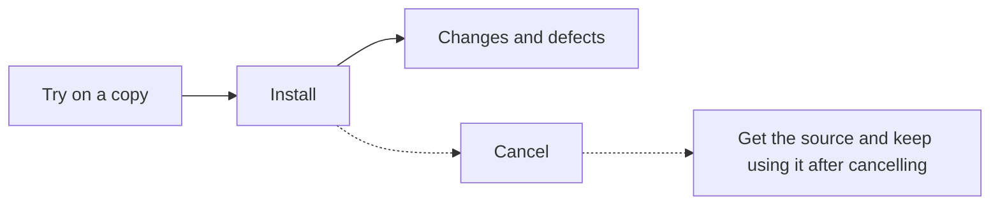

🏠 [Specs](../../../README.md) › 🧩 [Functional capabilities](../../README.md) ›
🏭 [F19 Feature factory (hosted edition)](../README.md) › 🔀 [Flows](README.md) › 🔀 FL-F19-03 Try, install and maintain

# 🔀 FL-F19-03 Try, install and maintain

**Status:** ✅ specified

## Summary

Covers UC-F19-07, UC-F19-08, UC-F19-09, UC-F19-10, UC-F19-11.

## Personas

- [U07 Administrator](../../../01-users/personas/u07-administrator.md)
- [U13 Owner](../../../01-users/personas/u13-owner.md)

## Flowchart

## Sequence diagram

See each use case.

## Steps

| Step | Persona | Screen | Use case | What happens |
|---|---|---|---|---|
| 1 | U13, U07 | [S-F19-07](../screens/03-try-install-and-maintain/s-f19-07-try-out.md) | [UC-F19-07](../use-cases/03-try-install-and-maintain/uc-f19-07-try-the-feature-on-a-copy-of-the-data.md) | Try the feature on a copy of the data |
| 2 | U07 | [S-F19-08](../screens/03-try-install-and-maintain/s-f19-08-install.md) | [UC-F19-08](../use-cases/03-try-install-and-maintain/uc-f19-08-accept-and-install-the-feature.md) | Accept and install the feature |
| 3 | U13 | [S-F19-09](../screens/03-try-install-and-maintain/s-f19-09-changes.md) | [UC-F19-09](../use-cases/03-try-install-and-maintain/uc-f19-09-ask-for-changes.md) | Ask for changes |
| 4 | U07 | [S-F19-10](../screens/03-try-install-and-maintain/s-f19-10-defects.md) | [UC-F19-10](../use-cases/03-try-install-and-maintain/uc-f19-10-report-a-defect.md) | Report a defect |
| 5 | U13 | [S-F19-11](../screens/03-try-install-and-maintain/s-f19-11-cancel.md) | [UC-F19-11](../use-cases/03-try-install-and-maintain/uc-f19-11-cancel-a-feature-and-export-its-data.md) | Cancel a feature and export its data |
| 6 | U13 | [S-F19-23](../screens/03-try-install-and-maintain/s-f19-23-ownership.md) | [UC-F19-23](../use-cases/03-try-install-and-maintain/uc-f19-23-get-the-source-of-a-feature.md) | Get the source and keep using it after cancelling |

### Entities and screens

| Entity | States in this flow | Shown at step and screen | Aggregated view |
|---|---|---|---|
| [E-F19-06 Try-out copy](../data/e-f19-06-try-out-copy.md) | Active | 1 [S-F19-07](../screens/03-try-install-and-maintain/s-f19-07-try-out.md); 5 [S-F19-11](../screens/03-try-install-and-maintain/s-f19-11-cancel.md) | Try-out copies |
| [E-F19-01 Feature request](../data/e-f19-01-feature-request.md) | Active | 3 [S-F19-09](../screens/03-try-install-and-maintain/s-f19-09-changes.md) | Feature requests |
| [E-F19-16 Feature defect](../data/e-f19-16-feature-defect.md) | Active | 4 [S-F19-10](../screens/03-try-install-and-maintain/s-f19-10-defects.md) | Feature defects |
| [E-F19-13 Code handover](../data/e-f19-13-code-handover.md) | Available, Downloaded | 5 [S-F19-11](../screens/03-try-install-and-maintain/s-f19-11-cancel.md); 6 [S-F19-23](../screens/03-try-install-and-maintain/s-f19-23-ownership.md) | Code handovers |

## Errors

As each use case.

## Images

Every step and error, for each persona taking part, in light and dark mode (D120). Steps are numbered as in the Steps
table; E rows are the error cases.

| Step | Persona | Device | Light | Dark |
|---|---|---|---|---|
| 1 | U13 | desktop | [light](../images/03-try-install-and-maintain/u13-owner/1-try-desktop-light.png) | [dark](../images/03-try-install-and-maintain/u13-owner/1-try-desktop-dark.png) |
| 1 | U13 | phone | [light](../images/03-try-install-and-maintain/u13-owner/1-try-phone-light.png) | [dark](../images/03-try-install-and-maintain/u13-owner/1-try-phone-dark.png) |
| 1 | U07 | desktop | [light](../images/03-try-install-and-maintain/u07-administrator/1-try-desktop-light.png) | [dark](../images/03-try-install-and-maintain/u07-administrator/1-try-desktop-dark.png) |
| 2 | U07 | desktop | [light](../images/03-try-install-and-maintain/u07-administrator/2-install-desktop-light.png) | [dark](../images/03-try-install-and-maintain/u07-administrator/2-install-desktop-dark.png) |
| 3 | U13 | desktop | [light](../images/03-try-install-and-maintain/u13-owner/3-changes-desktop-light.png) | [dark](../images/03-try-install-and-maintain/u13-owner/3-changes-desktop-dark.png) |
| 3 | U13 | phone | [light](../images/03-try-install-and-maintain/u13-owner/3-changes-phone-light.png) | [dark](../images/03-try-install-and-maintain/u13-owner/3-changes-phone-dark.png) |
| 4 | U07 | desktop | [light](../images/03-try-install-and-maintain/u07-administrator/4-defect-desktop-light.png) | [dark](../images/03-try-install-and-maintain/u07-administrator/4-defect-desktop-dark.png) |
| 5 | U13 | desktop | [light](../images/03-try-install-and-maintain/u13-owner/5-cancel-desktop-light.png) | [dark](../images/03-try-install-and-maintain/u13-owner/5-cancel-desktop-dark.png) |
| 5 | U13 | phone | [light](../images/03-try-install-and-maintain/u13-owner/5-cancel-phone-light.png) | [dark](../images/03-try-install-and-maintain/u13-owner/5-cancel-phone-dark.png) |
| E1 | U07 | desktop | [light](../images/03-try-install-and-maintain/u07-administrator/e1-signature-desktop-light.png) | [dark](../images/03-try-install-and-maintain/u07-administrator/e1-signature-desktop-dark.png) |
| 6 | U13 | desktop | [light](../images/03-try-install-and-maintain/u13-owner/6-ownership-desktop-light.png) | [dark](../images/03-try-install-and-maintain/u13-owner/6-ownership-desktop-dark.png) |
| 6 | U13 | phone | [light](../images/03-try-install-and-maintain/u13-owner/6-ownership-phone-light.png) | [dark](../images/03-try-install-and-maintain/u13-owner/6-ownership-phone-dark.png) |

## Open questions

None.

---

⬅️ [FL-F19-02 Build and check](fl-f19-02-build-and-check.md) · ⬆️ [Up](README.md) ·
➡️ [FL-F19-04 Promote](fl-f19-04-promote.md)
