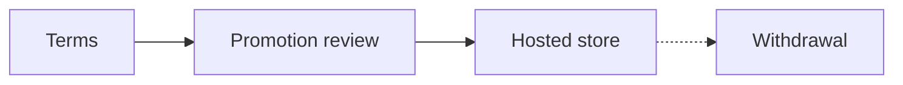

🏠 [Specs](../../../README.md) › 🧩 [Functional capabilities](../../README.md) ›
🏭 [F19 Feature factory (hosted edition)](../README.md) › 🔀 [Flows](README.md) › 🔀 FL-F19-04 Promote

# 🔀 FL-F19-04 Promote

**Status:** ✅ specified

## Summary

Covers UC-F19-12, UC-F19-13, UC-F19-14, UC-F19-18, UC-F19-20.

## Personas

- [U13 Owner](../../../01-users/personas/u13-owner.md)
- [U48 Hosting engineer](../../../01-users/personas/u48-hosting-engineer.md)

## Flowchart

## Sequence diagram

See each use case.

## Steps

| Step | Persona | Screen | Use case | What happens |
|---|---|---|---|---|
| 1 | U13 | [S-F19-12](../screens/04-promote/s-f19-12-promotion.md) | [UC-F19-12](../use-cases/04-promote/uc-f19-12-promote-the-feature-to-every-hosted-customer.md) | Promote the feature to every hosted customer |
| 2 | U48 | [S-F19-13](../screens/04-promote/s-f19-13-promotion-review.md) | [UC-F19-13](../use-cases/04-promote/uc-f19-13-review-a-promotion-for-genericity-and-privacy.md) | Review a promotion for genericity and privacy |
| 3 | U48 | [S-F19-14](../screens/04-promote/s-f19-14-store-listing.md) | [UC-F19-14](../use-cases/04-promote/uc-f19-14-publish-it-in-the-hosted-store.md) | Publish it in the hosted store |
| 4 | U48 | [S-F19-18](../screens/04-promote/s-f19-18-withdrawal.md) | [UC-F19-18](../use-cases/04-promote/uc-f19-18-withdraw-a-harmful-feature.md) | Withdraw a harmful feature |
| 5 | U13 | [S-F19-20](../screens/04-promote/s-f19-20-promotion-terms.md) | [UC-F19-20](../use-cases/04-promote/uc-f19-20-accept-the-licence-terms-of-a-promotion.md) | Accept the licence terms of a promotion |

### Entities and screens

| Entity | States in this flow | Shown at step and screen | Aggregated view |
|---|---|---|---|
| [E-F19-07 Feature promotion](../data/e-f19-07-feature-promotion.md) | Listed, Submitted, Started | 1 [S-F19-12](../screens/04-promote/s-f19-12-promotion.md); 2 [S-F19-13](../screens/04-promote/s-f19-13-promotion-review.md); 3 [S-F19-14](../screens/04-promote/s-f19-14-store-listing.md); 5 [S-F19-20](../screens/04-promote/s-f19-20-promotion-terms.md) | Feature promotions |
| [E-F14-01 Store listing](../../f14-plugin-store/data/e-f14-01-store-listing.md) | New, Paid, Refused, Complete | Shown elsewhere: [S-F14-01 Store](../../f14-plugin-store/screens/01-find-and-install/s-f14-01-store.md) | Store listings |
| [E-F19-10 Feature withdrawal](../data/e-f19-10-feature-withdrawal.md) | Active | 4 [S-F19-18](../screens/04-promote/s-f19-18-withdrawal.md) | Feature withdrawals |

## Errors

As each use case.

## Images

Every step and error, for each persona taking part, in light and dark mode (D120). Steps are numbered as in the Steps
table; E rows are the error cases.

| Step | Persona | Device | Light | Dark |
|---|---|---|---|---|
| 1 | U13 | desktop | [light](../images/04-promote/u13-owner/1-promote-desktop-light.png) | [dark](../images/04-promote/u13-owner/1-promote-desktop-dark.png) |
| 1 | U13 | phone | [light](../images/04-promote/u13-owner/1-promote-phone-light.png) | [dark](../images/04-promote/u13-owner/1-promote-phone-dark.png) |
| 2 | U48 | desktop | [light](../images/04-promote/u48-hosting-engineer/2-privacy-review-desktop-light.png) | [dark](../images/04-promote/u48-hosting-engineer/2-privacy-review-desktop-dark.png) |
| 2 | U48 | phone | [light](../images/04-promote/u48-hosting-engineer/2-privacy-review-phone-light.png) | [dark](../images/04-promote/u48-hosting-engineer/2-privacy-review-phone-dark.png) |
| 3 | U48 | desktop | [light](../images/04-promote/u48-hosting-engineer/3-listing-desktop-light.png) | [dark](../images/04-promote/u48-hosting-engineer/3-listing-desktop-dark.png) |
| 3 | U48 | phone | [light](../images/04-promote/u48-hosting-engineer/3-listing-phone-light.png) | [dark](../images/04-promote/u48-hosting-engineer/3-listing-phone-dark.png) |
| 4 | U48 | desktop | [light](../images/04-promote/u48-hosting-engineer/4-withdraw-desktop-light.png) | [dark](../images/04-promote/u48-hosting-engineer/4-withdraw-desktop-dark.png) |
| 4 | U48 | phone | [light](../images/04-promote/u48-hosting-engineer/4-withdraw-phone-light.png) | [dark](../images/04-promote/u48-hosting-engineer/4-withdraw-phone-dark.png) |
| 5 | U13 | desktop | [light](../images/04-promote/u13-owner/5-terms-desktop-light.png) | [dark](../images/04-promote/u13-owner/5-terms-desktop-dark.png) |
| 5 | U13 | phone | [light](../images/04-promote/u13-owner/5-terms-phone-light.png) | [dark](../images/04-promote/u13-owner/5-terms-phone-dark.png) |
| E1 | U48 | desktop | [light](../images/04-promote/u48-hosting-engineer/e1-customer-data-desktop-light.png) | [dark](../images/04-promote/u48-hosting-engineer/e1-customer-data-desktop-dark.png) |
| E1 | U48 | phone | [light](../images/04-promote/u48-hosting-engineer/e1-customer-data-phone-light.png) | [dark](../images/04-promote/u48-hosting-engineer/e1-customer-data-phone-dark.png) |

## Open questions

None.

---

⬅️ [FL-F19-03 Try, install and maintain](fl-f19-03-try-install-and-maintain.md) · ⬆️ [Up](README.md) ·
➡️ [FL-F19-05 Bill and credit](fl-f19-05-bill-and-credit.md)
