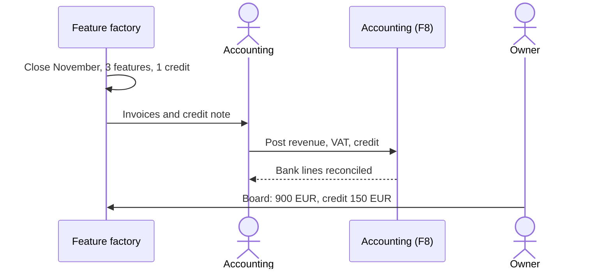

🏠 [Specs](../../../README.md) › 🧩 [Functional capabilities](../../README.md) ›
🏭 [F19 Feature factory (hosted edition)](../README.md) › 🔀 [Flows](README.md) › 🔀 FL-F19-05 Bill and credit

# 🔀 FL-F19-05 Bill and credit

**Status:** ✅ specified

## Summary

Each month the factory invoices every feature at 300 EUR excluding VAT with the right VAT (BR-F19-01), credits promoting
customers 50 % of what others paid as a credit note (BR-F19-11, BR-F19-12), credits or refunds features that failed
(UC-F19-22), posts it all to accounting and reconciles the payments (UC-F19-25, UC-F19-26); the board shows
subscriptions, costs and credits.

## Personas

- [U05 Accounting](../../../01-users/personas/u05-accounting.md)
- [U13 Owner](../../../01-users/personas/u13-owner.md)

## Flowchart

## Sequence diagram

## Steps

| Step | Persona | Screen | Use case | What happens |
|---|---|---|---|---|
| 1 | U05, U13 | [S-F19-15](../screens/05-bill-and-credit/s-f19-15-credits.md) | [UC-F19-15](../use-cases/05-bill-and-credit/uc-f19-15-receive-the-promotion-credit.md) | Receive the promotion credit |
| 2 | U05 | [S-F19-16](../screens/05-bill-and-credit/s-f19-16-invoices.md) | [UC-F19-16](../use-cases/05-bill-and-credit/uc-f19-16-invoice-features-with-the-right-vat.md) | Invoice features with the right VAT |
| 3 | U13, U05 | [S-F19-19](../screens/05-bill-and-credit/s-f19-19-feature-board.md) | [UC-F19-19](../use-cases/05-bill-and-credit/uc-f19-19-follow-features-costs-and-credits.md) | Follow features, costs and credits |
| 4 | U05 | [S-F19-25](../screens/05-bill-and-credit/s-f19-25-factory-accounting.md) | [UC-F19-25](../use-cases/05-bill-and-credit/uc-f19-25-post-feature-invoices-credits-and-refunds-to-accounting.md) | Post invoices, credits and refunds to accounting |
| 5 | U05, U13 | [S-F19-25](../screens/05-bill-and-credit/s-f19-25-factory-accounting.md) | [UC-F19-26](../use-cases/05-bill-and-credit/uc-f19-26-reconcile-feature-payments-and-follow-up-unpaid-invoices.md) | Reconcile payments and follow up unpaid invoices |

### Entities and screens

| Entity | States in this flow | Shown at step and screen | Aggregated view |
|---|---|---|---|
| [E-F19-09 Hosted invoice](../data/e-f19-09-hosted-invoice.md) | Active | 1 [S-F19-15](../screens/05-bill-and-credit/s-f19-15-credits.md); 2 [S-F19-16](../screens/05-bill-and-credit/s-f19-16-invoices.md); 4, 5 [S-F19-25](../screens/05-bill-and-credit/s-f19-25-factory-accounting.md) | Hosted invoices |
| [E-F19-08 Promotion credit](../data/e-f19-08-promotion-credit.md) | Active | 1 [S-F19-15](../screens/05-bill-and-credit/s-f19-15-credits.md); 3 [S-F19-19](../screens/05-bill-and-credit/s-f19-19-feature-board.md) | Promotion credits |
| [E-F19-12 Feature refund](../data/e-f19-12-feature-refund.md) | Proposed, Refused | 3 [S-F19-19](../screens/05-bill-and-credit/s-f19-19-feature-board.md) | Feature refunds |
| [E-F19-15 Factory posting](../data/e-f19-15-factory-posting.md) | Prepared, Posted, Reconciled | 1 [S-F19-15](../screens/05-bill-and-credit/s-f19-15-credits.md); 2 [S-F19-16](../screens/05-bill-and-credit/s-f19-16-invoices.md); 4, 5 [S-F19-25](../screens/05-bill-and-credit/s-f19-25-factory-accounting.md) | Factory postings |
| [E-F6-06 Customer payment](../../f06-customers-and-sales/data/e-f06-06-customer-payment.md) | Refused | Shown elsewhere: [S-F6-07 Payments and reconciliation](../../f06-customers-and-sales/screens/03-invoice-and-get-paid/s-f06-07-payments-and-reconciliation.md) | Customer payments |

## Errors

E1: an invoice fails e-invoicing validation: it is corrected and sent again before its due date (step 2). E2: a credit
is larger than the invoice it reduces: the rest is carried to the next month (D390). E3: a payment is missing at its due
date: a reminder goes out and the feature stays on while dunning runs (step 5). E4: a posting is refused by F8 (closed
period): it is posted in the next open period with a note (step 4).

## Images

Every step and error, for each persona taking part, in light and dark mode (D120). Steps are numbered as in the Steps
table; E rows are the error cases.

| Step | Persona | Device | Light | Dark |
|---|---|---|---|---|
| 1 | U05 | desktop | [light](../images/05-bill-and-credit/u05-accounting/1-credit-desktop-light.png) | [dark](../images/05-bill-and-credit/u05-accounting/1-credit-desktop-dark.png) |
| 1 | U13 | desktop | [light](../images/05-bill-and-credit/u13-owner/1-credit-desktop-light.png) | [dark](../images/05-bill-and-credit/u13-owner/1-credit-desktop-dark.png) |
| 1 | U13 | phone | [light](../images/05-bill-and-credit/u13-owner/1-credit-phone-light.png) | [dark](../images/05-bill-and-credit/u13-owner/1-credit-phone-dark.png) |
| 2 | U05 | desktop | [light](../images/05-bill-and-credit/u05-accounting/2-invoice-desktop-light.png) | [dark](../images/05-bill-and-credit/u05-accounting/2-invoice-desktop-dark.png) |
| 3 | U13 | desktop | [light](../images/05-bill-and-credit/u13-owner/3-board-desktop-light.png) | [dark](../images/05-bill-and-credit/u13-owner/3-board-desktop-dark.png) |
| 3 | U13 | phone | [light](../images/05-bill-and-credit/u13-owner/3-board-phone-light.png) | [dark](../images/05-bill-and-credit/u13-owner/3-board-phone-dark.png) |
| 3 | U05 | desktop | [light](../images/05-bill-and-credit/u05-accounting/3-board-desktop-light.png) | [dark](../images/05-bill-and-credit/u05-accounting/3-board-desktop-dark.png) |
| E1 | U05 | desktop | [light](../images/05-bill-and-credit/u05-accounting/e1-vat-number-desktop-light.png) | [dark](../images/05-bill-and-credit/u05-accounting/e1-vat-number-desktop-dark.png) |
| 4 | U05 | desktop | [light](../images/05-bill-and-credit/u05-accounting/4-factory-accounting-desktop-light.png) | [dark](../images/05-bill-and-credit/u05-accounting/4-factory-accounting-desktop-dark.png) |
| 5 | U05 | desktop | [light](../images/05-bill-and-credit/u05-accounting/5-factory-accounting-desktop-light.png) | [dark](../images/05-bill-and-credit/u05-accounting/5-factory-accounting-desktop-dark.png) |
| 5 | U13 | desktop | [light](../images/05-bill-and-credit/u13-owner/5-factory-accounting-desktop-light.png) | [dark](../images/05-bill-and-credit/u13-owner/5-factory-accounting-desktop-dark.png) |
| 5 | U13 | phone | [light](../images/05-bill-and-credit/u13-owner/5-factory-accounting-phone-light.png) | [dark](../images/05-bill-and-credit/u13-owner/5-factory-accounting-phone-dark.png) |

## Open questions

None.

---

⬅️ [FL-F19-04 Promote](fl-f19-04-promote.md) · ⬆️ [Up](README.md) ·
➡️ [FL-F19-06 Delivery and refunds](fl-f19-06-delivery-and-refunds.md)
