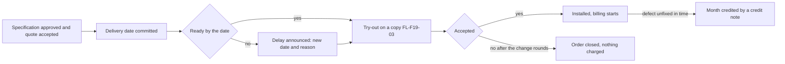
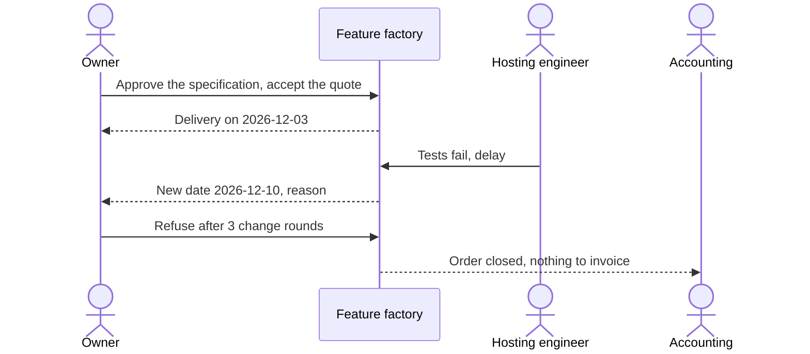

🏠 [Specs](../../../README.md) › 🧩 [Functional capabilities](../../README.md) ›
🏭 [F19 Feature factory (hosted edition)](../README.md) › 🔀 [Flows](README.md) › 🔀 FL-F19-06 Delivery and refunds

# 🔀 FL-F19-06 Delivery and refunds

**Status:** ✅ specified

## Summary

Once the specification is approved, the factory commits to a delivery date; a delay is announced with its new date and
reason, and a feature that fails its acceptance is closed without charge or credited, as the rules say (D476).

## Personas

- [U13 Owner](../../../01-users/personas/u13-owner.md)
- [U48 Hosting engineer](../../../01-users/personas/u48-hosting-engineer.md)
- [U05 Accounting](../../../01-users/personas/u05-accounting.md)

## Flowchart

## Sequence diagram

## Steps

| Step | Persona | Screen | Use case | What happens |
|---|---|---|---|---|
| 1 | U13, U48 | [S-F19-21](../screens/01-describe-and-order/s-f19-21-delivery-plan.md) | [UC-F19-21](../use-cases/01-describe-and-order/uc-f19-21-commit-to-a-delivery-date-and-handle-delays.md) | Commit to a delivery date and handle delays |
| 2 | U13, U05 | [S-F19-22](../screens/06-delivery-and-refunds/s-f19-22-refunds.md) | [UC-F19-22](../use-cases/06-delivery-and-refunds/uc-f19-22-refund-when-acceptance-fails.md) | Refund when acceptance fails |

### Entities and screens

| Entity | States in this flow | Shown at step and screen | Aggregated view |
|---|---|---|---|
| [E-F19-02 Feature specification](../data/e-f19-02-feature-specification.md) | Active | Shown elsewhere: [S-F19-02 Specification](../screens/01-describe-and-order/s-f19-02-specification.md) | Feature specifications |
| [E-F6-03 Quote](../../f06-customers-and-sales/data/e-f06-03-quote.md) | Accepted | Shown elsewhere: [S-F6-03 Quote editor](../../f06-customers-and-sales/screens/01-lead-to-quote/s-f06-03-quote-editor.md) | Quotes |
| [E-F19-11 Delivery commitment](../data/e-f19-11-delivery-commitment.md) | On time, Delayed, Late | 1 [S-F19-21](../screens/01-describe-and-order/s-f19-21-delivery-plan.md) | Delivery commitments |
| [E-F19-06 Try-out copy](../data/e-f19-06-try-out-copy.md) | Active | Shown elsewhere: [S-F19-07 Try-out](../screens/03-try-install-and-maintain/s-f19-07-try-out.md) | Try-out copies |
| [E-F19-03 Feature subscription](../data/e-f19-03-feature-subscription.md) | Active | Shown elsewhere: [S-F19-19 Feature board](../screens/05-bill-and-credit/s-f19-19-feature-board.md) | Feature subscriptions |
| [E-F19-01 Feature request](../data/e-f19-01-feature-request.md) | Active | Shown elsewhere: [S-F19-01 Feature chat](../screens/01-describe-and-order/s-f19-01-feature-chat.md) | Feature requests |
| [E-F19-12 Feature refund](../data/e-f19-12-feature-refund.md) | Proposed, Issued, Refused | 2 [S-F19-22](../screens/06-delivery-and-refunds/s-f19-22-refunds.md) | Feature refunds |
| [E-F19-16 Feature defect](../data/e-f19-16-feature-defect.md) | Active | 2 [S-F19-22](../screens/06-delivery-and-refunds/s-f19-22-refunds.md) | Feature defects |

## Errors

E1: a second delay passes the limit of 20 business days late: the owner may cancel the order without charge
(step 1). E2: a credit for an unfixed defect is disputed: accounting checks the dates of the report and the fix and
decides (step 2).

## Images

Every step and error, for each persona taking part, in light and dark mode (D120). Steps are numbered as in the Steps
table; E rows are the error cases.

| Step | Persona | Device | Light | Dark |
|---|---|---|---|---|
| 1 | U13 | desktop | [light](../images/06-delivery-and-refunds/u13-owner/1-delivery-plan-desktop-light.png) | [dark](../images/06-delivery-and-refunds/u13-owner/1-delivery-plan-desktop-dark.png) |
| 1 | U13 | phone | [light](../images/06-delivery-and-refunds/u13-owner/1-delivery-plan-phone-light.png) | [dark](../images/06-delivery-and-refunds/u13-owner/1-delivery-plan-phone-dark.png) |
| 1 | U48 | desktop | [light](../images/06-delivery-and-refunds/u48-hosting-engineer/1-delivery-plan-desktop-light.png) | [dark](../images/06-delivery-and-refunds/u48-hosting-engineer/1-delivery-plan-desktop-dark.png) |
| 1 | U48 | phone | [light](../images/06-delivery-and-refunds/u48-hosting-engineer/1-delivery-plan-phone-light.png) | [dark](../images/06-delivery-and-refunds/u48-hosting-engineer/1-delivery-plan-phone-dark.png) |
| 2 | U13 | desktop | [light](../images/06-delivery-and-refunds/u13-owner/2-refunds-desktop-light.png) | [dark](../images/06-delivery-and-refunds/u13-owner/2-refunds-desktop-dark.png) |
| 2 | U13 | phone | [light](../images/06-delivery-and-refunds/u13-owner/2-refunds-phone-light.png) | [dark](../images/06-delivery-and-refunds/u13-owner/2-refunds-phone-dark.png) |
| 2 | U05 | desktop | [light](../images/06-delivery-and-refunds/u05-accounting/2-refunds-desktop-light.png) | [dark](../images/06-delivery-and-refunds/u05-accounting/2-refunds-desktop-dark.png) |
| E1 | U13 | desktop | [light](../images/06-delivery-and-refunds/u13-owner/e1-delivery-plan-refused-desktop-light.png) | [dark](../images/06-delivery-and-refunds/u13-owner/e1-delivery-plan-refused-desktop-dark.png) |
| E1 | U13 | phone | [light](../images/06-delivery-and-refunds/u13-owner/e1-delivery-plan-refused-phone-light.png) | [dark](../images/06-delivery-and-refunds/u13-owner/e1-delivery-plan-refused-phone-dark.png) |

## Open questions

None.

---

⬅️ [FL-F19-05 Bill and credit](fl-f19-05-bill-and-credit.md) · ⬆️ [Up](README.md) ·
➡️ [FL-F19-07 Similar features, catalogue, co-funding and maintenance](fl-f19-07-catalogue-and-co-funding.md)
