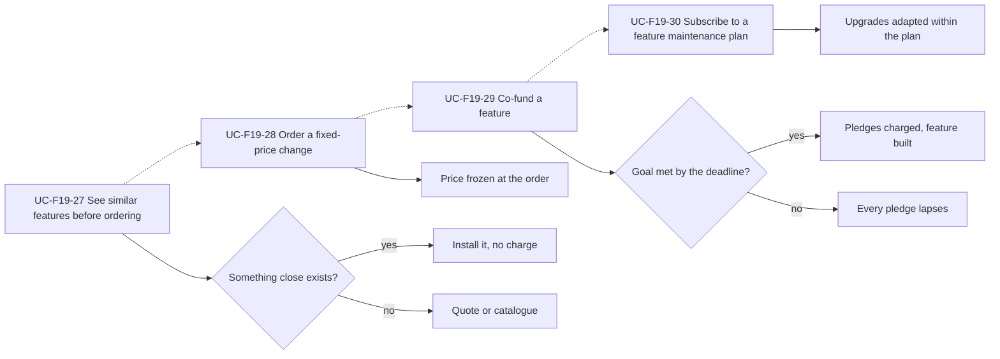
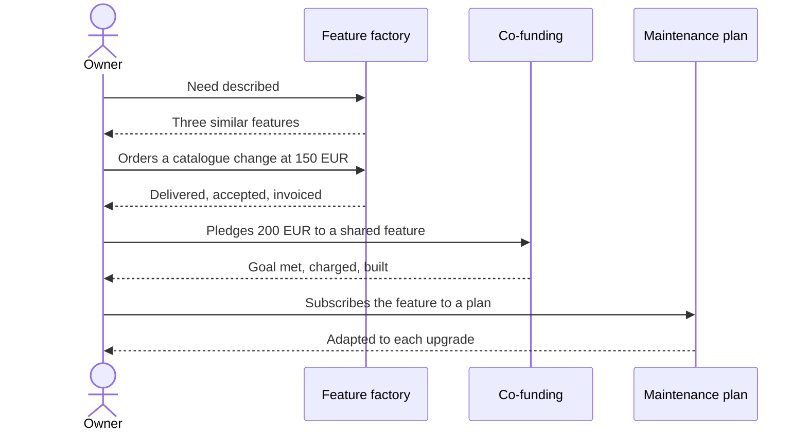

🏠 [Specs](../../../README.md) › 🧩 [Functional capabilities](../../README.md) ›
🏭 [F19 Feature factory (hosted edition)](../README.md) › 🔀 [Flows](README.md) ›
🔀 FL-F19-07 Similar features, catalogue, co-funding and maintenance

# 🔀 FL-F19-07 Similar features, catalogue, co-funding and maintenance

**Status:** 🔄 waiting for the owner

## Summary

Before ordering, the owner sees the features that already exist. A small change is ordered from a catalogue at a price
that does not move, a feature several customers want is co-funded and built only if the goal is met, and a feature paid
once is kept working across upgrades by a monthly maintenance plan
([D538](../../../06-decisions/f19-feature-factory/d538-benchmark-gaps-f19-feature-factory.md)).

## Personas

- [U13 Owner](../../../01-users/personas/u13-owner.md), who looks for similar features, orders, pledges and subscribes
- [U07 Administrator](../../../01-users/personas/u07-administrator.md), who orders catalogue changes for the company

## Flowchart

## Sequence diagram

## Steps

| Step | Persona | Screen | Use case | What happens |
|---|---|---|---|---|
| 1 | [U13](../../../01-users/personas/u13-owner.md) | [S-F19-26](../screens/07-catalogue-and-co-funding/s-f19-26-similar-features.md) | [UC-F19-27](../use-cases/07-catalogue-and-co-funding/uc-f19-27-see-similar-features-before-ordering.md) | The owner sees the similar features of the stores before any quote and installs one or goes on |
| 2 | [U13](../../../01-users/personas/u13-owner.md) | [S-F19-27](../screens/07-catalogue-and-co-funding/s-f19-27-fixed-price-catalogue.md) | [UC-F19-28](../use-cases/07-catalogue-and-co-funding/uc-f19-28-order-a-fixed-price-change.md) | The owner orders a small ready-made change at a fixed price and date |
| 3 | [U13](../../../01-users/personas/u13-owner.md) | [S-F19-28](../screens/07-catalogue-and-co-funding/s-f19-28-co-funding.md) | [UC-F19-29](../use-cases/07-catalogue-and-co-funding/uc-f19-29-co-fund-a-feature.md) | The owner pledges to a shared feature that is charged and built only if the goal is met |
| 4 | [U13](../../../01-users/personas/u13-owner.md) | [S-F19-29](../screens/07-catalogue-and-co-funding/s-f19-29-maintenance-plan.md) | [UC-F19-30](../use-cases/07-catalogue-and-co-funding/uc-f19-30-subscribe-to-a-feature-maintenance-plan.md) | The owner subscribes a feature to a monthly plan that keeps it working across upgrades |

### Entities and screens

| Entity | States in this flow | Shown at step and screen | Aggregated view |
|---|---|---|---|
| [E-F19-17 Catalogue change](../data/e-f19-17-catalogue-change.md) | Ordered, Building, Ready, Accepted, Refused, Cancelled | 2 [S-F19-27](../screens/07-catalogue-and-co-funding/s-f19-27-fixed-price-catalogue.md) | Catalogue changes |
| [E-F19-18 Funding pledge](../data/e-f19-18-funding-pledge.md) | Pledged, Charged, Lapsed, Withdrawn, Refunded | 3 [S-F19-28](../screens/07-catalogue-and-co-funding/s-f19-28-co-funding.md) | Funding pledges |
| [E-F19-19 Feature maintenance plan](../data/e-f19-19-feature-maintenance-plan.md) | Offered, Active, Declined, Ending, Ended | 4 [S-F19-29](../screens/07-catalogue-and-co-funding/s-f19-29-maintenance-plan.md) | Maintenance plans |

## Errors

- **E1 The funding goal is not reached.** The deadline passes below the goal: every pledge lapses, nothing is charged
  and everyone is told ([BR-F19-22](../business-rules/br-f19-22-pledges-are-charged-only-when-the-goal-is-met.md), step
  3).

## Images

Every step and error, for each persona taking part, in light and dark mode (D120). Steps are numbered as in the Steps
table; E rows are the error cases.

| Step | Persona | Device | Light | Dark |
|---|---|---|---|---|
| 1 | U13 | desktop | [light](../images/07-catalogue-and-co-funding/u13-owner/1-similar-features-desktop-light.png) | [dark](../images/07-catalogue-and-co-funding/u13-owner/1-similar-features-desktop-dark.png) |
| 1 | U13 | phone | [light](../images/07-catalogue-and-co-funding/u13-owner/1-similar-features-phone-light.png) | [dark](../images/07-catalogue-and-co-funding/u13-owner/1-similar-features-phone-dark.png) |
| 2 | U13 | desktop | [light](../images/07-catalogue-and-co-funding/u13-owner/2-fixed-price-catalogue-desktop-light.png) | [dark](../images/07-catalogue-and-co-funding/u13-owner/2-fixed-price-catalogue-desktop-dark.png) |
| 2 | U07 | desktop | [light](../images/07-catalogue-and-co-funding/u07-administrator/2-fixed-price-catalogue-desktop-light.png) | [dark](../images/07-catalogue-and-co-funding/u07-administrator/2-fixed-price-catalogue-desktop-dark.png) |
| 2 | U13 | phone | [light](../images/07-catalogue-and-co-funding/u13-owner/2-fixed-price-catalogue-phone-light.png) | [dark](../images/07-catalogue-and-co-funding/u13-owner/2-fixed-price-catalogue-phone-dark.png) |
| 3 | U13 | desktop | [light](../images/07-catalogue-and-co-funding/u13-owner/3-co-funding-desktop-light.png) | [dark](../images/07-catalogue-and-co-funding/u13-owner/3-co-funding-desktop-dark.png) |
| 3 | U13 | phone | [light](../images/07-catalogue-and-co-funding/u13-owner/3-co-funding-phone-light.png) | [dark](../images/07-catalogue-and-co-funding/u13-owner/3-co-funding-phone-dark.png) |
| 4 | U13 | desktop | [light](../images/07-catalogue-and-co-funding/u13-owner/4-maintenance-plan-desktop-light.png) | [dark](../images/07-catalogue-and-co-funding/u13-owner/4-maintenance-plan-desktop-dark.png) |
| 4 | U13 | phone | [light](../images/07-catalogue-and-co-funding/u13-owner/4-maintenance-plan-phone-light.png) | [dark](../images/07-catalogue-and-co-funding/u13-owner/4-maintenance-plan-phone-dark.png) |
| E1 | U13 | desktop | [light](../images/07-catalogue-and-co-funding/u13-owner/e1-the-funding-goal-is-not-reached-desktop-light.png) | [dark](../images/07-catalogue-and-co-funding/u13-owner/e1-the-funding-goal-is-not-reached-desktop-dark.png) |
| E1 | U13 | phone | [light](../images/07-catalogue-and-co-funding/u13-owner/e1-the-funding-goal-is-not-reached-phone-light.png) | [dark](../images/07-catalogue-and-co-funding/u13-owner/e1-the-funding-goal-is-not-reached-phone-dark.png) |

## Open questions

None.

---

⬅️ [FL-F19-06 Delivery and refunds](fl-f19-06-delivery-and-refunds.md) · ⬆️ [Up](README.md)
