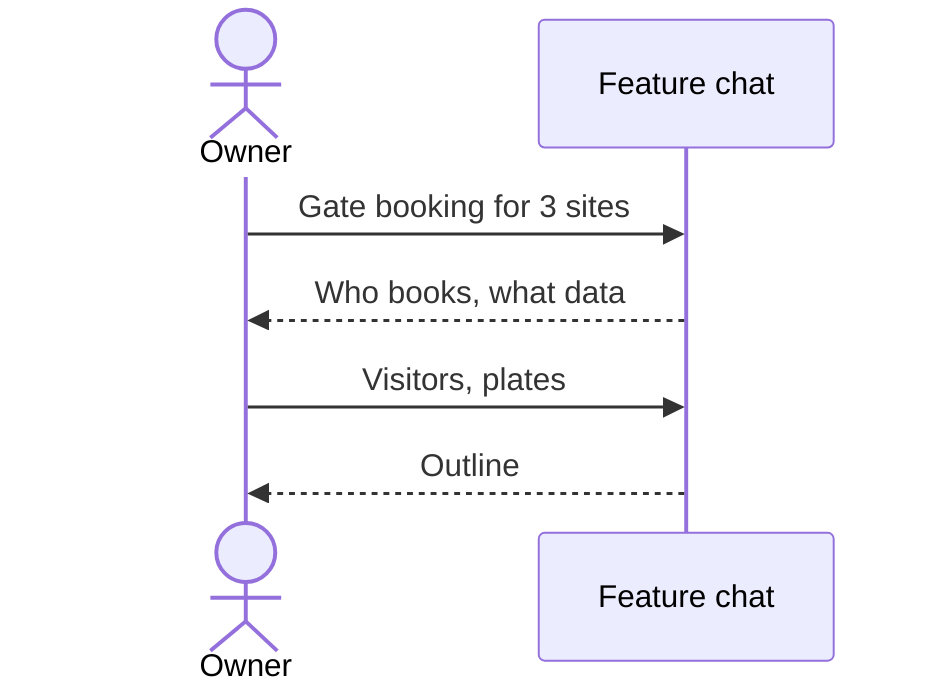

🏠 [Specs](../../../../README.md) › 🧩 [Functional capabilities](../../../README.md) ›
🏭 [F19 Feature factory (hosted edition)](../../README.md) › 📝 [Use cases](../README.md) ›
📝 [Use cases: FL-F19-01 Describe and order](README.md) › 📝 UC-F19-01 Describe a feature in plain words

# 📝 UC-F19-01 Describe a feature in plain words

**Status:** ✅ specified

## Summary

The owner or an administrator describes a need in plain words to the factory's chatbot, which asks questions until it
can outline a feature that a plugin on the public API can deliver.

## Personas

- [U13 Owner](../../../../01-users/personas/u13-owner.md)
- [U07 Administrator](../../../../01-users/personas/u07-administrator.md)

## Goal

A clear first outline of the feature.

## Trigger

A need the product does not cover.

## Frequency

A few a year per company.

## Preconditions

- Hosted edition (D388); the user is owner or administrator.

## Postconditions

- Success: a feature request with an outline.
- Failure: the need is out of reach of a plugin; the request is closed.

## Main flow

1. The owner opens the Feature chat (S-F19-01) and describes the need.
2. The chatbot asks questions: who uses it, which data, which screens, which rules.
3. The owner answers; the chatbot checks it can be a plugin (BR-F19-02).
4. The chatbot shows a first outline.
5. The owner moves on to the specification (UC-F19-02).

## Alternative flows

- 3a. Part of the need exists in a plugin of the store: the chatbot suggests it.

## Error flows

- 3e. Needs a core change: the chatbot says so and the request goes to the product backlog.
- Any step: a service does not answer; the call is retried first (BR-F3-32), then the message follows the error pattern
  (D122) and what was typed stays on the screen.

## Business rules

- [BR-F19-03 The specification is agreed before the build](../../business-rules/br-f19-03-spec-agreed-before-build.md)

## Entities

- [E-F19-01 Feature request](../../data/e-f19-01-feature-request.md)

## Permissions

Owner and administrator.

## Notifications

- None.

## Audit events

Requests.

## AI involvement

The chatbot is disclosed as an AI (BR-F19-14).

## API, MCP and A2A exposure

Through T5 and T6 with the caller's rights (BR-F3-34).

## Screens

- [S-F19-01 Feature chat](../../screens/01-describe-and-order/s-f19-01-feature-chat.md)

## Flowchart

See [FL-F19-01 Describe and order](../../flows/fl-f19-01-describe-and-order.md#flowchart).

## Sequence diagram

## Acceptance criteria

1. **Given** "gate booking for our 3 sites" **when** described **then** the chatbot asks who books and what is recorded.
2. **Given** a need that changes the core **when** checked **then** the chatbot says so.
3. **Given** a store plugin covering it **when** found **then** it is suggested.

## Non-functional notes

D408's targets ([Performance](../../../../05-non-functional/performance.md)): 95 % of screens within 1 second; lists
paged on the server, the first page within 1 second; reports within 5 seconds or in the background.

## Regulatory references

Billing and rights rules of the France country pack:
[CR-FR-205 VAT on the promotion credit](../../../../10-country-packs/france/tax-and-vat/cr-fr-205-promotion-credit-vat-treatment.md),
[CR-FR-200 Credit notes and corrective invoices](../../../../10-country-packs/france/invoicing/cr-fr-200-credit-notes.md),
[CR-FR-202 Price reductions on invoices](../../../../10-country-packs/france/invoicing/cr-fr-202-price-reductions-on-invoices.md),
[CR-FR-201 Self-billing](../../../../10-country-packs/france/invoicing/cr-fr-201-self-billing.md),
[CR-FR-015 Mandatory invoice mentions](../../../../10-country-packs/france/invoicing/cr-fr-015-invoice-mandatory-mentions.md),
[CR-FR-100 VAT on services to clients abroad](../../../../10-country-packs/france/tax-and-vat/cr-fr-100-vat-on-services-abroad.md),
[CR-FR-203 Who owns software, and assigning it](../../../../10-country-packs/france/digital/cr-fr-203-software-copyright-assignment.md),
[CR-FR-204 Works generated by an AI](../../../../10-country-packs/france/digital/cr-fr-204-ai-generated-works.md),
[CR-FR-016 Electronic invoicing](../../../../10-country-packs/france/invoicing/cr-fr-016-electronic-invoicing.md),
[CR-FR-056 People know they deal with an AI](../../../../10-country-packs/france/ai-and-recording/cr-fr-056-people-know-they-deal-with-an-ai.md).

## Related use cases

- [UC-F19-02 Refine the feature with the chatbot](uc-f19-02-refine-the-feature-with-the-chatbot.md)

## Open questions

None.

---

⬆️ [Up](README.md) ·
➡️ [UC-F19-02 Refine the feature with the chatbot](uc-f19-02-refine-the-feature-with-the-chatbot.md)
